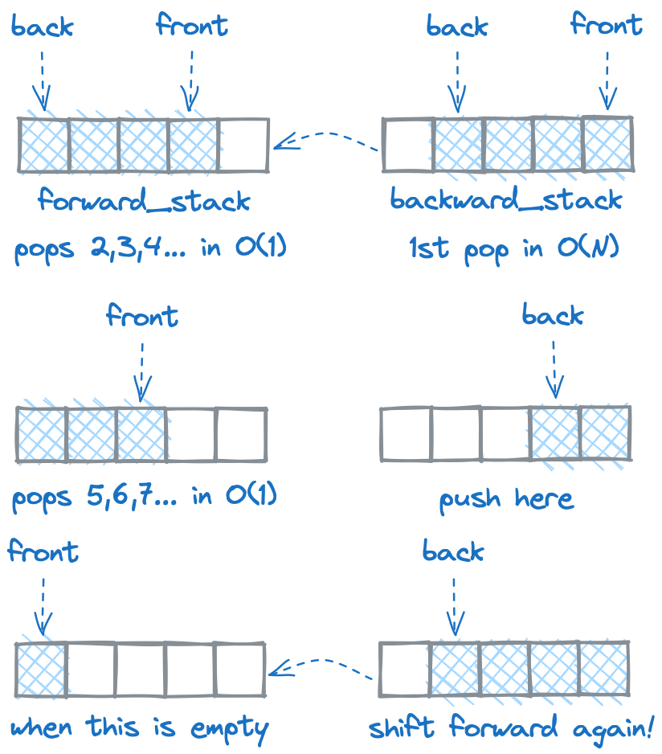

# Learning Rust: Result types would be cool

**Author:** OfficialSerge
**Votes:** 2
**Link:** [https://leetcode.com/problems/implement-queue-using-stacks/solutions/3635043/](https://leetcode.com/problems/implement-queue-using-stacks/solutions/3635043/)

---

# Intuition


You could do this using a single vector to store values, but then every time you wanted to pop a value from the front, you'd be shifting the entire vector which would take $$O(n)$$ time! A more optimal approach is to *use two vectors so we only shift values a single time.*

# Approach
We create a custom struct MyQueue with *forward_stack* and *backward_stack* attributes. We then **derive the default behavior for the MyQueue struct** by calling it above the struct. The **Default** trait provides us a way to create default values for our types. Basically it just creates empty vectors automatically for us when we initialize an instance of MyQueue. This is super useful when we have mutliple attributes and many implementations to worry about.
```
#[derive(Default)]
struct MyQueue {
    forward_stack: Vec<i32>,
    backward_stack: Vec<i32>
}
```
You can see the Default trait in action when we call *new*.
```
fn new() -> Self {
    Default::default()
}
```
The thing with *push* is we only push to the backward stack because we use it to store the back half of values.
```
fn push(&mut self, x: i32) {
    self.backward_stack.push(x);
}
```
When we want to pop a value we shift the backward stack to the forward stack **only if there isn't anything already in the forward stack.** After we shift forwards, we call *pop* and then *unwrap.* In Rust, the unwrap method is a convenience method provided by the Option and Result types *used to retrieve the value contained within an Option or Result,* think of it as shorthand for a match statement. 
```
fn pop(&mut self) -> i32 {
    self.shift_forwards();
    self.forward_stack.pop().unwrap()
}
```
It's important to note that **unwrap will panic if the Option resuts to None!** For this reason it's not recommended in production code. *Instead you should use a Result type.* Finally we examine *peek* and *empty.* Peeking works the same way as poping except we don't pop we call last and dereference the result. We assert whether both vectors are empty when we call empty.
```
fn peek(&mut self) -> i32 {
    self.shift_forwards();
    *self.forward_stack.last().unwrap()
}
    
fn empty(&self) -> bool {
    self.forward_stack.is_empty() && self.backward_stack.is_empty()
}
```
The one helper function we rely on when shifting values from backward stack to forward stack is *shift_forwards.*
```
fn shift_forwards(&mut self) {
    if self.forward_stack.is_empty() {
        loop {
            match self.backward_stack.pop() {
                Some(value) => self.forward_stack.push(value),
                None => break
            }
        }
    }
}
```

# Complexity
- Time complexity:
push: $$O(1)$$
pop:  $$O(1)$$ worst case of $$O(n)$$
peek: $$O(1)$$ worst case of $$O(n)$$
empty: $$O(1)$$

- Space complexity: $$O(n)$$
Grows linearly as we add to it.

# Code
```
#[derive(Default)]
struct MyQueue {
    forward_stack: Vec<i32>,
    backward_stack: Vec<i32>
}

impl MyQueue {
    fn new() -> Self {
        Default::default()
    }
    
    fn push(&mut self, x: i32) {
        self.backward_stack.push(x);
    }
    
    fn pop(&mut self) -> i32 {
        self.shift_forwards();
        self.forward_stack.pop().unwrap()
    }
    
    fn peek(&mut self) -> i32 {
        self.shift_forwards();
        *self.forward_stack.last().unwrap()
    }
    
    fn empty(&self) -> bool {
        self.forward_stack.is_empty() && self.backward_stack.is_empty()
    }

    fn shift_forwards(&mut self) {
        if self.forward_stack.is_empty() {
            loop {
                match self.backward_stack.pop() {
                    Some(value) => self.forward_stack.push(value),
                    None => break
                }
            }
        }
    }
}
```