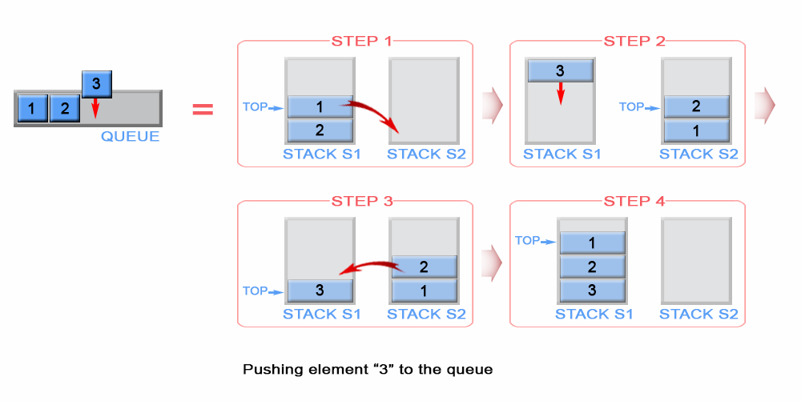
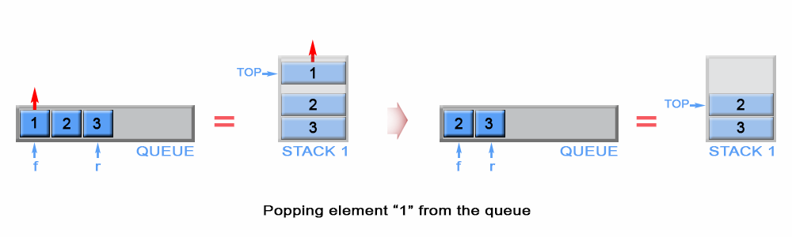
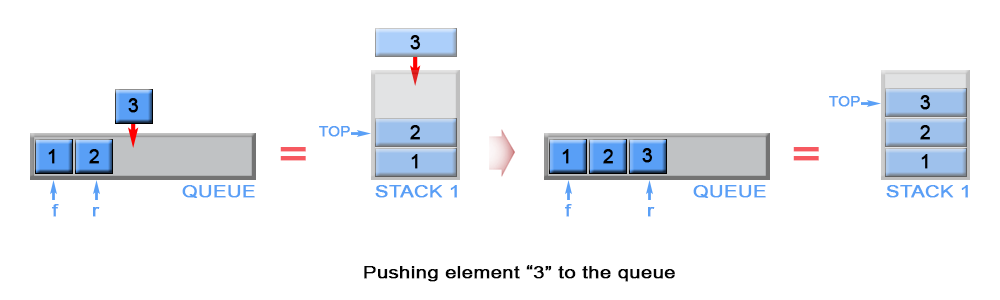
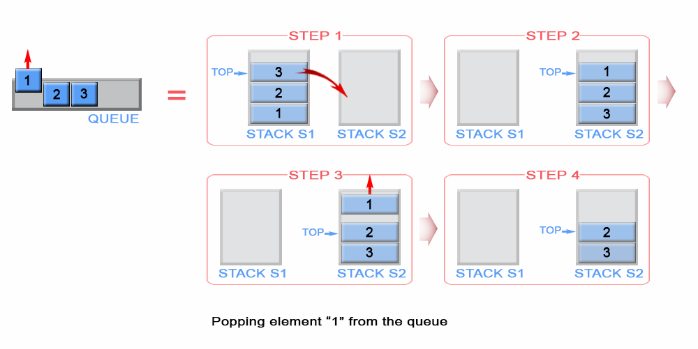

# Official Solution

**Link:** [https://leetcode.com/problems/implement-queue-using-stacks/solution/](https://leetcode.com/problems/implement-queue-using-stacks/solution/)

---

[TOC]

## Summary
This article is for beginners. It introduces the following ideas:
Queue, Stack.

## Solution

Queue is **FIFO** (first in - first out) data structure, in which the elements are inserted from one side - `rear` and removed from the other - `front`.
The most intuitive way to implement it is with linked lists, but this article will introduce another approach  using stacks.
Stack is **LIFO** (last in - first out) data structure, in which elements are added and removed from the same end, called `top`.
To satisfy **FIFO** property of a queue we need to keep two stacks. They serve to reverse arrival order of the  elements and one of them store the queue elements in their final order.

---

### Approach #1 (Two Stacks) Push - $O(n)$ per operation, Pop - $O(1)$ per operation.

#### Push

A queue is FIFO (first-in-first-out) but a stack is LIFO (last-in-first-out). This means the newest element must be pushed to the bottom of the stack. To do so we first transfer all `s1` elements to auxiliary stack `s2`. Then the newly arrived element is pushed on top of `s2` and all its elements are popped and pushed to `s1`.

{:width="539px"}

*Figure 1. Push an element in queue*

<iframe src="https://leetcode.com/playground/ZddHrP5d/shared" frameBorder="0" name="ZddHrP5d" width="100%" height="241"></iframe>

#### Complexity Analysis**

* Time complexity : $O(n)$.

 Each element, with the exception of the newly arrived, is pushed and popped twice. The last inserted element is popped and pushed once. Therefore this gives  $4 n + 2$  operations where $n$ is the queue size. The  `push` and `pop` operations have $O(1)$ time complexity.

* Space complexity : $O(n)$.
We need additional memory to store the queue elements

#### Pop

The algorithm pops an element from  the stack `s1`, because `s1` stores always on its top the first inserted element in the queue.
The front element of the queue is kept as `front`.

{:width="539px"}

*Figure 2. Pop an element from queue*

<iframe src="https://leetcode.com/playground/UZJY8ns5/shared" frameBorder="0" width="100%" height="157" name="UZJY8ns5"></iframe>

#### Complexity Analysis

* Time complexity : $O(1)$.
* Space complexity : $O(1)$.

#### Empty

Stack `s1` contains all stack elements, so the algorithm checks `s1` size to return if the queue is empty.

<iframe src="https://leetcode.com/playground/2urvcw97/shared" frameBorder="0" name="2urvcw97" width="100%" height="122"></iframe>

#### Complexity Analysis

* Time complexity : $O(1)$.
* Space complexity : $O(1)$.

#### Peek

The `front` element is kept in constant memory and is modified when we push or pop an element.

<iframe src="https://leetcode.com/playground/VGjvtStE/shared" frameBorder="0" name="VGjvtStE" width="100%" height="122"></iframe>

#### Complexity Analysis

* Time complexity : $O(1)$. The `front` element has been calculated in advance and only returned in `peek` operation.
* Space complexity : $O(1)$.

---

### Approach #2 (Two Stacks) Push - $O(1)$ per operation, Pop - Amortized $O(1)$ per operation.

#### Push

The newly arrived element is always added on top of stack `s1` and the first element is kept as `front` queue element

{:width="539px"}

*Figure 3. Push an element in queue*

<iframe src="https://leetcode.com/playground/qaVbztQ7/shared" frameBorder="0" name="qaVbztQ7" width="100%" height="224"></iframe>

#### Complexity Analysis

* Time complexity : $O(1)$. Аppending an element to a stack is an O(1) operation.

* Space complexity : $O(n)$. We need additional memory to store the queue elements

#### Pop

We have to remove element in front of the queue. This is the first inserted element in the stack `s1` and it is positioned at the bottom of the stack because of stack's `LIFO (last in - first out)` policy. To remove the bottom element  from  `s1`, we have to pop all elements from `s1` and to push them on to an additional stack `s2`, which helps us to store the elements of `s1` in reversed order. This way  the bottom element of `s1` will be positioned on top of `s2` and we can simply pop it from stack `s2`. Once `s2` is empty, the algorithm transfer data from `s1` to `s2` again.

{:width="539px"}

*Figure 4. Pop an element from stack*

<iframe src="https://leetcode.com/playground/PF3J5wXs/shared" frameBorder="0" width="100%" height="174" name="PF3J5wXs"></iframe>

#### Complexity Analysis

* Time complexity: Amortized $O(1)$, Worst-case $O(n)$. In the worst case scenario when stack `s2` is empty, the algorithm pops $n$ elements from stack s1 and pushes $n$ elements to `s2`, where $n$ is the queue size. This gives $2n$ operations, which is $O(n)$. But when stack `s2` is not empty the algorithm has $O(1)$ time complexity. So what does it mean by Amortized $O(1)$? Please see the next section on Amortized Analysis for more information.

* Space complexity : $O(1)$.

#### Amortized Analysis

Amortized analysis gives the average performance (over time) of each operation in the worst case. The basic idea is that a worst case operation can alter the state in such a way that the worst case cannot occur again for a long time, thus amortizing its cost.

Consider this example where we start with an empty queue with the following sequence of operations applied:

$$
push_1, push_2, \ldots, push_n, pop_1,pop_2 \ldots, pop_n
$$

The worst case time complexity of a single pop operation is $O(n)$. Since we have $n$ pop operations, using the worst-case per operation analysis gives us a total of $O(n^2)$ time.

However, in a sequence of operations the worst case does not occur often in each operation - some operations may be cheap, some may be expensive. Therefore, a traditional worst-case per operation analysis can give overly pessimistic bound. For example, in a dynamic array only some inserts take a linear time, though others - a constant time.

In the example above, the number of times pop operation can be called is limited by the number of push operations before it. Although a single pop operation could be expensive, it is expensive only once per `n` times (queue size), when `s2` is empty and there is a need for data transfer between `s1` and `s2`. Hence the total time complexity of the sequence is : `n` (for push operations) + `2*n` (for first pop operation) + `n - 1` ( for pop operations) which is $O(2*n)$.This gives $O(2n/2n)$ = $O(1)$ average time per operation.

#### Empty

Both stacks `s1` and `s2` contain all stack elements, so the algorithm checks `s1` and `s2` size to return if the queue is empty.

<iframe src="https://leetcode.com/playground/hswBjmcT/shared" frameBorder="0" name="hswBjmcT" width="100%" height="139"></iframe>

#### Complexity Analysis

* Time complexity : $O(1)$.
* Space complexity : $O(1)$.

#### Peek

The `front` element is kept in constant memory and is modified when we push an element. When `s2` is not empty, front element is positioned on the top of `s2`

<iframe src="https://leetcode.com/playground/xmLcBbmw/shared" frameBorder="0" name="xmLcBbmw" width="100%" height="173"></iframe>

#### Complexity Analysis

* Time complexity : $O(1)$. The `front` element was either previously calculated or returned as a top element of stack `s2`. Therefore complexity is $O(1)$
* Space complexity : $O(1)$.