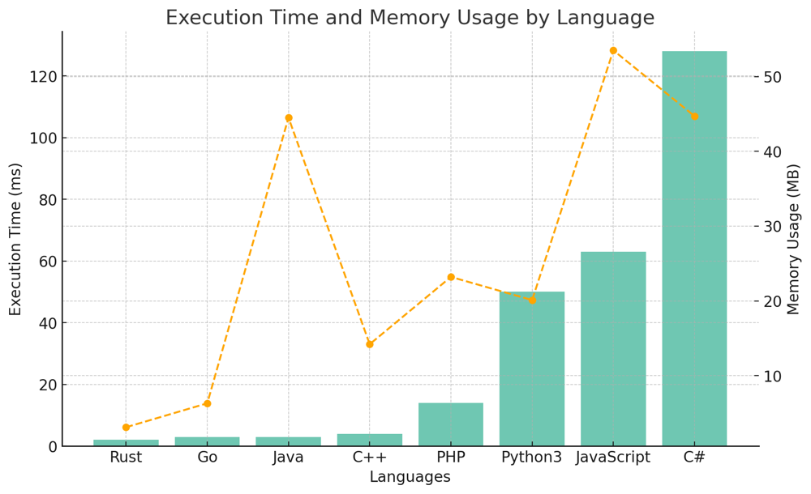

# ✅ 95.83% Recursive Flattening & Stack

**Author:** vanAmsen
**Votes:** 105
**Link:** [https://leetcode.com/problems/flatten-nested-list-iterator/solutions/4187840/](https://leetcode.com/problems/flatten-nested-list-iterator/solutions/4187840/)

---

# Intuition
When we hear "nested structure", the brain immediately thinks of recursion or stacks. Why? Because both tools excel at handling layered structures. Imagine Russian nesting dolls. To access the innermost doll, we must open each outer doll. This problem gives us a nested list and asks us to flatten it. A nested list is like a multi-layered onion. Peeling each layer reveals another layer until we finally reach the core. Flattening this onion means transforming it into a single layer of all the individual parts.

## Live Coding & Explaining
https://youtu.be/Mh8-eLca4Ks?si=5_ocf5e3_edgAtXe

# Approach 1: Recursive Flattening
1. **Recursive Exploration of Nested List**: To navigate the nested list, we must access each integer sequentially. This can be achieved by recursively examining each `NestedInteger`:
   - If it's an integer, we simply add it to our result.
   - If it's a list, we recursively flatten the list and merge our result with this newly flattened list.
   
2. **Linear Iteration**: Having flattened the nested list, iterating over it is a breeze. We maintain an index to trace our current position. The `next` function will fetch the current integer and move the index ahead, while `hasNext` will verify if any more integers are left in the flattened list.

# Approach 2: Using a Stack
Instead of immediately flattening the list, we can use a stack to process the nested list on-the-fly. This approach is akin to peeling our onion layer by layer, only when required.
1. **Stack Initialization**: Begin by pushing the nested list items onto the stack in reverse order.
2. **On-The-Fly Processing in `hasNext`**: Before retrieving the next integer, we ensure the top of the stack is an integer. If it's a list, we pop it and push its items onto the stack (again, in reverse). We repeat this until we find an integer or the stack is empty.
3. **Fetching the Next Integer**: Once `hasNext` ensures the top of the stack is an integer, `next` will simply pop it.

# Complexity

For both approaches:
- **Time complexity**: 
  - Flattening or processing the list is $$O(N)$$, where $$N$$ is the total number of integers in the nested structure. We handle each integer only once.
  - Both `next` and `hasNext` operations are $$O(1)$$ on average. Though there might be cases in the stack approach where `hasNext` takes longer, over a series of operations, it averages out to $$O(1)$$.
  
- **Space complexity**: 
  - The maximum space required is $$O(N)$$. This is because of the flattened list in the recursive approach or due to the stack in the stack approach.

# Code Flattening
```python []
class NestedIterator:
    def __init__(self, nestedList: [NestedInteger]):
        def flatten(nested):
            result = []
            for ni in nested:
                if ni.isInteger():
                    result.append(ni.getInteger())
                else:
                    result.extend(flatten(ni.getList()))
            return result
        
        self.flattened = flatten(nestedList)
        self.index = 0

    def next(self) -> int:
        self.index += 1
        return self.flattened[self.index - 1]

    def hasNext(self) -> bool:
        return self.index < len(self.flattened)
```
``` C++ []
#include <vector>

class NestedIterator {
private:
    std::vector<int> flattened;
    int index;
    
    std::vector<int> flatten(const std::vector<NestedInteger>& nested) {
        std::vector<int> result;
        for (const auto& ni : nested) {
            if (ni.isInteger()) {
                result.push_back(ni.getInteger());
            } else {
                auto subList = flatten(ni.getList());
                result.insert(result.end(), subList.begin(), subList.end());
            }
        }
        return result;
    }

public:
    NestedIterator(std::vector<NestedInteger> nestedList) {
        flattened = flatten(nestedList);
        index = 0;
    }

    int next() {
        return flattened[index++];
    }

    bool hasNext() {
        return index < flattened.size();
    }
};
```
``` Java []
public class NestedIterator {
    private List<Integer> flattened;
    private int index;

    public NestedIterator(List<NestedInteger> nestedList) {
        flattened = new ArrayList<>();
        index = 0;
        flattened = flatten(nestedList);
    }

    private List<Integer> flatten(List<NestedInteger> nested) {
        List<Integer> result = new ArrayList<>();
        for (NestedInteger ni : nested) {
            if (ni.isInteger()) {
                result.add(ni.getInteger());
            } else {
                result.addAll(flatten(ni.getList()));
            }
        }
        return result;
    }

    public int next() {
        return flattened.get(index++);
    }

    public boolean hasNext() {
        return index < flattened.size();
    }
}
```
``` JavaScript []
class NestedIterator {
    constructor(nestedList) {
        this.flattened = this.flatten(nestedList);
        this.index = 0;
    }

    flatten(nested) {
        let result = [];
        for (let ni of nested) {
            if (ni.isInteger()) {
                result.push(ni.getInteger());
            } else {
                result.push(...this.flatten(ni.getList()));
            }
        }
        return result;
    }

    next() {
        return this.flattened[this.index++];
    }

    hasNext() {
        return this.index < this.flattened.length;
    }
}
```
``` PHP []
<?php
class NestedIterator {
    private $flattened = [];
    private $index = 0;

    function __construct($nestedList) {
        $this->flattened = $this->flatten($nestedList);
    }

    private function flatten($nested) {
        $result = [];
        foreach ($nested as $ni) {
            if ($ni->isInteger()) {
                $result[] = $ni->getInteger();
            } else {
                $result = array_merge($result, $this->flatten($ni->getList()));
            }
        }
        return $result;
    }

    function next() {
        return $this->flattened[$this->index++];
    }

    function hasNext() {
        return $this->index < count($this->flattened);
    }
}
?>
```
``` Rust []

struct NestedIterator {
    flattened: Vec<i32>,
    index: usize,
}

impl NestedIterator {
    fn new(nested_list: Vec<NestedInteger>) -> Self {
        let mut flattened = Vec::new();
        Self::flatten(&nested_list, &mut flattened);

        Self {
            flattened,
            index: 0,
        }
    }

    fn flatten(nested: &[NestedInteger], result: &mut Vec<i32>) {
        for ni in nested {
            match ni {
                NestedInteger::Int(val) => result.push(*val),
                NestedInteger::List(list) => Self::flatten(list, result),
            }
        }
    }

    fn next(&mut self) -> i32 {
        let val = self.flattened[self.index];
        self.index += 1;
        val
    }

    fn has_next(&self) -> bool {
        self.index < self.flattened.len()
    }
}

```
``` Go []
type NestedIterator struct {
    flattened []int
    index     int
}

func Constructor(nestedList []*NestedInteger) *NestedIterator {
    return &NestedIterator{
        flattened: flatten(nestedList),
        index:     0,
    }
}

func flatten(nested []*NestedInteger) []int {
    var result []int
    for _, ni := range nested {
        if ni.IsInteger() {
            result = append(result, ni.GetInteger())
        } else {
            result = append(result, flatten(ni.GetList())...)
        }
    }
    return result
}

func (this *NestedIterator) Next() int {
    val := this.flattened[this.index]
    this.index++
    return val
}

func (this *NestedIterator) HasNext() bool {
    return this.index < len(this.flattened)
}
```
``` C# []
using System.Collections.Generic;

public class NestedIterator {
    private List<int> flattened;
    private int index;

    public NestedIterator(IList<NestedInteger> nestedList) {
        flattened = new List<int>();
        index = 0;
        flattened = Flatten(nestedList);
    }

    private List<int> Flatten(IList<NestedInteger> nested) {
        List<int> result = new List<int>();
        foreach (var ni in nested) {
            if (ni.IsInteger()) {
                result.Add(ni.GetInteger());
            } else {
                result.AddRange(Flatten(ni.GetList()));
            }
        }
        return result;
    }

    public int Next() {
        return flattened[index++];
    }

    public bool HasNext() {
        return index < flattened.Count;
    }
}
```

# Code Stack
``` Python []
class NestedIterator:
    def __init__(self, nestedList: [NestedInteger]):
        self.stack = nestedList[::-1]
    
    def next(self) -> int:
        return self.stack.pop().getInteger()
    
    def hasNext(self) -> bool:
        while self.stack:
            top = self.stack[-1]
            if top.isInteger():
                return True
            self.stack = self.stack[:-1] + top.getList()[::-1]
        return False
```

# Performance
| Language   | Execution Time (ms) | Memory Usage |
|------------|---------------------|--------------|
| Rust       | 2 ms                | 3.1 MB       |
| Go         | 3 ms                | 6.3 MB       |
| Java       | 3 ms                | 44.5 MB      |
| C++        | 4 ms                | 14.2 MB      |
| PHP        | 14 ms               | 23.2 MB      |
| Python3    | 50 ms               | 20.1 MB      |
| JavaScript | 63 ms               | 53.5 MB      |
| C#         | 128 ms              | 44.7 MB      |




# Let's Dive Into the Code!
The first approach employs recursion to methodically flatten the nested list. The second uses a stack to peel the nested list layer by layer, revealing integers or further nested lists.

The beauty of these approaches lies in their adaptability. Whether you want a pre-flattened list ready to be iterated or you prefer to peel back layers as you go, we've got you covered. Choose the one that aligns best with your problem-solving style!