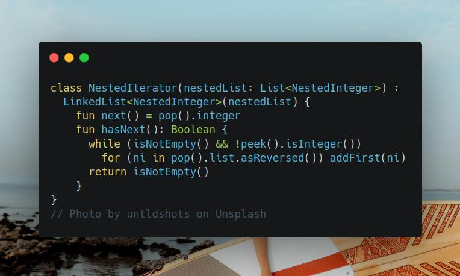

# Kotlin | stack

**Author:** SamoylenkoDmitry
**Votes:** 1
**Link:** [https://leetcode.com/problems/flatten-nested-list-iterator/solutions/4188488/](https://leetcode.com/problems/flatten-nested-list-iterator/solutions/4188488/)

---




#### Join me on Telegram

https://t.me/leetcode_daily_unstoppable/376

#### Problem TLDR

Implement graph iterator

#### Intuition

We need to save all the deep levels positions, so let's use a Stack.

#### Approach

* we can store `nextInt` integer in a separate variable, or just leave it in a Stack and do `pop` on `next()`
* it is better to `advance` after each `next()` call to know if there is a next position
* careful with the order of elements when expanding 

#### Complexity

- Time complexity:
$$O(n)$$

- Space complexity:
$$O(n)$$

#### Code

```kotlin

class NestedIterator(nestedList: List<NestedInteger>) : 
  LinkedList<NestedInteger>(nestedList) {
    fun next() = pop().integer
    fun hasNext(): Boolean {
      while (isNotEmpty() && !peek().isInteger())
        for (ni in pop().list.asReversed()) addFirst(ni)
      return isNotEmpty()
    }
}

```