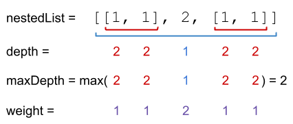
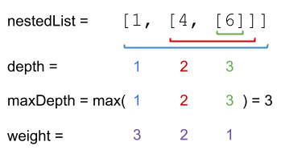

# [364. Nested List Weight Sum II](https://leetcode.com/problems/nested-list-weight-sum-ii/)

| Category | Difficulty | Likes | Dislikes |
| :------: | :--------: | :---: | :------: |
| Algorithms | Medium | 1166 | 479 |

**Tags:** [`stack`](https://leetcode.com/tag/stack), [`depth-first-search`](https://leetcode.com/tag/depth-first-search), [`breadth-first-search`](https://leetcode.com/tag/breadth-first-search)

**Companies:** `linkedin`, `facebook`, `google`

## Description

You are given a nested list of integers `nestedList`. Each element is either an integer or a list whose elements may also be integers or other lists.

The **depth** of an integer is the number of lists that it is inside of. For example, the nested list `[1,[2,2],[[3],2],1]` has each integer's value set to its **depth**. Let `maxDepth` be the **maximum depth** of any integer.

The **weight** of an integer is `maxDepth - (the depth of the integer) + 1`.

Return *the sum of each integer in *`nestedList`* multiplied by its **weight***.

 

**Example 1:**


```

Input: nestedList = [[1,1],2,[1,1]]
Output: 8
Explanation: Four 1&#39;s with a weight of 1, one 2 with a weight of 2.
1*1 + 1*1 + 2*2 + 1*1 + 1*1 = 8

```

**Example 2:**


```

Input: nestedList = [1,[4,[6]]]
Output: 17
Explanation: One 1 at depth 3, one 4 at depth 2, and one 6 at depth 1.
1*3 + 4*2 + 6*1 = 17

```

 

**Constraints:**

	- `1 <= nestedList.length <= 50`

	- The values of the integers in the nested list is in the range `[-100, 100]`.

	- The maximum **depth** of any integer is less than or equal to `50`.

	- There are no empty lists.

---

**Links:** [Submissions](https://leetcode.com/problems/nested-list-weight-sum-ii/) | [Solutions](https://leetcode.com/problems/nested-list-weight-sum-ii/)
