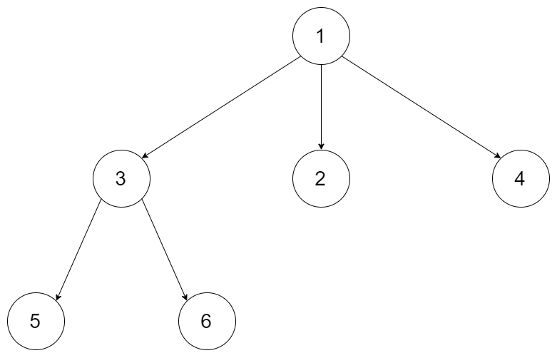

# [590. N-ary Tree Postorder Traversal](https://leetcode.com/problems/n-ary-tree-postorder-traversal/)

| Category | Difficulty | Likes | Dislikes |
| :------: | :--------: | :---: | :------: |
| Algorithms | Easy | 2742 | 119 |

**Tags:** [`stack`](https://leetcode.com/tag/stack), [`tree`](https://leetcode.com/tag/tree), [`depth-first-search`](https://leetcode.com/tag/depth-first-search)

**Companies:** `amazon`, `google`, `bloomberg`

## Description

Given the `root` of an n-ary tree, return *the postorder traversal of its nodes' values*.

Nary-Tree input serialization is represented in their level order traversal. Each group of children is separated by the null value (See examples)

 

**Example 1:**


```

Input: root = [1,null,3,2,4,null,5,6]
Output: [5,6,3,2,4,1]

```

**Example 2:**


```

Input: root = [1,null,2,3,4,5,null,null,6,7,null,8,null,9,10,null,null,11,null,12,null,13,null,null,14]
Output: [2,6,14,11,7,3,12,8,4,13,9,10,5,1]

```

 

**Constraints:**

	- The number of nodes in the tree is in the range `[0, 10^4]`.

	- `0 <= Node.val <= 10^4`

	- The height of the n-ary tree is less than or equal to `1000`.

 

**Follow up:** Recursive solution is trivial, could you do it iteratively?

---

**Links:** [Submissions](https://leetcode.com/problems/n-ary-tree-postorder-traversal/) | [Solutions](https://leetcode.com/problems/n-ary-tree-postorder-traversal/)
