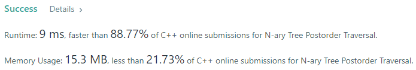
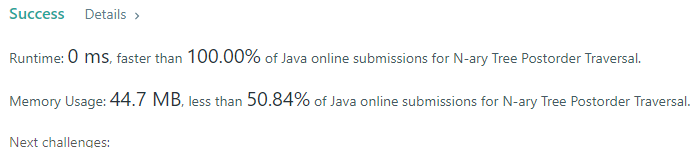
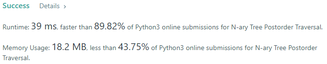
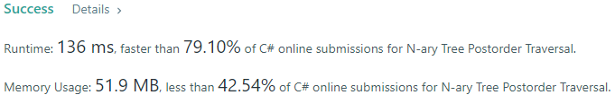
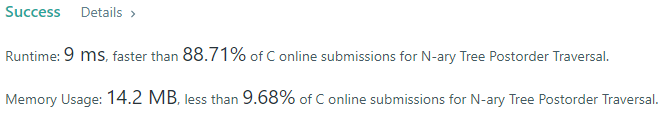
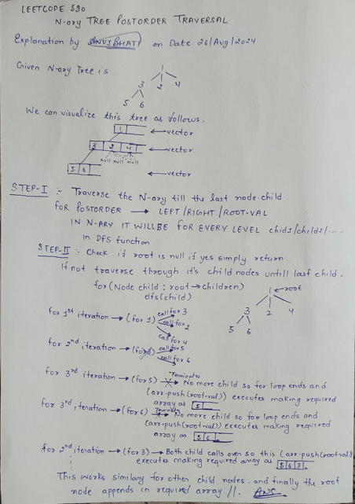

# 💢☠💫Easiest👾Faster✅💯 Lesser🧠 🎯 C++✅Python3🐍✅Java✅C✅Python🐍✅C#✅💥🔥💫Explained☠💥🔥 Beats 100

**Author:** Edwards310
**Votes:** 19
**Link:** [https://leetcode.com/problems/n-ary-tree-postorder-traversal/solutions/5691837/](https://leetcode.com/problems/n-ary-tree-postorder-traversal/solutions/5691837/)

---

# Intuition








---
***I Tried to explain this question in best possible way.. We Just Simply Try to traverse through every chil node for every node. For every languages other than C there is an advantage for having a for-each loop which directly retrievs the child nodes from every node.. Although in every Node type there is a array of nodes with number of array elements in it which is numChildren in C but in all other languages we can retrieve it via arr.length i.e why in all other languages int numChildren is not shown in Node definition.***


***Also Visit my N-ary PreOrder Tree Traversal helps you to learn better to tackle these types of trees.. Afterwards We can do Level-Order Traversal for N-ary tress***

***Q - 589*** https://leetcode.com/problems/n-ary-tree-preorder-traversal/solutions/5692438/easiest-faster-lesser-c-python3-java-c-python-c-explained-beats-100

***Q - 429*** https://leetcode.com/problems/n-ary-tree-level-order-traversal/solutions/5693741/easiestfaster-lesser-cpython3javacpythoncexplained-beats-100
---


```javascript []
//JavaScript Code
/**
 * // Definition for a _Node.
 * function _Node(val,children) {
 *    this.val = val;
 *    this.children = children;
 * };
 */

/**
 * @param {_Node|null} root
 * @return {number[]}
 */
var postorder = function(root) {
    const arr = []
    const postOrder = ((root) =>{
        if(root == undefined)
            return
        for(let child of root.children)
            postOrder(child)
        
        arr.push(root.val)
    })
    
    postOrder(root)
    return arr
};
```
```C++ []
//C++ Code
/*
// Definition for a Node.
class Node {
public:
    int val;
    vector<Node*> children;

    Node() {}

    Node(int _val) {
        val = _val;
    }

    Node(int _val, vector<Node*> _children) {
        val = _val;
        children = _children;
    }
};
*/

class Solution {
    vector<int> res;
    void postOrder(Node* root) {
        if (!root)
            return;
        for (auto child : root->children) {
            postOrder(child);
            res.push_back(child->val);
        }
    }

public:
    vector<int> postorder(Node* root) {
        if (!root)
            return {};
        postOrder(root);
        res.push_back(root->val);
        return res;
    }
};
```
```Python3  []
#Python3 Code
"""
# Definition for a Node.
class Node:
    def __init__(self, val=None, children=None):
        self.val = val
        self.children = children
"""

class Solution:
    def postorder(self, root: 'Node') -> List[int]:
        res = []
        
        def postOrder(root):
            if not root:
                return
            for node in root.children:
                postOrder(node)
                res.append(node.val)
        
        if not root:
            return []
        postOrder(root)
        res.append(root.val)
        return res
```
```Java []
//Java Code
/*
// Definition for a Node.
class Node {
    public int val;
    public List<Node> children;

    public Node() {}

    public Node(int _val) {
        val = _val;
    }

    public Node(int _val, List<Node> _children) {
        val = _val;
        children = _children;
    }
};
*/

class Solution {
    List<Integer> res = new ArrayList<>();

    private void postOrder(Node root) {
        if (root == null)
            return;
        for (Node child : root.children) {
            postOrder(child);
            res.add(child.val);
        }
    }

    public List<Integer> postorder(Node root) {
        if (root == null)
            return new ArrayList<>();
        postOrder(root);
        res.add(root.val);
        return res;
    }
}
```
```C []
//C Code
/**
 * Definition for a Node.
 * struct Node {
 *     int val;
 *     int numChildren;
 *     struct Node** children;
 * };
 */

/**
 * Note: The returned array must be malloced, assume caller calls free().
 */
void postOrder(struct Node* root, int* arr, int* returnSize){
    if(!root)
        return;
    for(int i = 0; i < root->numChildren; i++)
        postOrder(root->children[i], arr, returnSize);

    arr[(*returnSize)++] = root->val;
}

int* postorder(struct Node* root, int* returnSize) {
    int* arr = (int*)calloc(sizeof(int), 10001);
    *returnSize = 0;
    
    if(!root)
        return arr;
    
    postOrder(root, arr, returnSize);
    return arr;
}
```
```Python []
#python Code
"""
# Definition for a Node.
class Node(object):
    def __init__(self, val=None, children=None):
        self.val = val
        self.children = children
"""

class Solution(object):
    def postorder(self, root):
        """
        :type root: Node
        :rtype: List[int]
        """
        res = []
        
        def postOrder(root):
            if not root:
                return
            for node in root.children:
                postOrder(node)
                res.append(node.val)
        
        if not root:
            return []
        postOrder(root)
        res.append(root.val)
        return res
```
```C# []
//C# Code
/*
// Definition for a Node.
public class Node {
    public int val;
    public IList<Node> children;

    public Node() {}

    public Node(int _val) {
        val = _val;
    }

    public Node(int _val, IList<Node> _children) {
        val = _val;
        children = _children;
    }
}
*/

public class Solution {
    List<int> res = new List<int>();
    
    void postOrder(Node root){
        if(root == null)
            return;
        foreach(Node child in root.children){
            postOrder(child);
            res.Add(child.val);
        }
    }
    
    public IList<int> Postorder(Node root) {
        if(root == null)
            return new List<int>();
        postOrder(root);
        res.Add(root.val);
        return res;
    }
}
```
<!-- Describe your first thoughts on how to solve this problem. -->

# Approach
<!-- Describe your approach to solving the problem. -->

# Complexity
- Time complexity:
<!-- Add your time complexity here, e.g. $$O(n)$$ -->
     O(n)
- Space complexity:
<!-- Add your space complexity here, e.g. $$O(n)$$ -->
     O(n)
# Code

