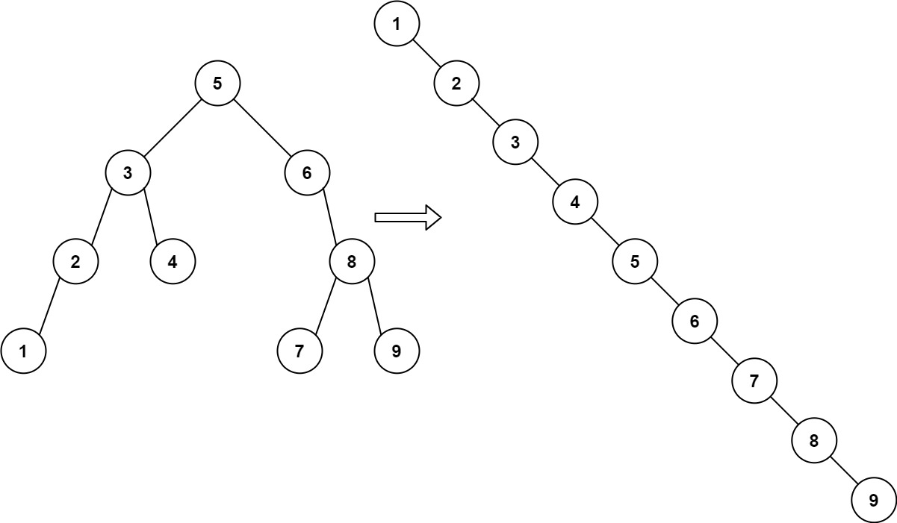
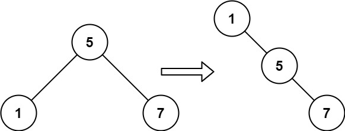

# [897. Increasing Order Search Tree](https://leetcode.com/problems/increasing-order-search-tree/)

| Category | Difficulty | Likes | Dislikes |
| :------: | :--------: | :---: | :------: |
| Algorithms | Easy | 4465 | 684 |

**Tags:** [`stack`](https://leetcode.com/tag/stack), [`tree`](https://leetcode.com/tag/tree), [`depth-first-search`](https://leetcode.com/tag/depth-first-search), [`binary-search-tree`](https://leetcode.com/tag/binary-search-tree), [`binary-tree`](https://leetcode.com/tag/binary-tree)

**Companies:** `amazon`

## Description

Given the `root` of a binary search tree, rearrange the tree in **in-order** so that the leftmost node in the tree is now the root of the tree, and every node has no left child and only one right child.

 

**Example 1:**


```

Input: root = [5,3,6,2,4,null,8,1,null,null,null,7,9]
Output: [1,null,2,null,3,null,4,null,5,null,6,null,7,null,8,null,9]

```

**Example 2:**


```

Input: root = [5,1,7]
Output: [1,null,5,null,7]

```

 

**Constraints:**

	- The number of nodes in the given tree will be in the range `[1, 100]`.

	- `0 <= Node.val <= 1000`

---

**Links:** [Submissions](https://leetcode.com/problems/increasing-order-search-tree/) | [Solutions](https://leetcode.com/problems/increasing-order-search-tree/)
