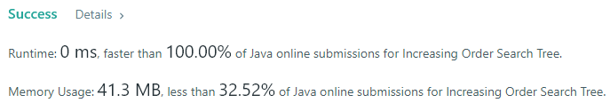
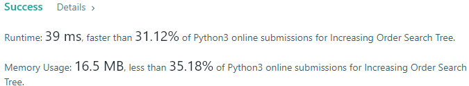
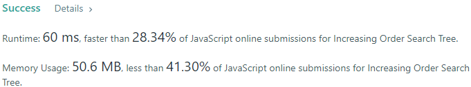

# 💢☠💫Easiest👾Faster✅💯 Lesser🧠 🎯 C++✅Python3🐍✅Java✅C✅Python🐍✅C#✅💥🔥💫Explained☠💥🔥 Beats 💯

**Author:** Edwards310
**Votes:** 7
**Link:** [https://leetcode.com/problems/increasing-order-search-tree/solutions/5640700/](https://leetcode.com/problems/increasing-order-search-tree/solutions/5640700/)

---

# Intuition








```javascript []
//JavaScript Code
/**
 * Definition for a binary tree node.
 * function TreeNode(val, left, right) {
 *     this.val = (val===undefined ? 0 : val)
 *     this.left = (left===undefined ? null : left)
 *     this.right = (right===undefined ? null : right)
 * }
 */
/**
 * @param {TreeNode} root
 * @return {TreeNode}
 */
var increasingBST = function(root) {
    var ptr = new TreeNode(-1)
    var curr = ptr
    inorder = ((root) => {
        if(root == undefined)
            return
        inorder(root.left)
        curr.right = new TreeNode(root.val)
        curr = curr.right
        inorder(root.right)
        return
    })
    inorder(root)
    return ptr.right
};
```
```python3 []
#Python3 Code
# Definition for a binary tree node.
# class TreeNode:
#     def __init__(self, val=0, left=None, right=None):
#         self.val = val
#         self.left = left
#         self.right = right
class Solution:
    def increasingBST(self, root: TreeNode) -> TreeNode:
        ptr = TreeNode()
        res = ptr

        def inorder(node):
            nonlocal ptr
            if not node:
                return
            
            inorder(node.left)
            ptr.right = TreeNode(node.val)
            ptr = ptr.right
            inorder(node.right)

        inorder(root)
        return res.right
```
```C++ []
//C++ Code
/**
 * Definition for a binary tree node.
 * struct TreeNode {
 *     int val;
 *     TreeNode *left;
 *     TreeNode *right;
 *     TreeNode() : val(0), left(nullptr), right(nullptr) {}
 *     TreeNode(int x) : val(x), left(nullptr), right(nullptr) {}
 *     TreeNode(int x, TreeNode *left, TreeNode *right) : val(x), left(left),
 * right(right) {}
 * };
 */
#pragma GCC optimize("O2")
#include <bits/stdc++.h>
using namespace std;
typedef vector<int> vi;
typedef vector<vi> vvi;
#define FOR(a, b, c) for (int a = b; a < c; a++)
#define FOR1(a, b, c) for (int a = b; a <= c; ++a)
#define Rep(i, n) FOR(i, 0, n)
#define Rep1(i, n) FOR1(i, 1, n)
#define RepA(ele, nums) for (auto& ele : nums)
#define WHL(i, n) while (i < n)
#define fi first
#define se second
#define mp make_pair
#define pb push_back
#define ALL(v) v.begin(), v.end()
#define SORT(v) sort(ALL(v))
class Solution {
private:
    void inorder(TreeNode* root, vi& ans) {
        if (!root)
            return;
        inorder(root->left, ans);
        ans.pb(root->val);
        inorder(root->right, ans);
        return;
    }
    TreeNode* solve(vi& ans, int idx) {
        if (idx >= ans.size())
            return nullptr;
        TreeNode* root = new TreeNode(ans[idx++]);
        root->right = solve(ans, idx);
        return root;
    }

public:
    TreeNode* increasingBST(TreeNode* root) {
        vi ans;
        inorder(root, ans);
        return solve(ans, 0);
    }
};
```
```Java []
//Java Code
/**
 * Definition for a binary tree node.
 * public class TreeNode {
 *     int val;
 *     TreeNode left;
 *     TreeNode right;
 *     TreeNode() {}
 *     TreeNode(int val) { this.val = val; }
 *     TreeNode(int val, TreeNode left, TreeNode right) {
 *         this.val = val;
 *         this.left = left;
 *         this.right = right;
 *     }
 * }
 */
class Solution {
    private void inorder(TreeNode root, ArrayList<Integer> res){
        if(root == null)
            return ;
        inorder(root.left, res);
        res.add(root.val);
        inorder(root.right, res);
        return ;
    }
    private TreeNode solve(ArrayList<Integer> res, int idx){
        if(idx >= res.size())
            return null;
        
        TreeNode root = new TreeNode(res.get(idx));
        root.right = solve(res, idx + 1);
        return root;
    }
    public TreeNode increasingBST(TreeNode root) {
        ArrayList<Integer> res = new ArrayList<>();
        inorder(root, res);
        return solve(res, 0);
    }
}
```
```C []
//C Code
/**
 * Definition for a binary tree node.
 * struct TreeNode {
 *     int val;
 *     struct TreeNode *left;
 *     struct TreeNode *right;
 * };
 */
struct TreeNode* curr = NULL;
struct TreeNode* createNewNode(int val){
    struct TreeNode* node = (struct TreeNode*)malloc(sizeof(struct TreeNode));
    node->val = val;
    node->right = NULL;
    node->left = NULL;
    return node;
}
void inorder(struct TreeNode* root){
    if(!root)
        return;
    inorder(root->left);
    curr->right = createNewNode(root->val);
    curr = curr->right;
    inorder(root->right);
}
struct TreeNode* increasingBST(struct TreeNode* root) {
    struct TreeNode* ptr =  createNewNode(-1);
    curr = ptr;
    inorder(root);
    return ptr->right;
}
```
```Python []
#Python Code
# Definition for a binary tree node.
# class TreeNode(object):
#     def __init__(self, val=0, left=None, right=None):
#         self.val = val
#         self.left = left
#         self.right = right
class Solution(object):
    def increasingBST(self, root):
        """
        :type root: TreeNode
        :rtype: TreeNode
        """
        dummy = TreeNode(-1)
        temp = dummy
        curr = root
        while curr:
            if not curr.left:
                temp.right = curr
                curr = curr.right
                temp = temp.right
            else:
                pred = curr.left
                while pred.right and pred.right != curr:
                    pred = pred.right
                if not pred.right:
                    pred.right = curr
                    curr = curr.left
                else:
                    temp.right = curr
                    curr.left = None
                    temp = temp.right
                    curr = curr.right
        return dummy.right
        
```
```C# []
//C# Code
/**
 * Definition for a binary tree node.
 * public class TreeNode {
 *     public int val;
 *     public TreeNode left;
 *     public TreeNode right;
 *     public TreeNode(int val=0, TreeNode left=null, TreeNode right=null) {
 *         this.val = val;
 *         this.left = left;
 *         this.right = right;
 *     }
 * }
 */
public class Solution {
    TreeNode curr = null;
    private void inorder(TreeNode root){
        if(root == null)
            return;
        inorder(root.left);
        curr.right = new TreeNode(root.val);
        curr = curr.right;
        inorder(root.right);
    }
    public TreeNode IncreasingBST(TreeNode root) {
        TreeNode ptr = new TreeNode(-1);
        curr = ptr;
        inorder(root);
        return ptr.right;
    }
}
```


<!-- Describe your first thoughts on how to solve this problem. -->

# Approach
<!-- Describe your approach to solving the problem. -->

# Complexity
- Time complexity:
<!-- Add your time complexity here, e.g. $$O(n)$$ -->
      O(n)
- Space complexity:
<!-- Add your space complexity here, e.g. $$O(n)$$ -->
      O(1)
# Code

