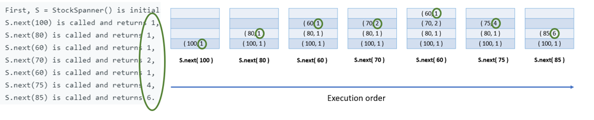

# Python/JS/C++ sol by monotonic stack [w/ Graph]

**Author:** brianchiang_tw
**Votes:** 88
**Link:** [https://leetcode.com/problems/online-stock-span/solutions/640396/](https://leetcode.com/problems/online-stock-span/solutions/640396/)

---

Solution base on monotonic stack

---

**Visualization**




---

Python:

```
class StockSpanner:

    def __init__(self):
        
        # maintain a monotonic stack for stock entry
        
		## definition of stock entry:
        # first parameter is price quote
        # second parameter is price span
        self.monotone_stack = []
              
        
        
    def next(self, price: int) -> int:

        stack = self.monotone_stack
        
        cur_price_quote, cur_price_span = price, 1
        
        # Compute price span in stock data with monotonic stack
        while stack and stack[-1][0] <= cur_price_quote:
            
            prev_price_quote, prev_price_span = stack.pop()
            
            # update current price span with history data in stack
            cur_price_span += prev_price_span
        
        # Update latest price quote and price span
        stack.append( (cur_price_quote, cur_price_span) )
        
        return cur_price_span
```

---

Javascript:

```
var StockSpanner = function() {
    
    // maintain a monotonic stack for stock entry

    // definition of stock entry:
    // first parameter is price quote
    // second parameter is price span
    this.stack = [];  
};


StockSpanner.prototype.next = function(price) {
    
    let [curPrice, curSpan] = [price, 1];
    
    // Compute price span in stock data with monotonic stack
    while( this.stack.length && this.stack[this.stack.length-1].price <= curPrice ){
        
        prev = this.stack.pop();
        let [prevPrice, prevSpan] = [prev.price, prev.span];
        
        // update current price span with history data in stack
        curSpan += prevSpan
    } 
    this.stack.push( {price: curPrice, span:curSpan} );
    
    return curSpan;
};
```

---

C++

```
class StockSpanner {
public:
    StockSpanner() {
        // maintain a monotonic stack for stock entry
        
		// definition of stock entry:
        // first parameter is price quote
        // second parameter is price span
    }
    
    int next(int price) {
        
        int curPrice = price;
        int curSpan = 1;
        
        // Compute price span in stock data with monotonic stack
        while( stack.size() && stack.back().first <= price ){
            
            auto [prevPrice, prevSpan] = stack.back();
            
            stack.pop_back();
            
            // update current price span with history data in stack
            curSpan += prevSpan;
        }
        
        // update latest price quote and price span
        stack.push_back( pair<int, int>{curPrice, curSpan} );
        
        return curSpan;
    }
private:
    vector< pair<int, int> > stack;
};
```


---


