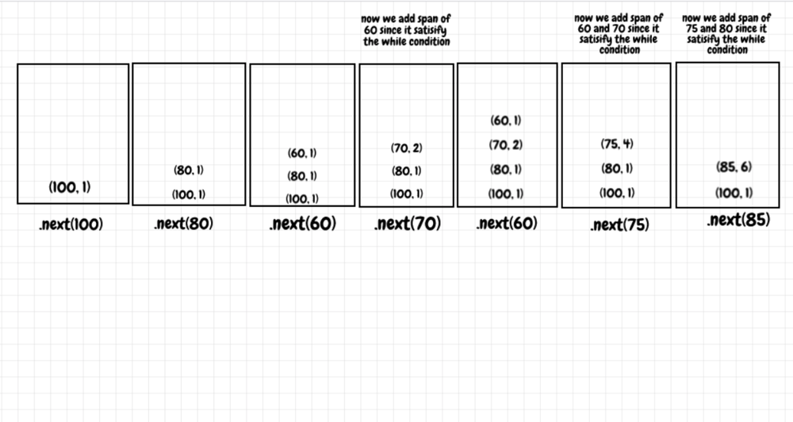

# Clean Java Stack solution with explanation. 90% better run time

**Author:** neerazz90
**Votes:** 58
**Link:** [https://leetcode.com/problems/online-stock-span/solutions/640648/](https://leetcode.com/problems/online-stock-span/solutions/640648/)

---

```
class StockSpanner {
//    Initialize a stack with int array.
//      First Index would be price, and
//      Second Index Will be span at that price.
    Stack<int[]> stack;
    public StockSpanner() {
        stack = new Stack<>();
    }

    public int next(int price) {
//        At each level initialize the span to 1.
        int span = 1;
//        If The top element of stack price is below or equal to the current price:
//          Then, the previous element will be span of current.
        while(!stack.isEmpty() && stack.peek()[0] <= price){
            span += stack.pop()[1];
        }
//        At each level add the price and the span. 
//        So that Next time when visited for consecutive days, you have the value of current that will avoid traversal till the current days span. 
        stack.add(new int[]{price, span});
        return span;
    }
}
```

