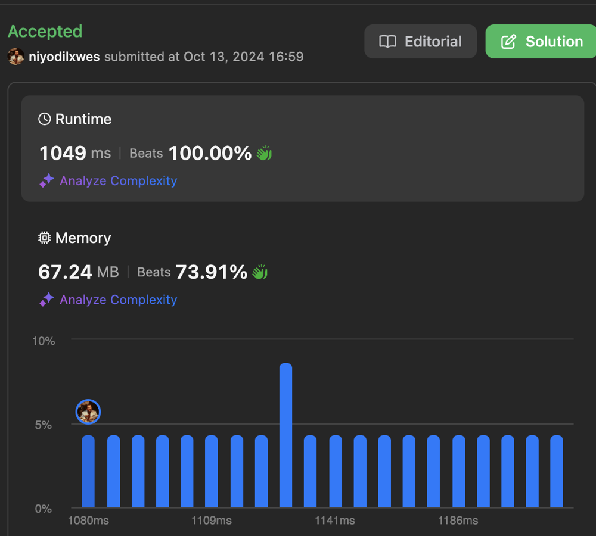

# ✅💯🔥 Extremely Simple Clean Code O(1) Python, Java, C++   ✅💯🔥

**Author:** niyodilxwes
**Votes:** 0
**Link:** [https://leetcode.com/problems/online-stock-span/solutions/5909239/](https://leetcode.com/problems/online-stock-span/solutions/5909239/)

---

<!-- Add your space complexity here, e.g. $$O(n)$$ -->


# Intuition
The problem asks us to implement a stock price tracker that, for each day's price, returns the number of consecutive days (including today) where the stock price was less than or equal to the current day's price. The first thought is to use a stack to keep track of prices and their spans, efficiently allowing us to compute the span for each new price by checking previously seen prices.

# Approach
1. **Stack-Based Approach**: We can use a stack to store pairs of (price, span). For each new price, we will:
   - Compare it with the price at the top of the stack.
   - While the current price is greater than or equal to the price at the top of the stack, we pop the stack and add the span of the popped price to the current day's span.
   - After determining the span for the current day, we push the current price and its span onto the stack.
   
2. **How It Works**:
   - The stack stores prices in decreasing order, with the corresponding span for each price.
   - If a new price is larger than or equal to the top of the stack, we know that the previous prices are part of the span, and we accumulate their spans.
   - This approach ensures that we only process each price once, making it efficient.

# Complexity
- Time complexity:
  The time complexity is `O(n)` for `n` calls to `next`. Each price is pushed and popped from the stack at most once, so each operation is amortized `O(1)`.

- Space complexity:
  The space complexity is `O(n)` where `n` is the number of days (or prices) because, in the worst case, all prices could be stored in the stack.

# Code
```python
class StockSpanner:

    def __init__(self):
        self.stack = []  # Stack to store (price, span)

    def next(self, price: int) -> int:
        span = 1  # Initial span for the current day

        # While the stack is not empty and the top price is less than or equal to the current price
        while self.stack and self.stack[-1][0] <= price:
            span += self.stack.pop()[1]  # Add the span of the popped price to the current span
        
        # Push the current price and its span onto the stack
        self.stack.append((price, span))
        
        # Return the span for the current price
        return span

```
```java
import java.util.Stack;

class StockSpanner {
    private Stack<int[]> stack;

    public StockSpanner() {
        stack = new Stack<>();
    }

    public int next(int price) {
        int span = 1;

        // While the stack is not empty and the top price is less than or equal to the current price
        while (!stack.isEmpty() && stack.peek()[0] <= price) {
            span += stack.pop()[1];  // Add the span of the popped price to the current span
        }

        // Push the current price and its span onto the stack
        stack.push(new int[] {price, span});
        
        // Return the span for the current price
        return span;
    }
}

```
```CPP
class StockSpanner {
public:
    stack<pair<int, int>> s;  // Stack to store (price, span)

    int next(int price) {
        int span = 1;

        // While the stack is not empty and the top price is less than or equal to the current price
        while (!s.empty() && s.top().first <= price) {
            span += s.top().second;  // Add the span of the popped price to the current span
            s.pop();
        }

        // Push the current price and its span onto the stack
        s.push({price, span});
        
        // Return the span for the current price
        return span;
    }
};
```
```typscript
class StockSpanner {
    private stack: [number, number][] = [];  // Stack to store [price, span]

    next(price: number): number {
        let span = 1;

        // While the stack is not empty and the top price is less than or equal to the current price
        while (this.stack.length && this.stack[this.stack.length - 

```
```scala
class StockSpanner() {
  val stack = scala.collection.mutable.Stack[(Int, Int)]() // Stack to store (price, span)

  def next(price: Int): Int = {
    var span = 1  // Initial span for the current day
    
    // While the stack is not empty and the top price is less than or equal to the current price
    while stack.nonEmpty && stack.head._1 <= price do
      span += stack.pop()._2  // Add the span of the popped price to the current span
    
    // Push the current price and its span onto the stack
    stack.push((price, span))
    
    // Return the span for the current price
    span
  }
}
