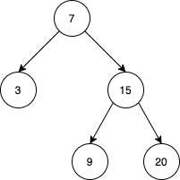

# [1586. Binary Search Tree Iterator II](https://leetcode.com/problems/binary-search-tree-iterator-ii/)

| Category | Difficulty | Likes | Dislikes |
| :------: | :--------: | :---: | :------: |
| Algorithms | Medium | 271 | 52 |

**Tags:** [`stack`](https://leetcode.com/tag/stack), [`tree`](https://leetcode.com/tag/tree), [`design`](https://leetcode.com/tag/design), [`binary-search-tree`](https://leetcode.com/tag/binary-search-tree), [`binary-tree`](https://leetcode.com/tag/binary-tree), [`iterator`](https://leetcode.com/tag/iterator)

**Companies:** `facebook`

## Description

Implement the `BSTIterator` class that represents an iterator over the **in-order traversal** of a binary search tree (BST):

	- `BSTIterator(TreeNode root)` Initializes an object of the `BSTIterator` class. The `root` of the BST is given as part of the constructor. The pointer should be initialized to a non-existent number smaller than any element in the BST.

	- `boolean hasNext()` Returns `true` if there exists a number in the traversal to the right of the pointer, otherwise returns `false`.

	- `int next()` Moves the pointer to the right, then returns the number at the pointer.

	- `boolean hasPrev()` Returns `true` if there exists a number in the traversal to the left of the pointer, otherwise returns `false`.

	- `int prev()` Moves the pointer to the left, then returns the number at the pointer.

Notice that by initializing the pointer to a non-existent smallest number, the first call to `next()` will return the smallest element in the BST.

You may assume that `next()` and `prev()` calls will always be valid. That is, there will be at least a next/previous number in the in-order traversal when `next()`/`prev()` is called.

 

**Example 1:**

****

```

Input
[&quot;BSTIterator&quot;, &quot;next&quot;, &quot;next&quot;, &quot;prev&quot;, &quot;next&quot;, &quot;hasNext&quot;, &quot;next&quot;, &quot;next&quot;, &quot;next&quot;, &quot;hasNext&quot;, &quot;hasPrev&quot;, &quot;prev&quot;, &quot;prev&quot;]
[[[7, 3, 15, null, null, 9, 20]], [null], [null], [null], [null], [null], [null], [null], [null], [null], [null], [null], [null]]
Output
[null, 3, 7, 3, 7, true, 9, 15, 20, false, true, 15, 9]

Explanation
// The underlined element is where the pointer currently is.
BSTIterator bSTIterator = new BSTIterator([7, 3, 15, null, null, 9, 20]); // state is   [3, 7, 9, 15, 20]
bSTIterator.next(); // state becomes [3, 7, 9, 15, 20], return 3
bSTIterator.next(); // state becomes [3, 7, 9, 15, 20], return 7
bSTIterator.prev(); // state becomes [3, 7, 9, 15, 20], return 3
bSTIterator.next(); // state becomes [3, 7, 9, 15, 20], return 7
bSTIterator.hasNext(); // return true
bSTIterator.next(); // state becomes [3, 7, 9, 15, 20], return 9
bSTIterator.next(); // state becomes [3, 7, 9, 15, 20], return 15
bSTIterator.next(); // state becomes [3, 7, 9, 15, 20], return 20
bSTIterator.hasNext(); // return false
bSTIterator.hasPrev(); // return true
bSTIterator.prev(); // state becomes [3, 7, 9, 15, 20], return 15
bSTIterator.prev(); // state becomes [3, 7, 9, 15, 20], return 9

```

 

**Constraints:**

	- The number of nodes in the tree is in the range `[1, 10^5]`.

	- `0 <= Node.val <= 10^6`

	- At most `10^5` calls will be made to `hasNext`, `next`, `hasPrev`, and `prev`.

 

**Follow up:** Could you solve the problem without precalculating the values of the tree?

---

**Links:** [Submissions](https://leetcode.com/problems/binary-search-tree-iterator-ii/) | [Solutions](https://leetcode.com/problems/binary-search-tree-iterator-ii/)
