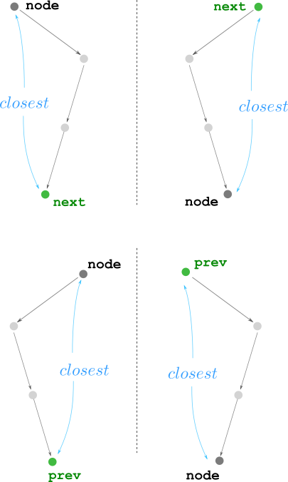
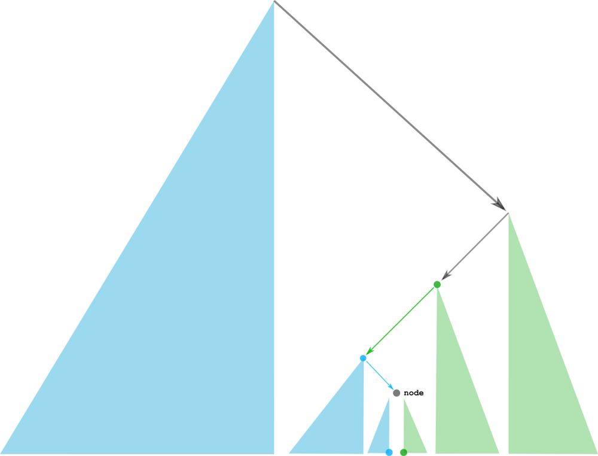

# stack ^^

**Author:** andrii_khlevniuk
**Votes:** 0
**Link:** [https://leetcode.com/problems/binary-search-tree-iterator-ii/solutions/4176646/](https://leetcode.com/problems/binary-search-tree-iterator-ii/solutions/4176646/)

---

The next element may be either down the tree or up in the tree. The same is true for the previous element.



This is the bigger picture




```
class BSTIterator 
{
    stack<TreeNode*> s;
    TreeNode* L, * R;
public:
    BSTIterator(TreeNode* r)
    {
       s.push(r); 
       for( ; s.top(); s.push(s.top()->left));
       for(L=r; L->left ; L=L->left );
       for(R=r; R->right; R=R->right);
    }
    
    bool hasNext() 
    {
       return s.top()!=R;
    }
    
    bool hasPrev() 
    {       
        return s.top() and s.top()!=L;
    }  
    
    int next() 
    {
        if(s.top() and s.top()->right) 
            for(s.push(s.top()->right); s.top()->left; s.push(s.top()->left));
        else
            for( ; ; )
            {
                auto x = s.top(); s.pop();
                if(s.top()->left==x) break;
            }
        return s.top()->val;
    }
    
    int prev() 
    {
        if(s.top()->left)
            for(s.push(s.top()->left); s.top()->right; s.push(s.top()->right));
        else
            for( ; ; )
            {
                auto x = s.top(); s.pop();
                if(s.top()->right==x) break;
            }
        return s.top()->val;
    }
};
```