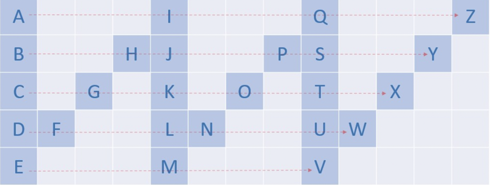

# Easy Explanation with Pics and Video | Java C++ Python

**Author:** jeevankumar159
**Votes:** 146
**Link:** [https://leetcode.com/problems/zigzag-conversion/solutions/3133966/](https://leetcode.com/problems/zigzag-conversion/solutions/3133966/)

---




Things become clear with the above image.

# Intuition:
1. Just look at the top row what is the difference b/w each char i.e A and I and I and Q = 8
            5*2-2 == numberOf rows *2 - 2 (The corner elements are excluded).
Similarly for each row i.e B and J the diff is 8, C and K is 8
2. The interesting part comes when the char in the diagnoal has to be added, but even this has a pattern
	
	There will be no char in between for row 0 and row n.
	There can be only one diagonal char and the diagonal diff is original diff -2 at each step or diff - (rowNumber*2);

# Approach

1. Create an empty StringBuilder which is our ans.
2.  Calculate the diff = numRows*2 -2;
3. Iterate over 0 to rowNumber in a for loop  
The first char will be row number or i (append to String)
4. Write a while loop in the above for loop :
5. The first char will be row number or i (append to String)
6. Calculate the diagonalDiff if any and append to the String.
7. Increase the index by diff and return ans.


https://youtu.be/YwU8pENP-vw
# If you find this useful


```
class Solution {
    public String convert(String s, int numRows) {
        if (numRows == 1) {
            return s;
        }
        
        StringBuilder answer = new StringBuilder();
        int n = s.length();
        int diff = 2 * (numRows - 1);
        int diagonalDiff = diff;
        int secondIndex;
        int index;
        for (int i = 0; i < numRows; i++) {
            index = i;

            while (index < n) {
                answer.append(s.charAt(index));
                if (i != 0 && i != numRows - 1) {
                    diagonalDiff = diff-2*i;
                    secondIndex = index + diagonalDiff;
                    
                    if (secondIndex < n) {
                        answer.append(s.charAt(secondIndex));
                    }
                }
                index += diff;
            }
        }
        
        return answer.toString();
    }
}
```

```
class Solution {
public:
    string convert(string s, int numRows) {
        if (numRows == 1) {
            return s;
        }
        
        stringstream answer;
        int n = s.length();
        int diff = 2 * (numRows - 1);
        int diagonalDiff = diff;
        int secondIndex;
        int index;
        for (int i = 0; i < numRows; i++) {
            index = i;

            while (index < n) {
                answer << s[index];
                if (i != 0 && i != numRows - 1) {
                    diagonalDiff = diff-2*i;
                    secondIndex = index + diagonalDiff;
                    
                    if (secondIndex < n) {
                        answer << s[secondIndex];
                    }
                }
                index += diff;
            }
        }
        
        return answer.str();
    }
};

```

```
class Solution:
    def convert(self, s: str, numRows: int) -> str:
        if numRows == 1:
            return s
        answer = ''
        n = len(s)
        diff = 2 * (numRows - 1)
        diagonal_diff = diff
        second_index = 0
        index = 0
        for i in range(numRows):
            index = i
            while index < n:
                answer += s[index]
                if i != 0 and i != numRows - 1:
                    diagonal_diff = diff - 2 * i
                    second_index = index + diagonal_diff
                    if second_index < n:
                        answer += s[second_index]
                index += diff
        return answer
```
