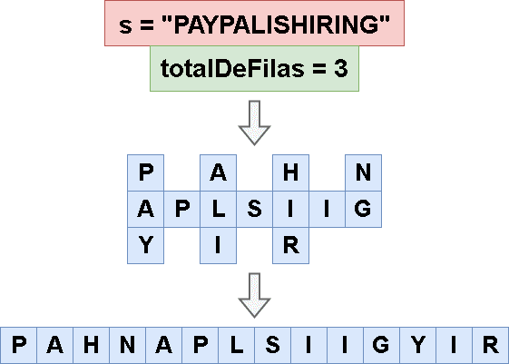

# 🔥🔥 Explicación y Resolución Del Ejercicio En Español Java | Python | PHP | C++ | JavaScript 🔥🔥

**Author:** hermescoder02
**Votes:** 5
**Link:** [https://leetcode.com/problems/zigzag-conversion/solutions/4098605/](https://leetcode.com/problems/zigzag-conversion/solutions/4098605/)

---

# Lectura

*Conversi\xF3n en zigzag (Java, Python, PHP, C++, Javascript)*

El ejercicio  consiste en tomar un string y reorganizarlo en una forma zigzag a trav\xE9s de un n\xFAmero de filas.

El objetivo del problema es escribir un algoritmo que tome una cadena y el n\xFAmero de filas y devuelva la cadena reorganizada en un patr\xF3n zigzag a trav\xE9s de las filas





# Explicaci\xF3n del ejercicio Paso por paso

https://youtu.be/lffK6wIpkhk


Si te gust\xF3 el contenido \xA1visita mi canal de youtube!: 
\u2705https://www.youtube.com/@hermescoder

Si deseas profundizar m\xE1s en este tema \xA1visita mi blog!: 
\u2705https://hermescoder.com/zigzag-conversion-leetcode-espanol.html

# C\xF3digo 
```Java []
public class Solution {

    /**
     * @param String s
     * @param Integer totalFilas
     * @return String
     */
     public String convert(String s, int totalFilas) {
        if(totalFilas==1) return s;

        // paso#1
        String[] posiciones = new String[totalFilas];
        Arrays.fill(posiciones, "");

        // paso#2
        int size = s.length();
        int direccion = 1;
        int filaActual = 0;

        // paso#3
        for (int i = 0; i < size; i++) {       
            // paso#4
            posiciones[filaActual] += s.charAt(i);
               
            // paso#5
            if (filaActual == 0) direccion = 1;
            else if (filaActual == totalFilas-1) direccion = -1;
            
            // paso#6
            filaActual += direccion;
        }
        
        // paso#7
        return String.join("", posiciones);
    }
}
```
```Python []
class Solution:

    def convert(self, s, total_filas):
        if total_filas == 1:
            return s

        # Paso #1
        posiciones = [""] * total_filas

        # Paso #2
        size = len(s)
        direccion = 1
        fila_actual = 0

        # Paso #3
        for i in range(size):
            # Paso #4
            posiciones[fila_actual] += s[i]


            # Paso #5
            if fila_actual == 0:
                direccion = 1
            elif fila_actual == (total_filas - 1):
                direccion = -1

            # Paso #6
            fila_actual += direccion

        # Paso #7
        return "".join(posiciones)
```
```PHP []
class Solution {

    /**
     * @param String $s
     * @param Integer $totalFilas
     * @return String
     */
     function convert($s, $totalFilas) {
        
        //paso#1
        $posiciones=array_fill(0, $totalFilas, '');
        
        //paso#2
        $size=strlen($s);
        $direccion=1;
        $filaActual=0;


        //paso#3
        for ($i=0; $i<$size; $i++) {
            //paso#4
            $posiciones[$filaActual].=$s[$i];
            
            //paso#5
            if ($filaActual == 0)              $direccion = 1;
            elseif ($filaActual == $totalFilas-1) $direccion = -1;
            
            //paso#6
            $filaActual += $direccion;
        }
        
        //paso#7
        return implode('', $posiciones);
    }
}
```
```C++ []
class Solution {
public:
  std::string convert(const std::string& s, int totalFilas) {
    if (totalFilas == 1) {
      return s;
    }

    // Paso #1
    std::vector<std::string> posiciones(totalFilas);
    for (auto& posicion : posiciones) {
      posicion = "";
    }

    // Paso #2
    int size = s.length();
    int direccion = 1;
    int filaActual = 0;

    // Paso #3
    for (int i = 0; i < size; i++) {
      // Paso #4
      posiciones[filaActual] += s[i];

      // Paso #5
      if (filaActual == 0) {
        direccion = 1;
      } else if (filaActual == totalFilas - 1) {
        direccion = -1;
      }

      // Paso #6
      filaActual += direccion;
    }

    // Paso #7
    std::string resultado;
    for (const auto& posicion : posiciones) {
      resultado += posicion;
    }
    return resultado;
  }
};
```
```JavaScript []
/**
 * @param {string} s
 * @param {number} numRows
 * @return {string}
 */
var convert = function(s, totalFilas) {
    if (totalFilas == 1) {
      return s;
    }

    // Paso #1
    const posiciones = new Array(totalFilas);
    for (let i = 0; i < posiciones.length; i++) {
      posiciones[i] = "";
    }

    // Paso #2
    const size = s.length;
    let direccion = 1;
    let filaActual = 0;

    // Paso #3
    for (let i = 0; i < size; i++) {
      // Paso #4
      posiciones[filaActual] += s[i];

      // Paso #5
      if (filaActual == 0) {
        direccion = 1;
      } else if (filaActual == totalFilas - 1) {
        direccion = -1;
      }

      // Paso #6
      filaActual += direccion;
    }

    // Paso #7
    return posiciones.join("");
};
```


