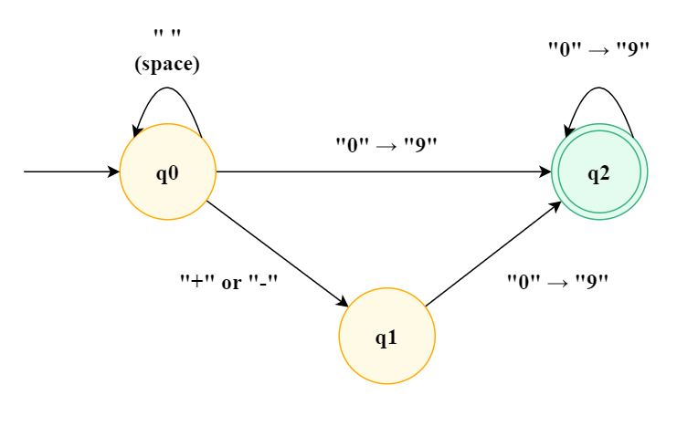

# Fast and simpler DFA approach (Python 3)

**Author:** spencerwoo
**Votes:** 358
**Link:** [https://leetcode.com/problems/string-to-integer-atoi/solutions/798380/](https://leetcode.com/problems/string-to-integer-atoi/solutions/798380/)

---

A fast and (probably) **much simpler and easier to understand DFA solution** than the others when you search for the keyword `DFA`:

```python
class Solution:
    def myAtoi(self, str: str) -> int:
        value, state, pos, sign = 0, 0, 0, 1

        if len(str) == 0:
            return 0

        while pos < len(str):
            current_char = str[pos]
            if state == 0:
                if current_char == " ":
                    state = 0
                elif current_char == "+" or current_char == "-":
                    state = 1
                    sign = 1 if current_char == "+" else -1
                elif current_char.isdigit():
                    state = 2
                    value = value * 10 + int(current_char)
                else:
                    return 0
            elif state == 1:
                if current_char.isdigit():
                    state = 2
                    value = value * 10 + int(current_char)
                else:
                    return 0
            elif state == 2:
                if current_char.isdigit():
                    state = 2
                    value = value * 10 + int(current_char)
                else:
                    break
            else:
                return 0
            pos += 1

        value = sign * value
        value = min(value, 2 ** 31 - 1)
        value = max(-(2 ** 31), value)

        return value
```

DFA, which stands for Deterministic finite automaton, is a state machine that either accepts or rejects a sequence of symbols by running through a state sequence uniquely determined by the string. The DFA I used to implement this answer is very simple:



