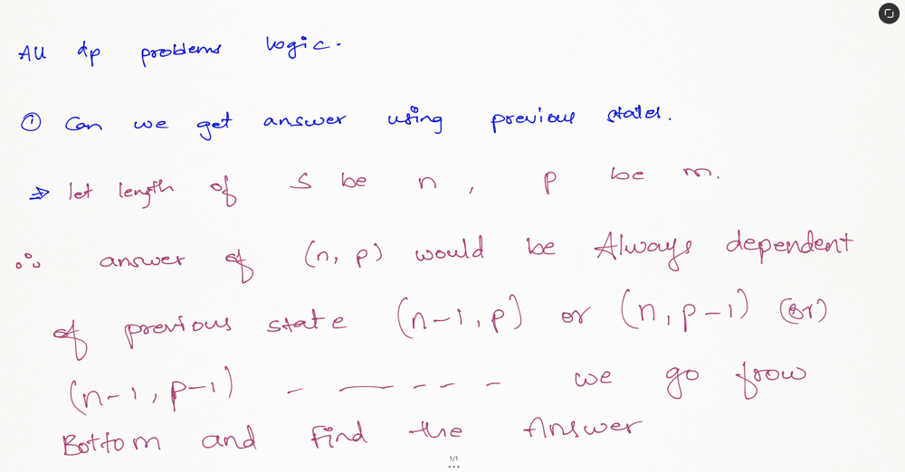
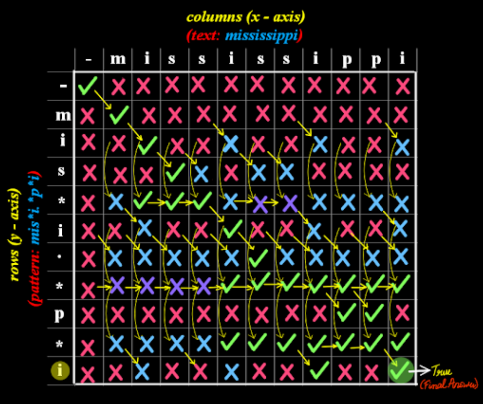
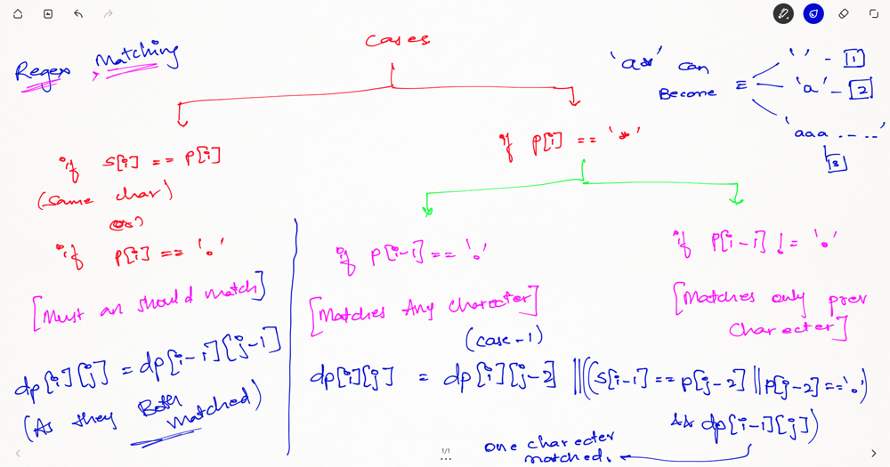

# 🚀 ✅ Detailed explaination 🔥 with Pictures ✅ 🔥 🚀 in C++,Java , Python , DP bottom up tabulation.

**Author:** chandra0918
**Votes:** 370
**Link:** [https://leetcode.com/problems/regular-expression-matching/solutions/3401751/](https://leetcode.com/problems/regular-expression-matching/solutions/3401751/)

---

# Approach
- Here the approach is very simple we basically must create a DP to store the states. For any DP problem all follow the same rule that we should memoize the truth value of $$(n,m)$$ then we need the values of $$(n-1 , m)$$ or $$(n ,m-1)$$ or $$(n-1 , m-1)$$ this would be the whole point of DP.


---




>The example of mississippi is taken and the DP table is depicted below and the explaination is provided down.



>Here we basically broke the entire one into three cases as shown in the below picture.Now we procced based on the below three cases and construct our DP table and thus we finally obtain our answer.




---


# Complexity
> - Time complexity: Here the complexity would be $$O(n^2)$$ as we need a 2D loop for keeping the track of length of both the strings.

>- Space complexity: Here the space would also be $$O(n^2)$$ which can later be optimised to $$O(n)$$ by making space optimisation into two 1D arrays but we must do this to store the truth values of the lengths.


---


# Code
```C++ []
class Solution {
public:
    bool isMatch(string s, string p) {
        int n = s.length(), m = p.length();
        bool dp[n+1][m+1];
        memset(dp, false, sizeof(dp));
        dp[0][0] = true;
        
        for(int i=0; i<=n; i++){
            for(int j=1; j<=m; j++){
                if(p[j-1] == '*'){
                    dp[i][j] = dp[i][j-2] || (i > 0 && (s[i-1] == p[j-2] || p[j-2] == '.') && dp[i-1][j]);
                }
                else{
                    dp[i][j] = i > 0 && dp[i-1][j-1] && (s[i-1] == p[j-1] || p[j-1] == '.');
                }
            }
        }
        
        return dp[n][m];
    }
};
```
```java []
enum Result {
    TRUE, FALSE
}

class Solution {
    Result[][] memo;

    public boolean isMatch(String text, String pattern) {
        memo = new Result[text.length() + 1][pattern.length() + 1];
        return dp(0, 0, text, pattern);
    }

    public boolean dp(int i, int j, String text, String pattern) {
        if (memo[i][j] != null) {
            return memo[i][j] == Result.TRUE;
        }
        boolean ans;
        if (j == pattern.length()){
            ans = i == text.length();
        } else{
            boolean first_match = (i < text.length() &&
                                   (pattern.charAt(j) == text.charAt(i) ||
                                    pattern.charAt(j) == '.'));

            if (j + 1 < pattern.length() && pattern.charAt(j+1) == '*'){
                ans = (dp(i, j+2, text, pattern) ||
                       first_match && dp(i+1, j, text, pattern));
            } else {
                ans = first_match && dp(i+1, j+1, text, pattern);
            }
        }
        memo[i][j] = ans ? Result.TRUE : Result.FALSE;
        return ans;
    }
}
```
```python []
class Solution:
    def isMatch(self, s: str, p: str) -> bool:
        i, j = len(s) - 1, len(p) - 1
        return self.backtrack({}, s, p, i, j)

    def backtrack(self, cache, s, p, i, j):
        key = (i, j)
        if key in cache:
            return cache[key]

        if i == -1 and j == -1:
            cache[key] = True
            return True

        if i != -1 and j == -1:
            cache[key] = False
            return cache[key]

        if i == -1 and p[j] == '*':
            k = j
            while k != -1 and p[k] == '*':
                k -= 2
            
            if k == -1:
                cache[key] = True
                return cache[key]
            
            cache[key] = False
            return cache[key]
        
        if i == -1 and p[j] != '*':
            cache[key] = False
            return cache[key]

        if p[j] == '*':
            if self.backtrack(cache, s, p, i, j - 2):
                cache[key] = True
                return cache[key]
            
            if p[j - 1] == s[i] or p[j - 1] == '.':
                if self.backtrack(cache, s, p, i - 1, j):
                    cache[key] = True
                    return cache[key]
        
        if p[j] == '.' or s[i] == p[j]:
            if self.backtrack(cache, s, p, i - 1, j - 1):
                cache[key] = True
                return cache[key]

        cache[key] = False
        return cache[key]
```


---


IF YOU LIKE THE SOLUTION THEN PLEASE UPVOTE MY SOLUTION BECAUSE IT GIVES ME MOTIVATION TO REGULARLY POST THE SOLUTION.


