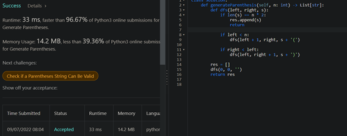

# Python, Java w/ Explanation | Faster than 96% w/ Proof | Easy to Understand

**Author:** IdealYuvi
**Votes:** 1948
**Link:** [https://leetcode.com/problems/generate-parentheses/solutions/2542620/](https://leetcode.com/problems/generate-parentheses/solutions/2542620/)

---

1. The idea is to add `')'` only after valid `'('`
2. We use two integer variables `left` & `right` to see how many `'('` & `')'` are in the current string
3. If `left < n` then we can add `'('` to the current string
4. If `right < left` then we can add `')'` to the current string

**Python Code:**
```
def generateParenthesis(self, n: int) -> List[str]:
	def dfs(left, right, s):
		if len(s) == n * 2:
			res.append(s)
			return 

		if left < n:
			dfs(left + 1, right, s + '(')

		if right < left:
			dfs(left, right + 1, s + ')')

	res = []
	dfs(0, 0, '')
	return res
```

For` n = 2`, the recursion tree will be something like this,
```
								   	(0, 0, '')
								 	    |	
									(1, 0, '(')  
								   /           \\
							(2, 0, '((')      (1, 1, '()')
							   /                 \\
						(2, 1, '(()')           (2, 1, '()(')
						   /                       \\
					(2, 2, '(())')                (2, 2, '()()')
						      |	                             |
					res.append('(())')             res.append('()()')
   
```

**Java Code:**
```java
class Solution {
    public List<String> generateParenthesis(int n) {
        List<String> res = new ArrayList<String>();
        recurse(res, 0, 0, "", n);
        return res;
    }
    
    public void recurse(List<String> res, int left, int right, String s, int n) {
        if (s.length() == n * 2) {
            res.add(s);
            return;
        }
        
        if (left < n) {
            recurse(res, left + 1, right, s + "(", n);
        }
        
        if (right < left) {
            recurse(res, left, right + 1, s + ")", n);
        }
    }
	// See above tree diagram with parameters (left, right, s) for better understanding
}
```



