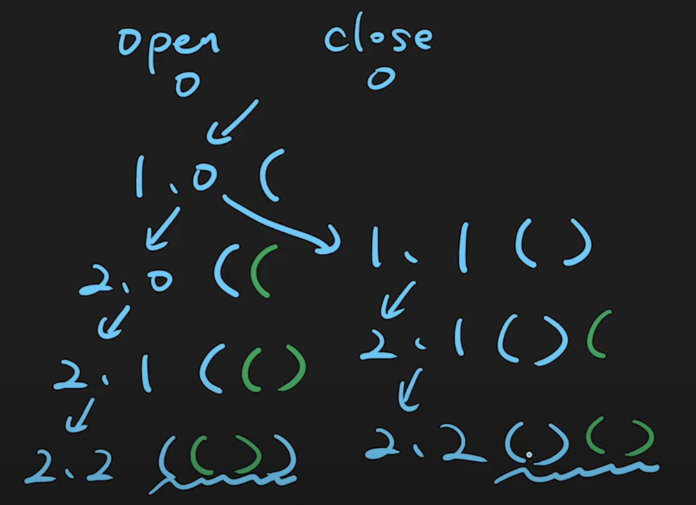

# 【Video】Increase number of open parentheses until we reach n at first

**Author:** niits
**Votes:** 89
**Link:** [https://leetcode.com/problems/generate-parentheses/solutions/6048157/](https://leetcode.com/problems/generate-parentheses/solutions/6048157/)

---

# Intuition
Increase number of open parentheses until we reach `n` at first

# Solution Video

https://youtu.be/FMoH-huqTe4

### \u2B50\uFE0F\u2B50\uFE0F Don't forget to subscribe to my channel! \u2B50\uFE0F\u2B50\uFE0F

**\u25A0 Subscribe URL**
http://www.youtube.com/channel/UC9RMNwYTL3SXCP6ShLWVFww?sub_confirmation=1

Subscribers: 10,613
Thank you for your support!

---

# Approach

Let's think about `n = 2`.
```
n = 2

well-formed parentheses
()()
(())
```
Did you learn something from the example?


Thinking time...


...\uD83D\uDE29


...\uD83D\uDE05


...\uD83D\uDE03


---

\u2B50\uFE0F Points

We have open parentheses before close parentheses. That's why my strategy is to increase number of open parentheses until `n` at first, then increase number of close parentheses until `n`.

---



## How it works
First of all, we start 
```
number of open parenthese: 0
number of close parenthese: 0
```
Increase `open` until we reach `n`.
```
open: 1
close: 0
parenthese: (
```
Increase `open` until we reach `n`.
```
open: 2
close: 0
parenthese: ((
```
Now we reach `n`, then increase `close` until we reach `n`
```
open: 2
close: 1
parenthese: (()
```
Increase `close` until we reach `n`
```
open: 2
close: 2
parenthese: (())
```
Now we succeefully created one of well-formed parentheses.

```
res = ["(())"]
```
Now we have `2 open` and `2 close`, so let's go back to `1 open` and `0 close`, so that we can move in different way.

```
open: 1
close: 0
parenthese: (
```
Increase close to move in a different way. 
```
open: 1
close: 1
parenthese: ()
```
Now we have `1 open`. We will increase `open` until `n`. 
```
open: 2
close: 1
parenthese: ()(
```
Now we reach `n` with 2 open. Then increase `close` until `n`. 
```
open: 2
close: 2
parenthese: ()()
```
We successfully created one of well-formed parentheses.

```
return res (= ["(())","()()"])
```

Easy!\uD83D\uDE03
Let's see a real algorithm!

---

\u2B50\uFE0F Related Question - Valid Parentheses #20

https://youtu.be/-CGiyb1Loyc

---


# Complexity
- Time complexity:$$O(2^2n)$$
<!-- Add your time complexity here, e.g. $$O(n)$$ -->

- Space complexity: $$O(n)$$
<!-- Add your space complexity here, e.g. $$O(n)$$ -->

```python []
class Solution:
    def generateParenthesis(self, n: int) -> List[str]:
        res = []

        def dfs(openP, closeP, s):
            if openP == closeP and openP + closeP == n * 2:
                res.append(s)
                return
            
            if openP < n:
                dfs(openP + 1, closeP, s + "(")
            
            if closeP < openP:
                dfs(openP, closeP + 1, s + ")")

        dfs(0, 0, "")

        return res
```
```javascript []
var generateParenthesis = function(n) {
    const res = [];

    function dfs(openP, closeP, s) {
        if (openP === closeP && openP + closeP === n * 2) {
            res.push(s);
            return;
        }

        if (openP < n) {
            dfs(openP + 1, closeP, s + "(");
        }

        if (closeP < openP) {
            dfs(openP, closeP + 1, s + ")");
        }
    }

    dfs(0, 0, "");

    return res;    
};
```
```java []
class Solution {
    public List<String> generateParenthesis(int n) {
        List<String> res = new ArrayList<>();

        dfs(0, 0, "", n, res);

        return res;        
    }

    private void dfs(int openP, int closeP, String s, int n, List<String> res) {
        if (openP == closeP && openP + closeP == n * 2) {
            res.add(s);
            return;
        }

        if (openP < n) {
            dfs(openP + 1, closeP, s + "(", n, res);
        }

        if (closeP < openP) {
            dfs(openP, closeP + 1, s + ")", n, res);
        }
    }    
}
```
```C++ []
class Solution {
public:
    vector<string> generateParenthesis(int n) {
        vector<string> res;
        dfs(0, 0, "", n, res);
        return res;        
    }

private:
    void dfs(int openP, int closeP, string s, int n, vector<string>& res) {
        if (openP == closeP && openP + closeP == n * 2) {
            res.push_back(s);
            return;
        }

        if (openP < n) {
            dfs(openP + 1, closeP, s + "(", n, res);
        }

        if (closeP < openP) {
            dfs(openP, closeP + 1, s + ")", n, res);
        }
    }
};
```


### 1. Define the `generateParenthesis` function
```python
res = []
```
- **Initialization**: We initialize an empty list `res` to store the valid combinations.

### 2. Define the `dfs` function
```python
def dfs(openP, closeP, s):
```
- **Purpose**: This is a helper function that uses depth-first search (DFS) to explore all possible combinations.
- **Parameters**:
  - `openP`: The current number of open parentheses used.
  - `closeP`: The current number of close parentheses used.
  - `s`: The current string being built.

### 3. Base Case
```python
if openP == closeP and openP + closeP == n * 2:
    res.append(s)
    return
```
- **Condition**: If the number of open and close parentheses are equal and the total length of the string is `2 * n`, it means we have a valid combination.
- **Action**: Append the valid combination `s` to the result list `res` and return.

### 4. Recursive Case: Adding an Open Parenthesis
```python
if openP < n:
    dfs(openP + 1, closeP, s + "(")
```
- **Condition**: If the number of open parentheses used (`openP`) is less than `n`, we can add another open parenthesis.
- **Action**: Recursively call `dfs` with one more open parenthesis, and append `(` to the current string `s`.

### 5. Recursive Case: Adding a Close Parenthesis
```python
if closeP < openP:
    dfs(openP, closeP + 1, s + ")")
```
- **Condition**: If the number of close parentheses used (`closeP`) is less than the number of open parentheses, we can add a close parenthesis to maintain balance.
- **Action**: Recursively call `dfs` with one more close parenthesis, and append `)` to the current string `s`.

### 6. Initial Call to `dfs`
```python
dfs(0, 0, "")
```
- **Purpose**: Start the recursive process by calling `dfs` with zero open and close parentheses, and an empty string `s`.

### 7. Return the Result
```python
return res
```
- **Purpose**: Return the list `res` containing all valid combinations of well-formed parentheses.

---

Thank you for reading my post. Please upvote it and don't forget to subscribe to my channel!

##### \u2B50\uFE0F Subscribe URL
http://www.youtube.com/channel/UC9RMNwYTL3SXCP6ShLWVFww?sub_confirmation=1

##### \u2B50\uFE0F Twitter
https://twitter.com/CodingNinjaAZ

##### My recent video - Longest Consecutive Sequence #128

https://youtu.be/PRVmb_7u6fo