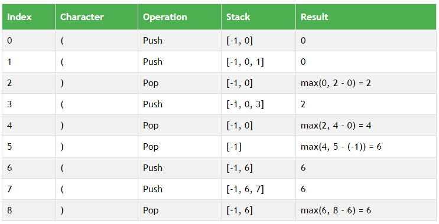

# 🚀 ✅100% , Detailed explaination 🔥 with Pictures ✅ 🔥 🚀O(n) ,  in C++ , Java , Python , stack. 🔥

**Author:** chandra0918
**Votes:** 118
**Link:** [https://leetcode.com/problems/longest-valid-parentheses/solutions/3401956/](https://leetcode.com/problems/longest-valid-parentheses/solutions/3401956/)

---

# Approach
- Here the approach is nothing but we are using a stack and when we encounter an opening brace then we push the index of it into the stack and whenever we touch a closing brace then we see the top of the stack if it's size is one then it means the closing braces have dominated the opening brace. We then edit the top value of the stack to the index of the closing brace.
>- This method is clearly depicted in the picture as shown below.



>- here answer is given as the line `ans = max(ans , index - stk.top())` only when the size of stack is not 1 and there is a closing brace encountered.

---


# Code
```C++ []
class Solution {
public:
    int longestValidParentheses(string s) {
        stack<int>stk;
        stk.push(-1);
        int ans = 0;
        for(int i = 0 ; i < s.size();  i++)
        {
            if(s[i] == '(')
                stk.push(i);
            else
            {
                if(stk.size() == 1)
                    stk.top() = i;
                else
                {
                    stk.pop();
                    ans = max(ans , i - stk.top());
                }
            }
        }
        return ans;
    }
};
```
```java []
class Solution {
    public int longestValidParentheses(String s) {
    int leftCount = 0;
    int rightCount = 0;
    int maxLength = 0;
    
    for (int i = 0; i < s.length(); i++) {
        if (s.charAt(i) == '(') {
            leftCount++;
        } else {
            rightCount++;
        }
        
        if (leftCount == rightCount) {
            maxLength = Math.max(maxLength, 2 * rightCount);
        } else if (rightCount > leftCount) {
            leftCount = rightCount = 0;
        }
    }
    
    leftCount = rightCount = 0;
    
    for (int i = s.length() - 1; i >= 0; i--) {
        if (s.charAt(i) == '(') {
            leftCount++;
        } else {
            rightCount++;
        }
        
        if (leftCount == rightCount) {
            maxLength = Math.max(maxLength, 2 * leftCount);
        } else if (leftCount > rightCount) {
            leftCount = rightCount = 0;
        }
    }
    
    return maxLength;
    }
}
```
```python []
class Solution:
    def longestValidParentheses(self, s: str) -> int:
        stack=[]
        l=['0']*len(s)
        for ind,i in enumerate(s):
            if i=='(':
                stack.append(ind)
            else:
                if stack:
                    l[stack.pop()]='1'
                    l[ind]='1'
        return max(len(i) for i in ''.join(l).split('0'))
```

---


# Complexity
>- Time complexity:Here the complexity would be $$O(n)$$ as we are using only a single loop with a stack only so this runs in a linear complexity.

>- Space complexity:Here the space complexity would be $O(n)$ as we are using just a stack that too store the elements in the worst case it goes to that complexity.
<!-- Add your space complexity here, e.g. $$O(n)$$ -->

---


**IF YOU LIKE THE SOLUTION THEN PLEASE UPVOTE MY SOLUTION BECAUSE IT GIVES ME MOTIVATION TO REGULARLY POST THE SOLUTION.**


