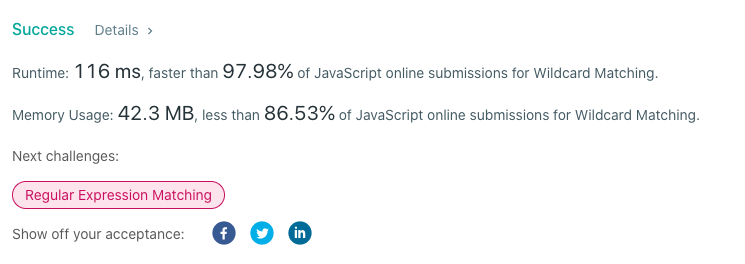

# Backtracking 97% Faster Javascript version of Official solution ES6

**Author:** mp3393
**Votes:** 6
**Link:** [https://leetcode.com/problems/wildcard-matching/solutions/1228581/](https://leetcode.com/problems/wildcard-matching/solutions/1228581/)

---

`Approach:` Backtracking
`Algorithm:`
- Initiate 3 pointers: 
	pointer for pattern-index
	pointer for string-index
	pointer for temporary-index when we encounter "*" in pattern
- Initiate a variable for storing index-position of star "*"
- both string pointer and pattern pointer are moved forward by 1 step whenever:
	chars in string and pattern match OR
	char in string matches with "?" in pattern
- Only pattern pointer is moved by a step when we encounter a "*"
- Only string pointer is moved when a char  doesn't match with char in pattern
- The starIndex acts as a reference point during entire iteration
- The temp-index along with string-index are constantly updated when chars in pattern and string do not match. 

`Code:`
```
const isMatch = function (string, pattern) {
  let s = 0, p = 0;
  let starIdx = -1, pointer = -1;

  while (s < string.length) {
    if ((p < pattern.length && string[s] === pattern[p]) || pattern[p] === "?") {
      s++;
      p++;
    } 
	else if (p < pattern.length && pattern[p] === "*") {
      starIdx = p;
      pointer = s;
      p++;
    } 
	else if (starIdx === -1) return false;
    else {
      p = starIdx + 1;
      s = pointer + 1;
      pointer = s;
    }
  }
  for (let idx = p; idx < pattern.length; idx++) {
    if (pattern[idx] !== "*") return false;
  }
  return true;
};
```

