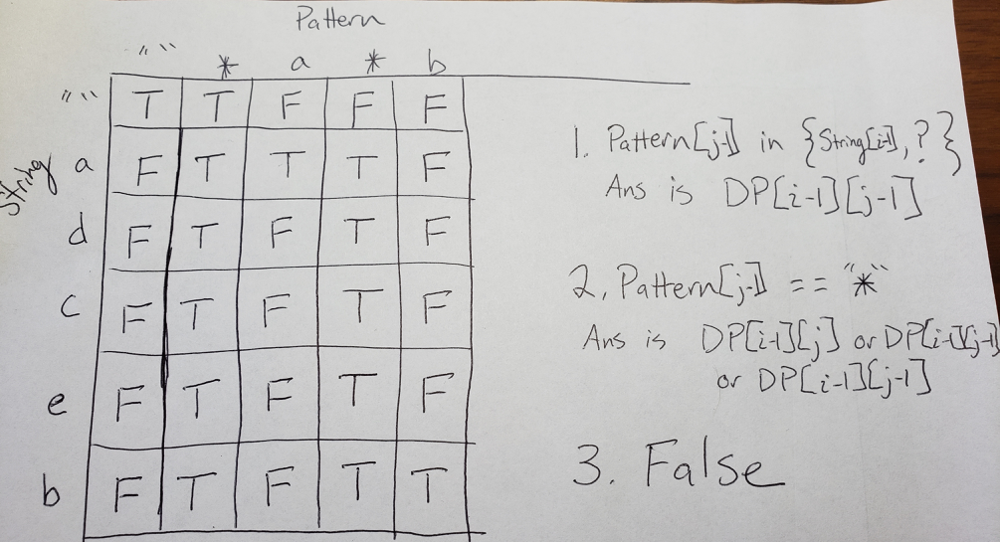

# Python DP with illustration

**Author:** etherealoptimist
**Votes:** 147
**Link:** [https://leetcode.com/problems/wildcard-matching/solutions/256025/](https://leetcode.com/problems/wildcard-matching/solutions/256025/)

---

I had to look at other solutions for the top row, we set values to true until a non "*" character is found
```
class Solution:
    def isMatch(self, s, p):
        dp = [[False for _ in range(len(p)+1)] for i in range(len(s)+1)]
        dp[0][0] = True
        for j in range(1, len(p)+1):
            if p[j-1] != '*':
                break
            dp[0][j] = True
                
        for i in range(1, len(s)+1):
            for j in range(1, len(p)+1):
                if p[j-1] in {s[i-1], '?'}:
                    dp[i][j] = dp[i-1][j-1]
                elif p[j-1] == '*':
                    dp[i][j] = dp[i-1][j] or dp[i][j-1]
        return dp[-1][-1]
```

