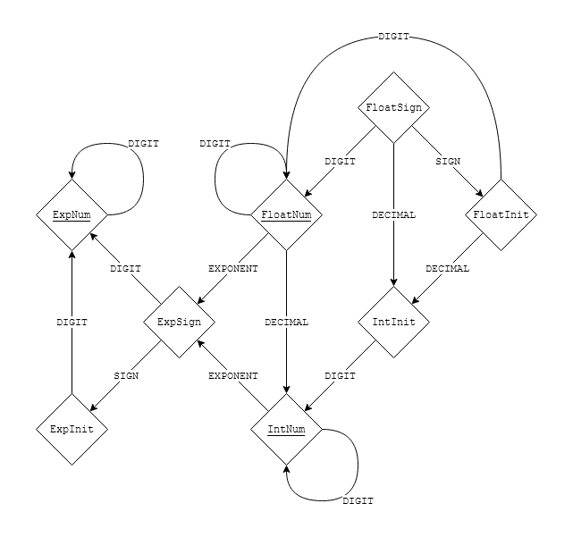

# Finite State Machine

**Author:** Lindelt
**Votes:** 6
**Link:** [https://leetcode.com/problems/valid-number/solutions/3461898/](https://leetcode.com/problems/valid-number/solutions/3461898/)

---

# Approach

Use a state machine to read each character of the input string and transition between states depending upon the read character. Valid transitions produce the next state, while invalid transitions produce an error and cause an early return of `false`.

After all characters in the string have been read, check that the state machine is in a valid ending state for the final result.

# Complexity
- Time complexity:
$$O(n)$$

- Space complexity:
$$O(1)$$

# State Machine Diagram




# Code
```
enum CheckState {
    FloatSign, // ACCEPTS: '+' | '-' | '.' | '0'..='9'
    FloatInit, // ACCEPTS: '.' | '0'..='9'
    FloatNum,  // ACCEPTS: '.' | 'e' | 'E' | '0'..='9'
    IntInit,   // ACCEPTS: '0'..='9'
    IntNum,    // ACCEPTS: 'e' | 'E' | '0'..='9'
    ExpSign,   // ACCEPTS: '+' | '-' | '0'..='9'
    ExpInit,   // ACCEPTS: '0'..='9'
    ExpNum,    // ACCEPTS: '0'..='9'
}

impl CheckState {
    pub fn accept(&self, c: char) -> Result<Self, ()> {
        match (c, self) {
            ('+' | '-', Self::FloatSign) => Ok(Self::FloatInit),
            ('+' | '-', Self::ExpSign) => Ok(Self::ExpInit),
            ('.', Self::FloatSign | Self::FloatInit) => Ok(Self::IntInit),
            ('.', Self::FloatNum) => Ok(Self::IntNum),
            ('e' | 'E', Self::FloatNum | Self::IntNum) => Ok(Self::ExpSign),
            ('0'..='9', Self::FloatSign | Self::FloatInit | Self::FloatNum) => Ok(Self::FloatNum),
            ('0'..='9', Self::IntInit | Self::IntNum) => Ok(Self::IntNum),
            ('0'..='9', Self::ExpSign | Self::ExpInit | Self::ExpNum) => Ok(Self::ExpNum),
            _ => Err(()),
        }
    }

    pub fn is_valid_end_state(&self) -> bool {
        matches!(self, Self::FloatNum | Self::IntNum | Self::ExpNum)
    }
}

impl Solution {
    pub fn is_number(s: String) -> bool {
        let mut state = CheckState::FloatSign;
        for c in s.chars() {
            state = match state.accept(c) {
                Ok(new_state) => new_state,
                Err(()) => return false,
            };
        }
        state.is_valid_end_state()
    }
}
```