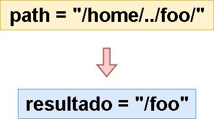
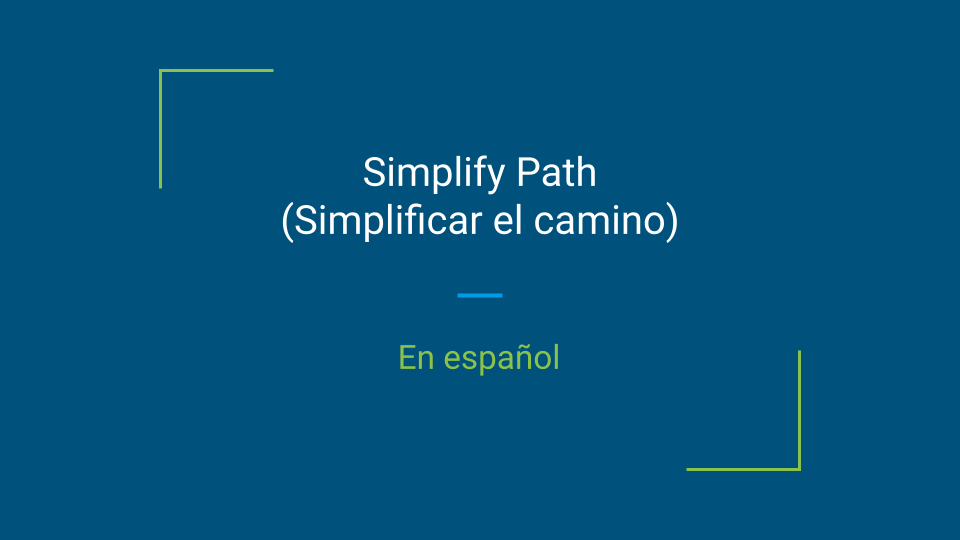
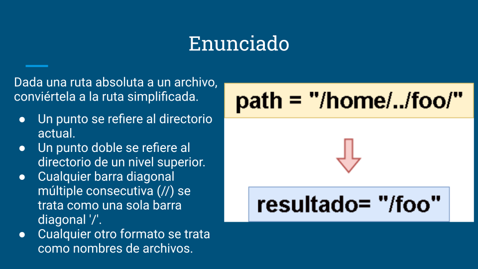
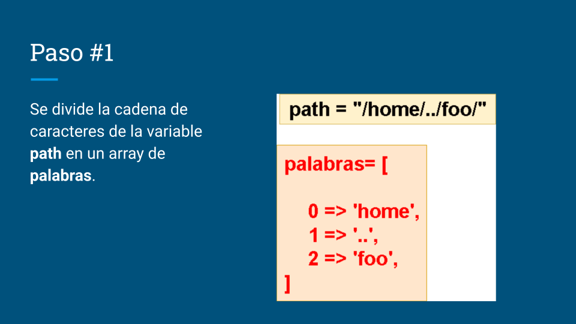
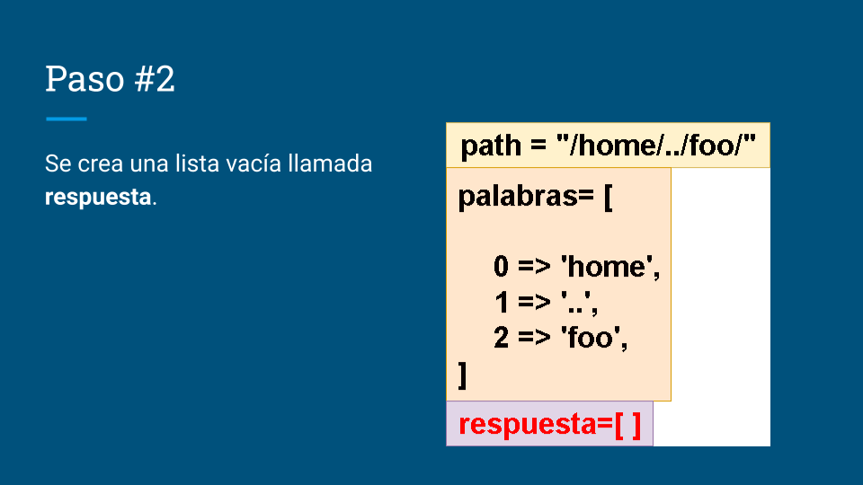
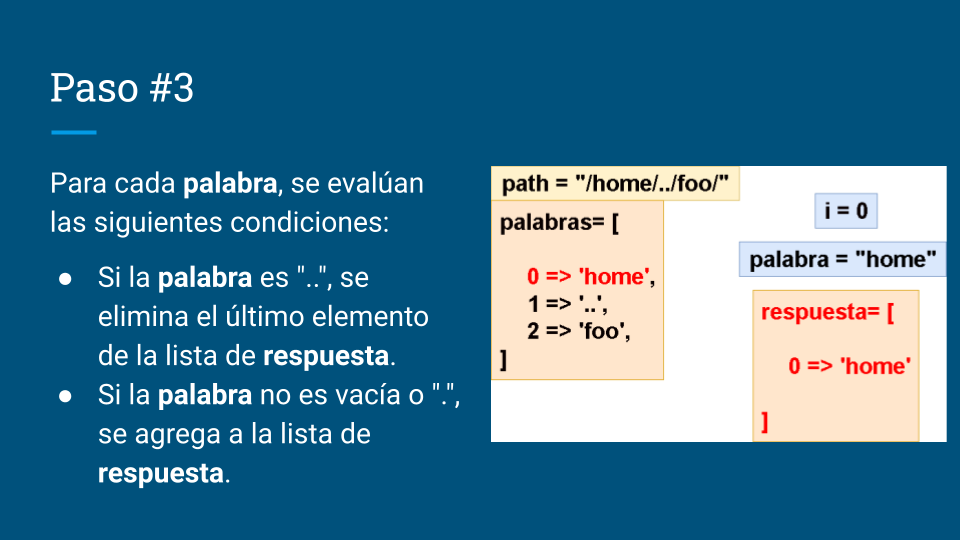
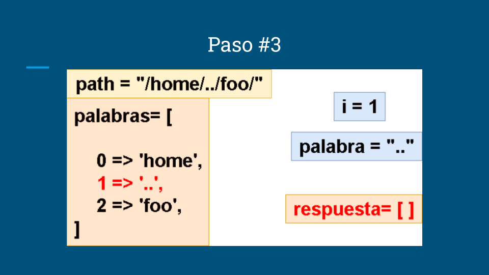
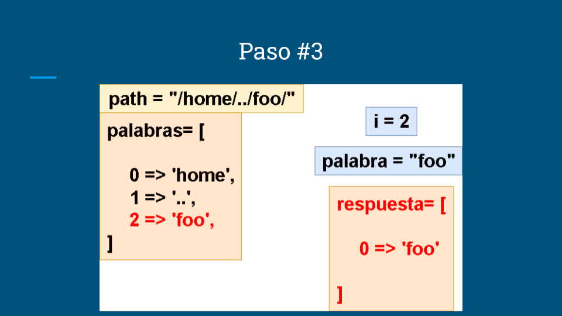
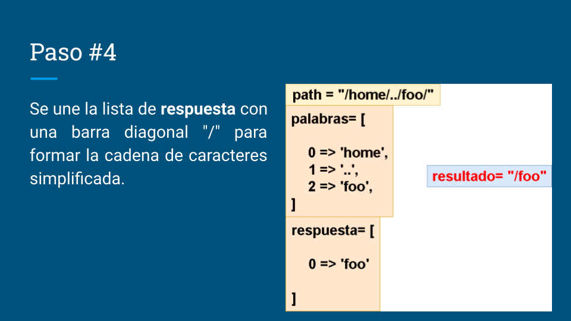

# 🔥🔥 Explicación y Resolución Del Ejercicio En Español Java | Python | PHP  | JavaScript  🔥🔥

**Author:** hermescoder02
**Votes:** 5
**Link:** [https://leetcode.com/problems/simplify-path/solutions/4363307/](https://leetcode.com/problems/simplify-path/solutions/4363307/)

---

# Lectura
*simplificar el camino(Java, Python, PHP, Javascript)*

Dada una ruta absoluta a un archivo, convi\xE9rtela a la ruta simplificada.
- Un punto se refiere al directorio actual.
- Un punto doble se refiere al directorio de un nivel superior. 
- Cualquier barra diagonal m\xFAltiple consecutiva (//) se trata como una sola barra diagonal '/'. 
- Cualquier otro formato se trata como nombres de archivos.




# Video

https://youtu.be/-GYCMMavvCc?si=Sr34Jejn0mqnhnAU

Si te gust\xF3 el contenido \xA1te invito a suscribirte!:
\u2705https://www.youtube.com/@hermescoder?sub_confirmation=1

# Pasos para realizar el algoritmo:

**1.-** Se divide la cadena de caracteres de la variable path en un array de palabras.
        
**2.-** Se crea una lista vac\xEDa llamada respuesta.

**3.-** Para cada palabra, se eval\xFAan las siguientes condiciones:

\u2705 **Si la palabra es ".."**, se elimina el \xFAltimo elemento de la lista de respuesta.

\u2705 **Si la palabra no es vac\xEDa o "."**, se agrega a la lista de respuesta.

**4.-** Se une la lista de respuesta con una barra diagonal "/" para formar la cadena de caracteres simplificada.


# C\xF3digo 

```Java []
public class Solution {
    public String simplifyPath(String path) {
        //paso#1
        String[] palabras = path.split("/");
 
        //paso#2
        List<String> respuesta = new ArrayList<>();
 
        //paso#3
        for (String palabra : palabras) {
            //paso#3.1
            if (palabra.equals("..")) {
                if (!respuesta.isEmpty())  
                    respuesta.remove(respuesta.size() - 1);
                continue;
            }
 
             //paso#3.2
            if (!palabra.equals("") && !palabra.equals(".")) {
                respuesta.add(palabra);
            }
        }
 
        //paso#4
        return "/" + String.join("/", respuesta);
    }
}
```
```Python []
class Solution(object):
    def simplifyPath(self, path):
         # Paso #1
        palabras = path.split("/")
 
        # Paso #2
        respuesta = []
 
        # Paso #3
        for palabra in palabras:
            # Paso #3.1
            if palabra == "..":
                if respuesta:
                    respuesta.pop()
                continue
 
            # Paso #3.2
            if palabra != "" and palabra != ".":
                respuesta.append(palabra)
 
        # Paso #4
        return "/" + "/".join(respuesta)
```
```PHP []
class Solution
{
    public function simplifyPath($path)
    {
        // Paso #1
        $palabras = explode('/', $path);
 
        // Paso #2
        $respuesta = [];
 
        // Paso #3
        foreach ($palabras as $palabra) {
            // Paso #3.1
            if ($palabra === '..') {
                if (!empty($respuesta)) {
                    array_pop($respuesta);
                }
                continue;
            }
 
            // Paso #3.2
            if ($palabra !== '' && $palabra !== '.') {
                $respuesta[] = $palabra;
            }
        }
 
        // Paso #4
        return '/' . implode('/', $respuesta);
    }
}
```
```JavaScript []
/**
 * @param {string} path
 * @return {string}
 */
var simplifyPath = function(path) {
    // Paso #1
  const palabras = path.split("/");
 
  // Paso #2
  const respuesta = [];
 
  // Paso #3
  for (const palabra of palabras) {
    // Paso #3.1
    if (palabra === "..") {
      if (!respuesta.length) {
        continue;
      }
      respuesta.pop();
      continue;
    }
 
    // Paso #3.2
    if (palabra !== "" && palabra !== ".") {
      respuesta.push(palabra);
    }
  }
 
  // Paso #4
  return "/" + respuesta.join("/");
};
```


# Imagenes de la Explicaci\xF3n
















