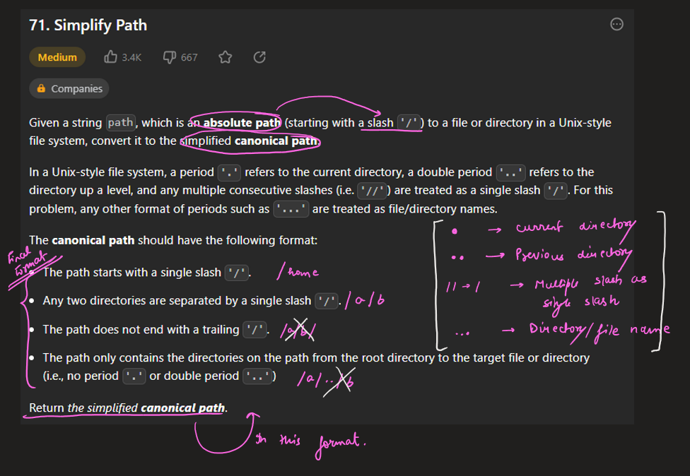
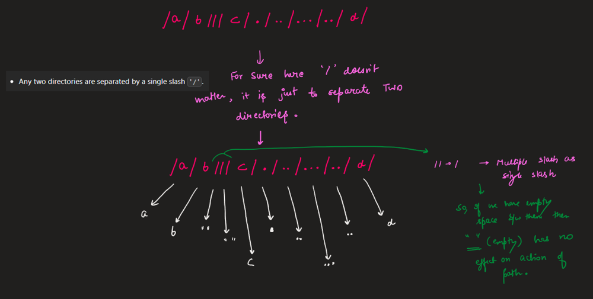
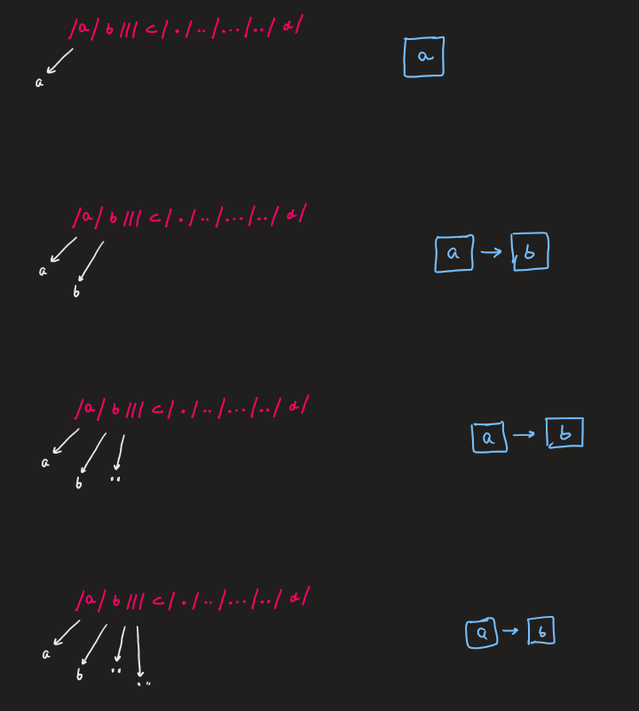
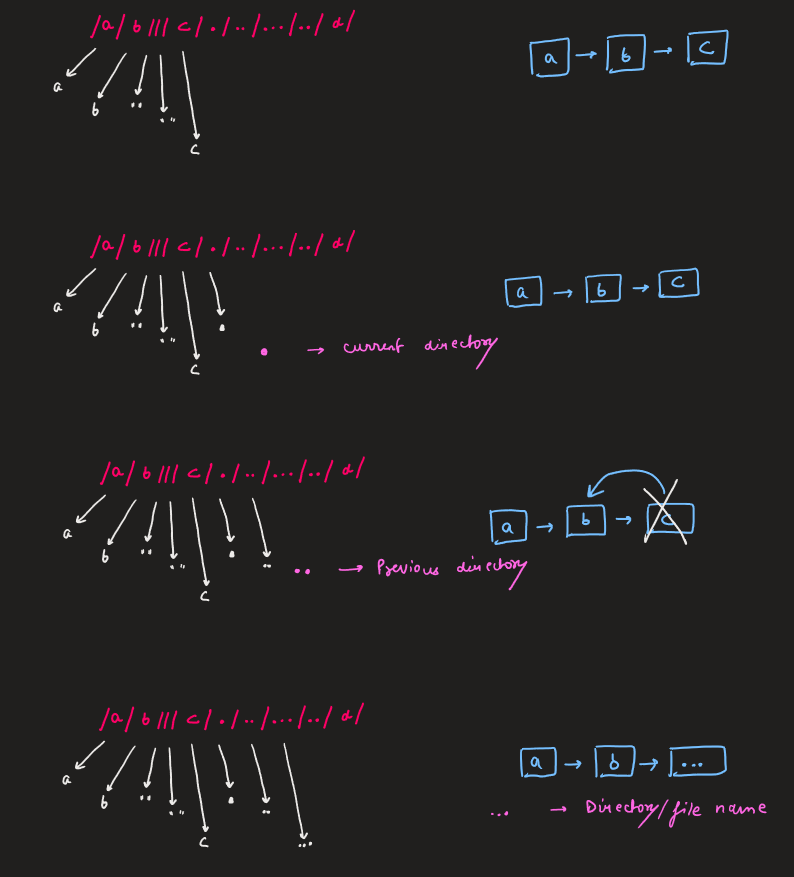
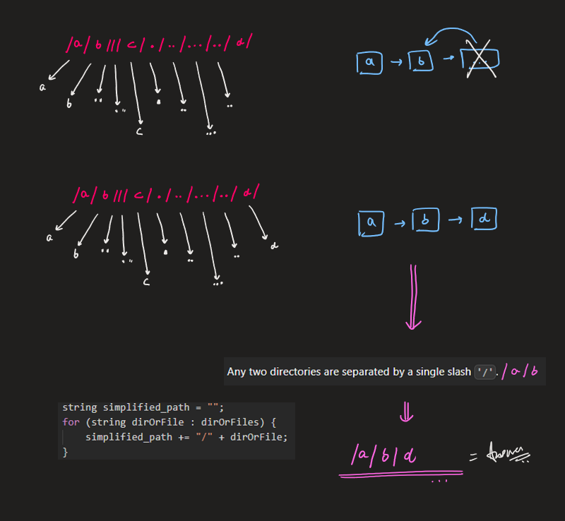
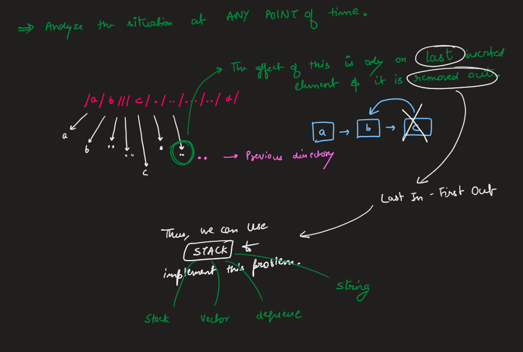
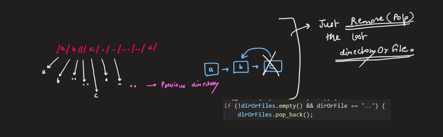
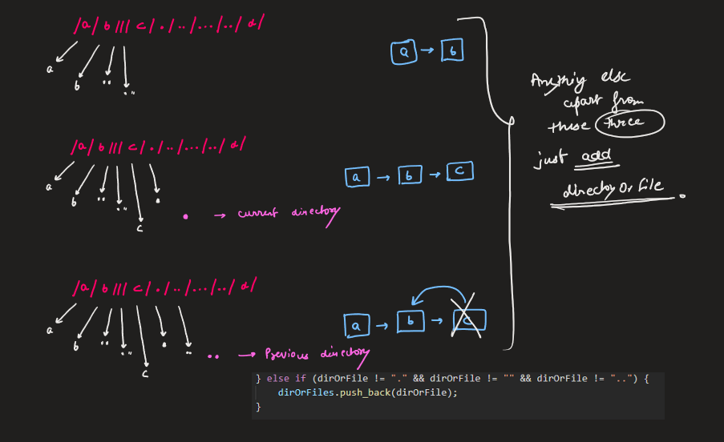
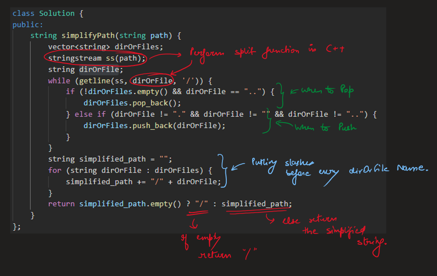
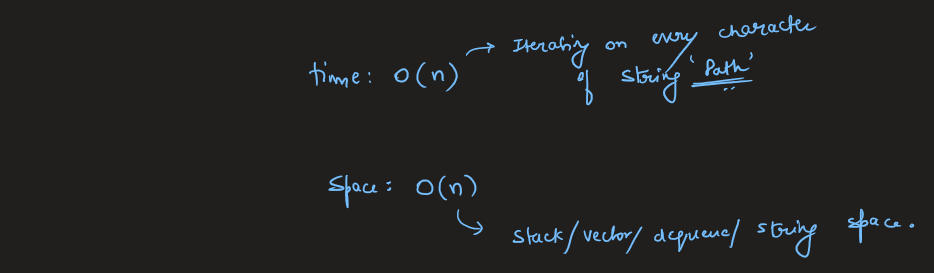

# Image Explanation🏆- [Simple, Easy & Concise - Stack] - C++/Java/Python

**Author:** aryan_0077
**Votes:** 92
**Link:** [https://leetcode.com/problems/simplify-path/solutions/3406788/](https://leetcode.com/problems/simplify-path/solutions/3406788/)

---

# Video Solution (`Aryan Mittal`) - Link in LeetCode Profile
`Simplify Path` by `Aryan Mittal`


# Approach & Intution












# Code
```C++ []
class Solution {
public:
    string simplifyPath(string path) {
        vector<string> dirOrFiles;
        stringstream ss(path);
        string dirOrFile;
        while (getline(ss, dirOrFile, '/')) {
            if (!dirOrFiles.empty() && dirOrFile == "..") {
                dirOrFiles.pop_back();
            } else if (dirOrFile != "." && dirOrFile != "" && dirOrFile != "..") {
                dirOrFiles.push_back(dirOrFile);
            }
        }
        string simplified_path = "";
        for (string dirOrFile : dirOrFiles) {
            simplified_path += "/" + dirOrFile;
        }
        return simplified_path.empty() ? "/" : simplified_path;
    }
};
```
```Java []
class Solution {
    public String simplifyPath(String path) {
        Deque<String> dirOrFiles = new ArrayDeque<>();
        for (String dirOrFile : path.split("/")) {
            if (!dirOrFiles.isEmpty() && dirOrFile.equals("..")) {
                dirOrFiles.removeLast();
            } else if (!dirOrFile.equals(".") && !dirOrFile.equals("") && !dirOrFile.equals("..")) {
                dirOrFiles.addLast(dirOrFile);
            }
        }
        StringBuilder simplified_path = new StringBuilder();
        for (String dirOrFile : dirOrFiles) {
            simplified_path.append("/").append(dirOrFile);
        }
        return simplified_path.length() == 0 ? "/" : simplified_path.toString();
    }
}
```
```Python []
class Solution:
    def simplifyPath(self, path):
        dirOrFiles = []
        path = path.split("/")
        for elem in path:
            if dirOrFiles and elem == "..":
                dirOrFiles.pop()
            elif elem not in [".", "", ".."]:
                dirOrFiles.append(elem)
                
        return "/" + "/".join(dirOrFiles)
```
