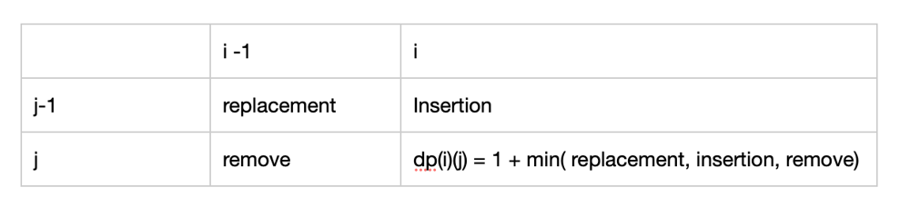
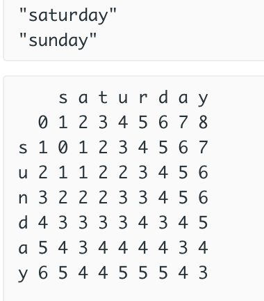

# scala: dp with explaination

**Author:** ccd9
**Votes:** 3
**Link:** [https://leetcode.com/problems/edit-distance/solutions/942465/](https://leetcode.com/problems/edit-distance/solutions/942465/)

---

Highly recommend watching the video in advance, and you don't need to read the following :)
* Edit Distance Between 2 Strings - The Levenshtein Distance ("Edit Distance" on LeetCode) https://www.youtube.com/watch?v=MiqoA-yF-0M


**Thought**
* Dynamic programming
	* state definition
		* two dimension dp(i)(j)
			* dp(i)(j) represents the minimum edit distance from the length i substring from word1 to the length j substring from word2
			*  i for word1
			*  j for word2
			*  ex:
				*  input: word1 : \u201Chorse\u201D, word2: "ros"
					*  dp(3)(2) means  the minimum distance that transforming \u201Chor\u201D  to  \u201Cro"
					
	* state transition
		* sub problem definition
            * dp(i)(j) could be solved by its sub-problem with three operation: replacement, remove and insertion
             * three operation
                  * replacement: dp(i  - 1)(j - 1)
                  * remove: dp(i - 1)(j)
                  * insertion: dp(i)(j - 1\uFF09
              * ex:
                  * input word1: \u201Csaturday\u201D, word2: \u201Csunday"
                      * let i be 5 , j be 4  => dp(i)(j) = dp(5)(4) => **what is the minimum distance transforming sub-word1 \u201Csatur\u201D to sub-word2 \u201Csund\u201D ??**
                           * \u201Csatur\u201D -> \u201Csund"
                       * *Replacement* op ( dp( i -1)(j - 1) )
                           * solve sub-problem dp(4)(3) and then replace \u201Cr" with \u201Cd"
                                * do dp(4)(3) :  \u201Csatu\u201D -> \u201Csun"
                        * *Remove* op ( dp(i -1)(j) )
                            *  remove  "r" from "satur"  and then solve sub-problem dp(4)(j)
                                * do dp(4)(4): \u201Csatu\u201D -> \u201Csund"
                        * *Insertion* op ( dp(i)(j -1) )
                            * solve sub-problem dp(5)(3) and then insert "d" to "sun"
                                * do dp(5)(3): \u201Csatur\u201D -> \u201Csun"


			* Visualization
				* 


		* Two case transformation
			* *Do nothing*  case if word1(i) = word2(j) 
				* dp(i)(j) = dp(i -1) (j - 1)
				* ex:
					*  input word1: \u201Csaturday\u201D, word2: \u201Csunday\u201D
					* solve dp(6)(4):  \u201Csaturd\u201D -> \u201Csund\u201D:
						* solve dp(5)(3) first and then it don\u2019t need any further operation
			* *Do three operations*  case if word1(i) != word2(j)
				* dp(i)(j) =  min { 
				  dp(i -1)(j -1) +  replacement op, 
				  dp(i)(j - 1) + insertion op, 
				  remove op +  dp( i -1)(j)
			 } = **1 + min( dp( i - 1)(j - 1), dp(i)(j -1),  dp(i-1)(j)  )**
			 
* Visualization: Levenshtein Distance table
	* 


**Code**
```
object Solution {
  def minDistance(word1: String, word2: String): Int = {
    val m = word1.length
    val n = word2.length
    /* initial  Levenshtein distance table 
    * dp(i)(j) represents the minimum distance transforming from length i of substring word1 to length j of substring word2
    */
    val dp = Array.tabulate(m + 1, n + 1) {
      case (0, j) => j
      case (i, 0) => i
      case _ => 0
    }


    for (i <- 1 to m; j <- 1 to n) {
      /* i-1 is word1 index, j-1 is word2 index */
      if (word1(i - 1) == word2(j - 1)) {
        // do nothing case
        dp(i)(j) = dp(i - 1)(j - 1)
      } else {
        /**
        *       i-1,    i
        * j-1 replace  insertion     
        *  j   delete  dp(i)(j)
        */
        val replace = dp(i - 1)(j - 1)
        val insert = dp(i)(j - 1)
        val delete = dp(i - 1)(j)
        dp(i)(j) = (replace min insert min delete) + 1
      }
    }
    dp(m)(n)
  }
}
```
* Complexity
    * time complexity: O(MN)
        * we need to fill the M *N table
        * M is the length of word1
        * N is the length of word 2
    * space complexity O(MN)

			 
