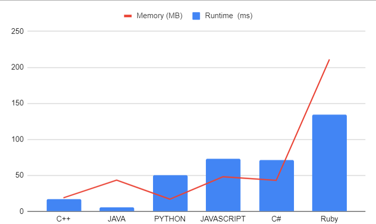

# 🟢 Mastering the Art of String Scrambling: An In-Depth Analysis || Mr. Robot

**Author:** LakshayBrejwal_1_0
**Votes:** 3
**Link:** [https://leetcode.com/problems/scramble-string/solutions/4174691/](https://leetcode.com/problems/scramble-string/solutions/4174691/)

---

# Unraveling the Scrambled String Problem with Dynamic Programming

## Problem Statement

The Scramble String problem presents us with two strings, `s1` and `s2`. We need to determine if `s2` is a scrambled string of `s1`. A scrambled string means that we can split `s1` into two non-empty substrings and swap them to create `s2`.

## Approach : Dynamic Programming 

We'll solve this problem using a top-down dynamic programming approach. Here's a breakdown of our approach:

1. **Base Cases**:
   - If the lengths of `s1` and `s2` are not equal, they can't be scrambled, so we return `false`.
   - If `s1` and `s2` are equal, they are already scrambled, and we return `true`.

2. **Memoization**:
   - We use a memoization map (`dp`) to store intermediate results to avoid redundant calculations. The key for the map is a combination of `s1` and `s2`.

3. **Frequency Check**:
   - We maintain an array `v` to count the frequency of each character in both `s1` and `s2`. If the frequencies do not match, the strings can't be scrambled.

4. **Recursive Scrambling**:
   - We iteratively split `s1` and `s2` at different positions and recursively check if the substrings can be scrambled. We try all possible splits and return `true` if any of them succeeds.

5. **Result Memoization**:
   - We store the final result in our memoization map and return it.


### Dry Run

**Input:**
- `s1 = "great"`
- `s2 = "rgeat"`

We want to determine if `s2` is a scrambled string of `s1`.

1. The lengths of `s1` and `s2` are equal, and they are not the same, so we continue.

2. We initialize the `dp` map and `v`, an array to store character frequencies, which is `[0, 0, 0, 0, 0, 0, 0, 0, 0, 0, 0, 0, 0, 0, 0, 0, 0, 0, 0, 0, 0, 0, 0, 0, 0, 0]` (representing the lowercase English alphabet).

3. We iterate through `s1` and `s2`, updating the character frequencies in `v`:
   - For `s1`, we increment the count for each character.
   - For `s2`, we decrement the count for each character.

   After this loop, `v` remains `[1, -1, 0, 0, 0, 0, 0, 0, 0, 0, 0, 0, 0, 0, 0, 0, 0, 0, 0, 0, 0, 0, 0, 0, 0, 0]`. Since the frequencies are not all zero, we return `false`.

4. In this step, we recursively check different substrings to see if they can be scrambled.

   - We start with `i = 1`:
     - `s1.substr(0, 1)` is "g" and `s2.substr(0, 1)` is "r". We continue recursively, but the frequencies are not the same, so we return `false`.
     - We also check for "reat" and "geat," but they also return `false`.

   - Next, we consider `i = 2`:
     - `s1.substr(0, 2)` is "gr" and `s2.substr(0, 2)` is "rg". We continue recursively, and both substrings return `true`.

   - We continue to check "eat" and "eat," which return `true`.

5. We have found a valid scramble, so we set `res` to `true` and return `true`.

The final result for this input is `true`, indicating that "rgeat" can be scrambled from "great."

### Edge Cases

1. **Empty Strings:**

   **Input:**
   - `s1 = ""`
   - `s2 = ""`

   **Explanation:**
   Both strings are empty, and they are equal. The result should be `true`.

2. **Different Lengths:**

   **Input:**
   - `s1 = "abc"`
   - `s2 = "defg"`

   **Explanation:**
   The lengths of `s1` and `s2` are different. The result should be `false`.

3. **Equal Strings:**

   **Input:**
   - `s1 = "hello"`
   - `s2 = "hello"`

   **Explanation:**
   Both strings are equal. The result should be `true`.

4. **Complex Scramble:**

   **Input:**
   - `s1 = "great"`
   - `s2 = "gtaer"`

   **Explanation:**
   This input is not a simple reversal. It's a more complex scramble. The result should be `true`.

These edge cases cover scenarios where the strings can be equal, have different lengths, or require more complex scrambling.

## Code Implementation

```cpp []
class Solution
{
public:
    unordered_map<string, bool> dp;

    bool isScramble(string s1, string s2)
    {
        // Base Cases
        if (s1.size() != s2.size()) return false;
        if (s1 == s2) return true;

        // Memoization
        if (dp.find(s1 + s2) != dp.end()) return dp[s1 + s2];

        bool res = false;
        vector<int> v(26, 0);

        // Frequency Check
        for (int i = 0; i < s1.size(); i++)
        {
            v[s1[i] - 'a']++;
            v[s2[i] - 'a']--;
        }

        for (int i = 0; i < 26; i++)
            if (v[i] != 0) return dp[s1 + s2] = false;

        // Recursive Scrambling
        for (int i = 1; i < s1.size(); i++)
        {
            res = res || (isScramble(s1.substr(0, i), s2.substr(0, i)) 
                && isScramble(s1.substr(i), s2.substr(i)));

            res = res || (isScramble(s1.substr(0, i), s2.substr(s1.size() - i)) 
                && isScramble(s1.substr(i), s2.substr(0, s1.size() - i)));
        }
        return dp[s1 + s2] = res;
    }
};
```


```java []
import java.util.HashMap;
import java.util.Map;

public class Solution {
    private Map<String, Boolean> dp = new HashMap<>();

    public boolean isScramble(String s1, String s2) {
        if (s1.length() != s2.length())
            return false;
        if (s1.equals(s2))
            return true;
        if (dp.containsKey(s1 + s2))
            return dp.get(s1 + s2);

        boolean res = false;
        int[] v = new int[26];
        for (int i = 0; i < s1.length(); i++) {
            v[s1.charAt(i) - 'a']++;
            v[s2.charAt(i) - 'a']--;
        }
        for (int i = 0; i < 26; i++) {
            if (v[i] != 0) {
                dp.put(s1 + s2, false);
                return false;
            }
        }
        for (int i = 1; i < s1.length(); i++) {
            res = res || (isScramble(s1.substring(0, i), s2.substring(0, i)) && isScramble(s1.substring(i), s2.substring(i)));
            res = res || (isScramble(s1.substring(0, i), s2.substring(s1.length() - i)) && isScramble(s1.substring(i), s2.substring(0, s1.length() - i)));
        }
        dp.put(s1 + s2, res);
        return res;
    }
}
```


```python []
class Solution:
    def isScramble(self, s1: str, s2: str) -> bool:
        dp = {}
        
        def isScrambleHelper(s1: str, s2: str) -> bool:
            if s1 == s2:
                return True
            if (s1, s2) in dp:
                return dp[(s1, s2)]
            
            if sorted(s1) != sorted(s2):
                dp[(s1, s2)] = False
                return False
            
            for i in range(1, len(s1)):
                if (isScrambleHelper(s1[:i], s2[:i]) and isScrambleHelper(s1[i:], s2[i:])) or (isScrambleHelper(s1[:i], s2[-i:]) and isScrambleHelper(s1[i:], s2[:-i])):
                    dp[(s1, s2)] = True
                    return True
            dp[(s1, s2)] = False
            return False
        
        return isScrambleHelper(s1, s2)
```


```javascript []
/**
 * @param {string} s1
 * @param {string} s2
 * @return {boolean}
 */
var isScramble = function(s1, s2) {
    let dp = new Map();
    
    function isScrambleHelper(s1, s2) {
        if (s1 === s2) {
            return true;
        }
        if (dp.has(s1 + s2)) {
            return dp.get(s1 + s2);
        }
        
        if (s1.split('').sort().join('') !== s2.split('').sort().join('')) {
            dp.set(s1 + s2, false);
            return false;
        }
        
        for (let i = 1; i < s1.length; i++) {
            if ((isScrambleHelper(s1.substring(0, i), s2.substring(0, i)) && isScrambleHelper(s1.substring(i), s2.substring(i))) ||
                (isScrambleHelper(s1.substring(0, i), s2.substring(s1.length - i)) && isScrambleHelper(s1.substring(i), s2.substring(0, s1.length - i)))) {
                dp.set(s1 + s2, true);
                return true;
            }
        }
        dp.set(s1 + s2, false);
        return false;
    }
    
    return isScrambleHelper(s1, s2);
};
```


```csharp []
using System.Collections.Generic;

public class Solution {
    private Dictionary<string, bool> dp = new Dictionary<string, bool>();

    public bool IsScramble(string s1, string s2) {
        if (s1.Length != s2.Length)
            return false;
        if (s1 == s2)
            return true;
        if (dp.ContainsKey(s1 + s2))
            return dp[s1 + s2];

        bool res = false;
        int[] v = new int[26];
        for (int i = 0; i < s1.Length; i++) {
            v[s1[i] - 'a']++;
            v[s2[i] - 'a']--;
        }
        for (int i = 0; i < 26; i++) {
            if (v[i] != 0) {
                dp[s1 + s2] = false;
                return false;
            }
        }
        for (int i = 1; i < s1.Length; i++) {
            res = res || (IsScramble(s1.Substring(0, i), s2.Substring(0, i)) && IsScramble(s1.Substring(i), s2.Substring(i)));
            res = res || (IsScramble(s1.Substring(0, i), s2.Substring(s1.Length - i)) && IsScramble(s1.Substring(i), s2.Substring(0, s1.Length - i)));
        }
        dp[s1 + s2] = res;
        return res;
    }
}
```

```ruby []
# @param {String} s1
# @param {String} s2
# @return {Boolean}
def is_scramble(s1, s2)
    dp = {}
    
    def is_scramble_helper(s1, s2, dp)
        return true if s1 == s2
        return dp[[s1, s2]] if dp.include?([s1, s2])
        
        return false if s1.chars.sort.join != s2.chars.sort.join
        
        res = false
        for i in 1...s1.length
            if (is_scramble_helper(s1[0...i], s2[0...i], dp) && is_scramble_helper(s1[i...s1.length], s2[i...s2.length], dp)) || 
               (is_scramble_helper(s1[0...i], s2[s1.length - i...s2.length], dp) && is_scramble_helper(s1[i...s1.length], s2[0...s1.length - i], dp))
                res = true
                break
            end
        end
        
        dp[[s1, s2]] = res
        return res
    end
    
    is_scramble_helper(s1, s2, dp)
end
```

---
## Analysis



| Language     | Runtime (ms) | Memory (MB) |
|--------------|--------------|-------------|
| C++          | 17           | 18.9        |
| Java         | 6            | 43.5        |
| Python       | 50           | 17          |
| JavaScript   | 73           | 48.1        |
| C#           | 71           | 43.1        |
| Ruby         | 134          | 211         |


---

# Consider UPVOTING\u2B06\uFE0F


# DROP YOUR SUGGESTIONS IN THE COMMENT

## Keep Coding\uD83E\uDDD1\u200D\uD83D\uDCBB

 -- *MR.ROBOT SIGNING OFF*
