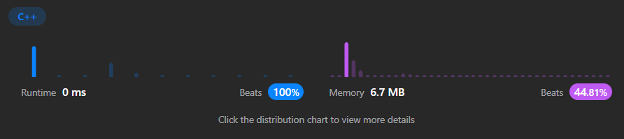
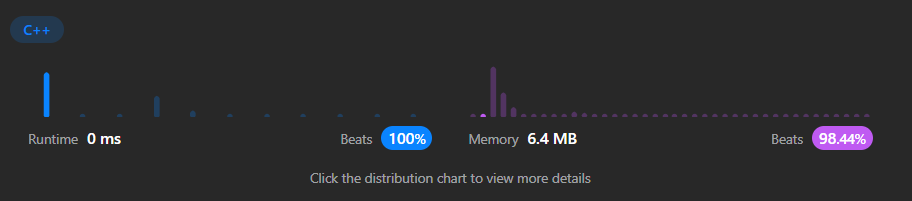

# ✅Beats 100% - DP- C++, JAVA, Python, JavaScript || Easiest Solutions with explanation || 3-Approach

**Author:** Vivekkrsk
**Votes:** 15
**Link:** [https://leetcode.com/problems/decode-ways/solutions/4454073/](https://leetcode.com/problems/decode-ways/solutions/4454073/)

---

# **Please Upvote If It Is Helpfull**
---
# 2nd Approach




---

---
# 3rd Approach



---


# Intuition
<!-- Describe your first thoughts on how to solve this problem. -->
**Key Idea:**
   - The code breaks down the problem into smaller subproblems and leverages dynamic programming to avoid redundant calculations, leading to an efficient solution.

# Approach
<!-- Describe your approach to solving the problem. -->

1. **Dynamic Programming:**
   - The code uses bottom-up dynamic programming to efficiently count the decoding combinations.
   - It builds up the solution from smaller subproblems to avoid redundant calculations.

2. **Helper Function for Validity:**
   - `isValid(code, len)` checks if a given code (single digit or two-digit) represents a valid letter (1-26).

3. **Recursive Function for Counting Decodings:**
   - `countOfDecoding(i, s, dp)` recursively calculates the number of decoding combinations possible from index `i` in the string `s`:
     - **Base Cases:**
       - If `i` reaches the end of the string, return 1 (one valid decoding).
       - If the current decoding result is already calculated (`dp[i] != -1`), return the stored value.
     - **Recursion:**
       - If the current character is valid (`isValid(s[i] - '0', 1)`):
         - Add the decoding combinations by considering it as a single letter (`dp[i] += countOfDecoding(i + 1, s, dp)`).
       - If the next two characters form a valid two-digit code (`i < s.length() - 1 && isValid((s[i] - '0') * 10 + s[i + 1] - '0', 2)`):
         - Add the decoding combinations by considering them as a two-letter code (`dp[i] += countOfDecoding(i + 2, s, dp)`).
       - Store the calculated result in `dp[i]` and return it.

4. **Main Function for Initialization and Final Result:**
   - `numDecodings(s)` initializes a `dp` array to store intermediate results and calls `countOfDecoding` from the beginning of the string.
   - It returns the final count of decoding combinations stored in `dp[0]`.


# Complexity

**Time and Space Complexity:**
   - **Time Complexity:** O(n), where n is the length of the string. Each index is visited once, and the work done at each index is constant.
   - **Space Complexity:** O(n), primarily due to the `dp` array used to store intermediate results.


```C++ []
class Solution {
    bool isValid(int code, int len){
        if(len==1) return code>=1 && code<=26;
        return code>=10&&code<=26;
    }

    int countOfDecoding(int i, string& s,vector<int>& dp){
        if(i>=s.length()) return 1;
        if(dp[i]!=-1) return dp[i];
        dp[i]=0;
        if(isValid(s[i]-'0',1)){
            dp[i]+=countOfDecoding(i+1,s,dp);
        }
        if(i<s.length()-1 && isValid((s[i]-'0')*10 +s[i+1]-'0',2)){
            dp[i]+=countOfDecoding(i+2,s,dp);
        }

        return dp[i];
    }
public:
    int numDecodings(string s) {
        vector<int> dp(s.length(),-1);
        return countOfDecoding(0,s,dp);
    }
};

```
```JAVA []
public class Solution {
    public boolean isValid(int code, int len) {
        if (len == 1) {
            return code >= 1 && code <= 26;
        } else {
            return code >= 10 && code <= 26;
        }
    }

    public int countOfDecoding(int i, String s, int[] dp) {
        if (i >= s.length()) {
            return 1;
        }
        if (dp[i] != -1) {
            return dp[i];
        }
        dp[i] = 0;
        if (isValid(s.charAt(i) - '0', 1)) {
            dp[i] += countOfDecoding(i + 1, s, dp);
        }
        if (i < s.length() - 1 && isValid((s.charAt(i) - '0') * 10 + s.charAt(i + 1) - '0', 2)) {
            dp[i] += countOfDecoding(i + 2, s, dp);
        }
        return dp[i];
    }

    public int numDecodings(String s) {
        int[] dp = new int[s.length()];
        Arrays.fill(dp, -1);
        return countOfDecoding(0, s, dp);
    }
}


```
```python []
def isValid(code, len):
    if len == 1:
        return 1 <= code <= 26
    else:
        return 10 <= code <= 26

def countOfDecoding(i, s, dp):
    if i >= len(s):
        return 1
    if dp[i] != -1:
        return dp[i]
    dp[i] = 0
    if isValid(ord(s[i]) - ord('0'), 1):
        dp[i] += countOfDecoding(i + 1, s, dp)
    if i < len(s) - 1 and isValid(int(s[i:i+2]), 2):
        dp[i] += countOfDecoding(i + 2, s, dp)
    return dp[i]

def numDecodings(s):
    dp = [-1] * len(s)
    return countOfDecoding(0, s, dp)


```
```javascript []
function isValid(code, len) {
    if (len === 1) {
        return code >= 1 && code <= 26;
    } else {
        return code >= 10 && code <= 26;
    }
}

function countOfDecoding(i, s, dp) {
    if (i >= s.length) {
        return 1;
    }
    if (dp[i] !== -1) {
        return dp[i];
    }
    dp[i] = 0;
    if (isValid(parseInt(s[i]), 1)) {
        dp[i] += countOfDecoding(i + 1, s, dp);
    }
    if (i < s.length - 1 && isValid(parseInt(s.substring(i, i + 2)), 2)) {
        dp[i] += countOfDecoding(i + 2, s, dp);
    }
    return dp[i];
}

function numDecodings(s) {
    const dp = new Array(s.length).fill(-1);
    return countOfDecoding(0, s, dp);
}

```
```ruby []
def is_valid(code, len)
    (len == 1 && (1..26).include?(code)) ||
    (len == 2 && (10..26).include?(code))
end

def count_of_decoding(i, s, dp)
    return 1 if i >= s.length
    return dp[i] if dp[i] != -1
    dp[i] = 0
    dp[i] += count_of_decoding(i + 1, s, dp) if is_valid(s[i].to_i - 48, 1)
    dp[i] += count_of_decoding(i + 2, s, dp) if i < s.length - 1 && is_valid(s[i..i+1].to_i, 2)
    dp[i]
end

def num_decodings(s)
    dp = Array.new(s.length, -1)
    count_of_decoding(0, s, dp)
end


```
```C# []
public bool IsValid(int code, int len) {
    if (len == 1) {
        return code >= 1 && code <= 26;
    } else {
        return code >= 10 && code <= 26;
    }
}

public int CountOfDecoding(int i, string s, int[] dp) {
    if (i >= s.Length) {
        return 1;
    }
    if (dp[i] != -1) {
        return dp[i];
    }
    dp[i] = 0;
    if (IsValid(s[i] - '0', 1)) {
        dp[i] += CountOfDecoding(i + 1, s, dp);
    }
    if (i < s.Length - 1 && IsValid(int.Parse(s.Substring(i, 2)), 2)) {
        dp[i] += CountOfDecoding(i + 2, s, dp);
    }
    return dp[i];
}

public int NumDecodings(string s) {
    int[] dp = new int[s.Length];
    Array.Fill(dp, -1);
    return CountOfDecoding(0, s, dp);
}


```
```Go []
func isValid(code int, len int) bool {
    if len == 1 {
        return code >= 1 && code <= 26
    } else {
        return code >= 10 && code <= 26
    }
}

func countOfDecoding(i int, s string, dp []int) int {
    if i >= len(s) {
        return 1
    }
    if dp[i] != -1 {
        return dp[i]
    }
    dp[i] = 0
    if isValid(int(s[i]) - '0', 1) {
        dp[i] += countOfDecoding(i+1, s, dp)
    }
    if i < len(s)-1 && isValid(int(s[i:i+2]) - '0', 2) {
        dp[i] += countOfDecoding(i+2, s, dp)
    }
    return dp[i]
}

func numDecodings(s string) int {
    dp := make([]int, len(s))
    for i := range dp {
        dp[i] = -1
    }
    return countOfDecoding(0, s, dp)
}


```


# Approach
<!-- Describe your approach to solving the problem. -->


**1. Dynamic Programming:**
   - The code employs dynamic programming to efficiently count decoding combinations.
   - It builds up the solution from smaller subproblems, storing intermediate results for reuse.

**2. Validity Check:**
   - `isValid(code, len)` determines if a given code (single or double digit) represents a valid letter (1-26).

**3. DP Array for Subproblem Solutions:**
   - `dp[i]` stores the number of decoding combinations for the substring `s[0:i]`.
   - It's initialized with `dp[0] = 1` (empty string has one decoding) and `dp[1]` based on the first character's validity.

**4. Building Up Solutions:**
   - The loop iterates from `i = 2` to `n`:
     - If the current character is valid (`isValid(s[i - 1] - '0', 1)`), add the decodings from the previous substring (`dp[i] += dp[i - 1]`).
     - If the previous two characters form a valid code, add the decodings from two characters back (`dp[i] += dp[i - 2]`).

**5. Final Result:**
   - `dp[n]` holds the total number of decoding combinations for the entire string `s`.


# Complexity

**Time and Space Complexity:**
   - **Time Complexity:** O(n), where n is the length of the string. Each index is visited once, and the work done at each index is constant.
   - **Space Complexity:** O(n), primarily due to the `dp` array used to store intermediate results.


```C++ []
class Solution {
    bool isValid(int code, int len){
        if(len==1) return code>=1 && code<=26;
        return code>=10&&code<=26;
    }

public:

   int numDecodings(string s) {
    int n = s.length();
    
    if (n == 0) return 0;
    
    vector<int> dp(n + 1, 0);
    dp[0] = 1;
    dp[1] = (isValid(s[0] - '0', 1)) ? 1 : 0;
    
    for (int i = 2; i <= n; i++) {
        if (isValid(s[i - 1] - '0', 1)) {
            dp[i] += dp[i - 1];
        }
        
        if (isValid((s[i - 2] - '0') * 10 + s[i - 1] - '0', 2)) {
            dp[i] += dp[i - 2];
        }
    }
    
    return dp[n];
}

};

```
```JAVA []
public class Solution {
    public boolean isValid(int code, int len) {
        if (len == 1) {
            return code >= 1 && code <= 26;
        } else {
            return code >= 10 && code <= 26;
        }
    }

    public int numDecodings(String s) {
        int n = s.length();

        if (n == 0) {
            return 0;
        }

        int[] dp = new int[n + 1];
        dp[0] = 1;
        dp[1] = isValid(s.charAt(0) - '0', 1) ? 1 : 0;

        for (int i = 2; i <= n; i++) {
            if (isValid(s.charAt(i - 1) - '0', 1)) {
                dp[i] += dp[i - 1];
            }
            if (isValid((s.charAt(i - 2) - '0') * 10 + s.charAt(i - 1) - '0', 2)) {
                dp[i] += dp[i - 2];
            }
        }

        return dp[n];
    }
}


```
```python []
def isValid(code, len):
    if len == 1:
        return 1 <= code <= 26
    else:
        return 10 <= code <= 26

def numDecodings(s):
    n = len(s)

    if n == 0:
        return 0

    dp = [0] * (n + 1)
    dp[0] = 1
    dp[1] = isValid(ord(s[0]) - ord('0'), 1)

    for i in range(2, n + 1):
        if isValid(ord(s[i - 1]) - ord('0'), 1):
            dp[i] += dp[i - 1]
        if isValid(int(s[i - 2:i]), 2):
            dp[i] += dp[i - 2]

    return dp[n]


```
```javascript []
function isValid(code, len) {
    if (len === 1) {
        return code >= 1 && code <= 26;
    } else {
        return code >= 10 && code <= 26;
    }
}

function numDecodings(s) {
    const n = s.length;

    if (n === 0) {
        return 0;
    }

    const dp = new Array(n + 1).fill(0);
    dp[0] = 1;
    dp[1] = isValid(parseInt(s[0]), 1);

    for (let i = 2; i <= n; i++) {
        if (isValid(parseInt(s[i - 1]), 1)) {
            dp[i] += dp[i - 1];
        }
        if (isValid(parseInt(s.substring(i - 2, i)), 2)) {
            dp[i] += dp[i - 2];
        }
    }

    return dp[n];
}


```
```ruby []
def is_valid(code, len)
    (len == 1 && (1..26).include?(code)) ||
    (len == 2 && (10..26).include?(code))
end

def num_decodings(s)
    n = s.length
    return 0 if n == 0

    dp = Array.new(n + 1, 0)
    dp[0] = 1
    dp[1] = is_valid(s[0].to_i - 48, 1) ? 1 : 0

    for i in 2..n
        dp[i] += dp[i - 1] if is_valid(s[i - 1].to_i - 48, 1)
        dp[i] += dp[i - 2] if is_valid(s[i - 2..i - 1].to_i, 2)
    end

    dp[n]
end


```
```C# []
public bool IsValid(int code, int len) {
    if (len == 1) {
        return code >= 1 && code <= 26;
    } else {
        return code >= 10 && code <= 26;
    }
}

public int NumDecodings(string s) {
    int n = s.Length;
    if (n == 0) {
        return 0;
    }

    int[] dp = new int[n + 1];
    dp[0] = 1;
    dp[1] = IsValid(s[0] - '0', 1) ? 1 : 0;

    for (int i = 2; i <= n; i++) {
        if (IsValid(s[i - 1] - '0', 1)) {
            dp[i] += dp[i - 1];
        }
        if (IsValid(int.Parse(s.Substring(i - 2, 2)), 2)) {
            dp[i] += dp[i - 2];
        }
    }

    return dp[n];
}


```
```Go []
func isValid(code int, len int) bool {
    if len == 1 {
        return code >= 1 && code <= 26
    } else {
        return code >= 10 && code <= 26
    }
}

func numDecodings(s string) int {
    n := len(s)
    if n == 0 {
        return 0
    }

    dp := make([]int, n+1)
    dp[0] = 1
    dp[1] = isValid(int(s[0]) - '0', 1)

    for i := 2; i <= n; i++ {
        if isValid(int(s[i-1]) - '0', 1) {
            dp[i] += dp[i-1]
        }
        if isValid(int(s[i-2:i]) - '0', 2) {
            dp[i] += dp[i-2]
        }
    }

    return dp[n]
}


```

# Approach
<!-- Describe your approach to solving the problem. -->

1. **Dynamic Programming:**
   - The code strategically breaks down the problem into smaller, overlapping subproblems to efficiently count decoding combinations.
   - It stores intermediate results to avoid redundant calculations.

2. **Validity Check:**
   - The `isValid(code, len)` function determines whether a given code (single-digit or double-digit) represents a valid letter (1-26).
   - This ensures only valid decodings are considered.

3. **Iterative Calculation:**
   - Instead of using a full DP array, it uses two variables, `first` and `second`, to track decoding counts for the last two substrings.
   - This optimization reduces memory usage while still maintaining accuracy.

4. **Building Up Solutions:**
   - It iterates through the string, updating `first` and `second` based on valid decoding possibilities:
     - If the current character forms a valid code, it adds `second` to `ans`.
     - If the previous two characters form a valid code, it adds `first` to `ans`.
   - `first` and `second` are shifted for the next iteration.

5. **Final Result:**
   - After processing the entire string, `second` holds the final count of possible decoding combinations.
   - This value is returned as the solution.


# Complexity

**Time and Space Complexity:**
   - **Time Complexity:** O(n), where n is the length of the string. Each index is visited once, and the work done at each index is constant.
   - **Space Complexity:** O(1), primarily due to the `dp` array used to store intermediate results.


```C++ []
class Solution {
    bool isValid(int code, int len){
        if(len==1) return code>=1 && code<=26;
        return code>=10&&code<=26;
    }

public:
int numDecodings(string s) {
        int n = s.length();
        
        if (n == 0) return 0;
        
        
        int first = 1;
        int second = (isValid(s[0] - '0', 1)) ? 1 : 0;
        
        for (int i = 2; i <= n; i++) {
            int ans=0;
            if (isValid(s[i - 1] - '0', 1)) {
                ans += second;
            }
            
            if (isValid((s[i - 2] - '0') * 10 + s[i - 1] - '0', 2)) {
                ans += first;
            }
            first=second;
            second=ans;
        }
        
        return second;
    }

};

```
```JAVA []
public class Solution {
    public boolean isValid(int code, int len) {
        if (len == 1) {
            return code >= 1 && code <= 26;
        } else {
            return code >= 10 && code <= 26;
        }
    }

    public int numDecodings(String s) {
        int n = s.length();

        if (n == 0) {
            return 0;
        }

        int first = 1;
        int second = isValid(s.charAt(0) - '0', 1) ? 1 : 0;

        for (int i = 2; i <= n; i++) {
            int ans = 0;
            if (isValid(s.charAt(i - 1) - '0', 1)) {
                ans += second;
            }
            if (isValid((s.charAt(i - 2) - '0') * 10 + s.charAt(i - 1) - '0', 2)) {
                ans += first;
            }
            first = second;
            second = ans;
        }

        return second;
    }
}

```
```python []
def isValid(code, len):
    if len == 1:
        return 1 <= code <= 26
    else:
        return 10 <= code <= 26

def numDecodings(s):
    n = len(s)

    if n == 0:
        return 0

    dp = [0] * (n + 1)
    dp[0] = 1
    dp[1] = isValid(ord(s[0]) - ord('0'), 1)

    for i in range(2, n + 1):
        if isValid(ord(s[i - 1]) - ord('0'), 1):
            dp[i] += dp[i - 1]
        if isValid(int(s[i - 2:i]), 2):
            dp[i] += dp[i - 2]

    return dp[n]


```
```javascript []
function isValid(code, len) {
    if (len === 1) {
        return code >= 1 && code <= 26;
    } else {
        return code >= 10 && code <= 26;
    }
}

function numDecodings(s) {
    const n = s.length;

    if (n === 0) {
        return 0;
    }

    const dp = new Array(n + 1).fill(0);
    dp[0] = 1;
    dp[1] = isValid(parseInt(s[0]), 1);

    for (let i = 2; i <= n; i++) {
        if (isValid(parseInt(s[i - 1]), 1)) {
            dp[i] += dp[i - 1];
        }
        if (isValid(parseInt(s.substring(i - 2, i)), 2)) {
            dp[i] += dp[i - 2];
        }
    }

    return dp[n];
}


```

---


