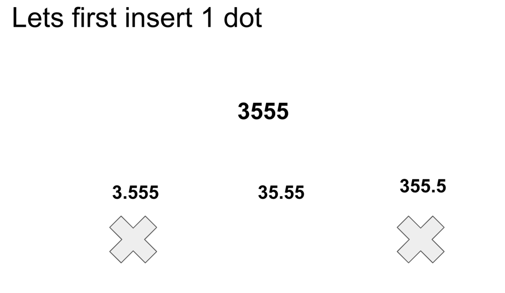
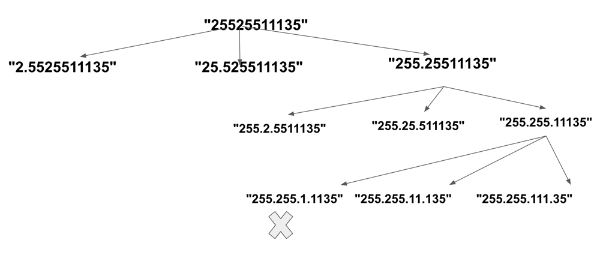

# 🔥Easy Explanation 🔥 with Video and Pics| Java|

**Author:** jeevankumar159
**Votes:** 116
**Link:** [https://leetcode.com/problems/restore-ip-addresses/solutions/3079183/](https://leetcode.com/problems/restore-ip-addresses/solutions/3079183/)

---

# Intuition
<!-- Describe your first thoughts on how to solve this problem. -->


Lets take a very simple scenario where we insert just one dot.
Quick Observation: The length of the string can be 1, 2 or 3 as the range is 0,255.

Once the function has inserted the dot it will verify if the string is valid or not, in the above example 355 is not valid, so we can discard it.

However we have one more invalid case i.e 3.555 The approach we can use here is though we are inserting one dot we will make it to insert 2 dots so that the same function will check the validitity of the second part and remove the last dot from ans.

The same approach goes for 3 dots, at each step add a dot --> generate valid answers and pass it down again. 




# Approach
<!-- Describe your approach to solving the problem. -->
Use an additional input to the function that is index, which says the function where the string starts from, it is as good as forgetting the already dotted part of the string.


Additional Improvement: Check if the string length is greater than 12, than its completely invalid, Similarly if already 2 dots inserted and the remaining string length is 7 its invalid as well.

https://youtu.be/h2HmKNdmZ_c


# Complexity
- Time complexity:
<!-- Add your time complexity here, e.g. $$O(n)$$ -->

- Space complexity:
<!-- Add your space complexity here, e.g. $$O(n)$$ -->

# Code
```
class Solution {
    List<String> ans = new ArrayList<>();
    String str;
    public List<String> restoreIpAddresses(String s) {
        str = s;
        magical("", 0, 0);
        return ans;
    } 

    void magical( String path, int index, int dots) {
        if (dots > 4) return;
        if (dots == 4 && index >= str.length()) {
            ans.add(path.substring(0,path.length()-1));
            return;
        }
        for (int length = 1; length <= 3 && index + length <= str.length(); length++) {
            String num = str.substring(index, index + length);
            if (num.charAt(0) == '0' && length != 1) break;
            else if (Integer.parseInt(num) <= 255) {
                magical( path + str.substring(index, index + length) + ".", index + length,dots + 1);
            }
        }
    }
}
```