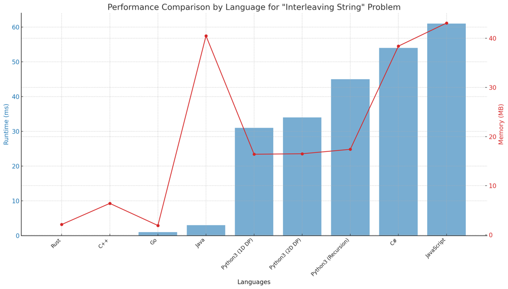

# ✅ 99.78% 2-Approaches DP & Recursion

**Author:** vanAmsen
**Votes:** 342
**Link:** [https://leetcode.com/problems/interleaving-string/solutions/3956393/](https://leetcode.com/problems/interleaving-string/solutions/3956393/)

---

# Interview Guide: "Interleaving String" Problem

## Problem Understanding

In the "Interleaving String" problem, you are given three strings: `s1`, `s2`, and `s3`. Your task is to determine whether `s3` can be formed by interleaving `s1` and `s2`. For example, if `s1 = "aabcc"` and `s2 = "dbbca"`, then `s3 = "aadbbcbcac"` should return `true`, but `s3 = "aadbbbaccc"` should return `false`.

## Key Points to Consider

### 1. Understand the Constraints

Before diving into the solution, make sure you understand the problem's constraints. The lengths of the strings will not be more than 100 for `s1` and `s2`, and not more than 200 for `s3`. This can help you gauge the time complexity you should aim for.

### 2. Multiple Approaches

There are multiple ways to solve this problem, including:

  - 2D Dynamic Programming
  - 1D Dynamic Programming
  - Recursion with Memoization

Each method has its own time and space complexity, so choose based on the problem's constraints.

### 3. Space Optimization

While 2D Dynamic Programming is the most intuitive approach, you can reduce the space complexity to \\(O(\\min(m, n))\\) by employing 1D Dynamic Programming. In an interview setting, discussing this optimization can impress your interviewer.

### 4. Early Exit

If the sum of the lengths of `s1` and `s2` does not match the length of `s3`, you can immediately return `false`. This can save computation time and demonstrate that you're mindful of edge cases.

### 5. Explain Your Thought Process

Always explain your thought process and why you chose a particular approach. Discuss the trade-offs you're making in terms of time and space complexity.

## Conclusion

The "Interleaving String" problem is an excellent example of a problem that can be tackled through Dynamic Programming or Recursion. Knowing the trade-offs between different approaches and optimizing for space can give you an edge in interviews. By taking the time to understand the problem, choosing the appropriate data structures, and optimizing your approach, you'll not only solve the problem but also demonstrate a well-rounded skill set.

---

# Live Coding & Explenation: 1D Dynamic Programming
https://youtu.be/iv_cTwwsRxs

---

# Approach: 2D Dynamic Programming 

To solve the "Interleaving String" problem using 2D Dynamic Programming, we utilize a 2D array `dp[i][j]` to represent whether the substring `s3[:i+j]` can be formed by interleaving `s1[:i]` and `s2[:j]`.

## Key Data Structures:
- **dp**: A 2D list to store the results of subproblems.

## Enhanced Breakdown:

1. **Initialization**:
   - Calculate lengths of `s1`, `s2`, and `s3`.
   - If the sum of lengths of `s1` and `s2` is not equal to the length of `s3`, return false.
   - Initialize the `dp` array with dimensions `(m+1) x (n+1)`, setting `dp[0][0] = True`.
  
2. **Base Cases**:
   - Fill in the first row of `dp` array, considering only the characters from `s1`.
   - Fill in the first column of `dp` array, considering only the characters from `s2`.
   
3. **DP Loop**:
   - Loop through each possible `(i, j)` combination, starting from `(1, 1)`.
   - Update `dp[i][j]` based on the transition `dp[i][j] = (dp[i-1][j] and s1[i-1] == s3[i+j-1]) or (dp[i][j-1] and s2[j-1] == s3[i+j-1])`.

4. **Wrap-up**:
   - Return the value stored in `dp[m][n]`, which indicates whether `s3` can be formed by interleaving `s1` and `s2`.

# Complexity:

**Time Complexity:** 
- The solution iterates over each possible $$ (i, j) $$ combination, leading to a time complexity of $$ O(m \	imes n) $$.

**Space Complexity:** 
- The space complexity is $$ O(m \	imes n) $$ due to the 2D $$ dp $$ array.

---

# Approach: 1D Dynamic Programming 

The optimization from 2D to 1D DP is based on the observation that the state of `dp[i][j]` in the 2D DP array depends only on `dp[i-1][j]` and `dp[i][j-1]`. Therefore, while iterating through the strings, the current state only depends on the states in the previous row of the 2D DP array, which means we can optimize our space complexity by just keeping track of one row (1D DP).

## Key Data Structures:

- **dp**: A 1D list that stores whether the substring `s3[:i+j]` can be formed by interleaving `s1[:i]` and `s2[:j]`. Initially, all values are set to `False` except `dp[0]`, which is set to `True`.

## Enhanced Breakdown:

1. **Initialization**:
   - First, calculate the lengths of `s1`, `s2`, and `s3`.
   - Check if the sum of the lengths of `s1` and `s2` equals the length of `s3`. If it doesn't, return `False` as `s3` cannot be formed by interleaving `s1` and `s2`.

2. **Optimization Check**:
   - If `m < n`, swap `s1` and `s2`. This is to ensure that `s1` is not longer than `s2`, which helps in optimizing the space complexity to `O(min(m, n))`.

3. **Base Cases**:
   - Initialize a 1D array `dp` of length `n+1` with `False`.
   - Set `dp[0] = True` because an empty `s1` and `s2` can interleave to form an empty `s3`.

4. **Single-Row DP Transition**:
   - Iterate through `s1` and `s2` to update the `dp` array.
   - For each character in `s1`, iterate through `s2` and update the `dp` array based on the transition rule: `dp[j] = (dp[j] and s1[i] == s3[i+j]) or (dp[j-1] and s2[j] == s3[i+j])`.
   - The transition rule checks if the current `s3[i+j]` can be matched by either `s1[i]` or `s2[j]`, relying solely on the previous values in the `dp` array.

5. **Wrap-up**:
   - The final value in the `dp` array will indicate whether the entire `s3` can be formed by interleaving `s1` and `s2`.
   - Return `dp[n]`.


# Complexity:

The primary advantage of this 1D DP approach is its space efficiency. While it maintains the same time complexity as the 2D DP approach $$O(m \	imes n)$$, the space complexity is optimized to $$O(\\min(m, n))$$.

**Time Complexity:** 
- The solution iterates over each character of `s1` and `s2` once, leading to a complexity of $$O(m \	imes n)$$.

**Space Complexity:** 
- The space complexity is optimized to $$O(\\min(m,n))$$ as we're only using a single 1D array instead of a 2D matrix.

---

# Approach: Recursion with Memoization

In this approach, we recursively check whether the substring `s3[k:]` can be formed by interleaving `s1[i:]` and `s2[j:]`. We store the results of these sub-problems in a dictionary named `memo`.

## Key Data Structures:
- **memo**: A dictionary to store the results of subproblems.

## Enhanced Breakdown:

1. **Initialization**:
   - Calculate lengths of `s1`, `s2`, and `s3`.
   - If the sum of lengths of `s1` and `s2` is not equal to the length of `s3`, return false.
   
2. **Recursive Function**:
   - Define a recursive function `helper` which takes indices `i`, `j`, and `k` as inputs.
   - The function checks whether the substring `s3[k:]` can be formed by interleaving `s1[i:]` and `s2[j:]`.
   - Store the result of each subproblem in the `memo` dictionary.

3. **Wrap-up**:
   - Return the result of the recursive function for the initial values `i=0, j=0, k=0`.

# Complexity:

**Time Complexity:** 
- Each combination of (i, j) is computed once and stored in the memo, leading to a time complexity of $$O(m \	imes n)$$.

**Space Complexity:** 
- The space complexity is $$O(m \	imes n)$$ for storing the memoization results.

---

# Performance

| Language  | Runtime (ms) | Memory (MB) |
|-----------|--------------|-------------|
| Rust      | 0            | 2.1         |
| C++       | 0            | 6.4         |
| Go        | 1            | 1.9         |
| Java      | 3            | 40.5        |
| Python3 (1D DP) | 31     | 16.4        |
| Python3 (2D DP) | 34     | 16.5        |
| Python3 (Recursion) | 45 | 17.4        |
| C#        | 54           | 38.4        |
| JavaScript| 61           | 43.1        |



# Code 1D Dynamic Programming 
``` Python []
class Solution:
    def isInterleave(self, s1: str, s2: str, s3: str) -> bool:
        m, n, l = len(s1), len(s2), len(s3)
        if m + n != l:
            return False
        
        if m < n:
            return self.isInterleave(s2, s1, s3)
        
        dp = [False] * (n + 1)
        dp[0] = True
        
        for j in range(1, n + 1):
            dp[j] = dp[j-1] and s2[j-1] == s3[j-1]
        
        for i in range(1, m + 1):
            dp[0] = dp[0] and s1[i-1] == s3[i-1]
            for j in range(1, n + 1):
                dp[j] = (dp[j] and s1[i-1] == s3[i+j-1]) or (dp[j-1] and s2[j-1] == s3[i+j-1])
        
        return dp[n]
```
``` C++ []
class Solution {
public:
    bool isInterleave(string s1, string s2, string s3) {
        int m = s1.length(), n = s2.length(), l = s3.length();
        if (m + n != l) return false;
        
        if (m < n) return isInterleave(s2, s1, s3);

        vector<bool> dp(n + 1, false);
        dp[0] = true;

        for (int j = 1; j <= n; ++j) {
            dp[j] = dp[j - 1] && s2[j - 1] == s3[j - 1];
        }

        for (int i = 1; i <= m; ++i) {
            dp[0] = dp[0] && s1[i - 1] == s3[i - 1];
            for (int j = 1; j <= n; ++j) {
                dp[j] = (dp[j] && s1[i - 1] == s3[i + j - 1]) || (dp[j - 1] && s2[j - 1] == s3[i + j - 1]);
            }
        }
        
        return dp[n];
    }
};
```
``` Java []
public class Solution {
    public boolean isInterleave(String s1, String s2, String s3) {
        int m = s1.length(), n = s2.length(), l = s3.length();
        if (m + n != l) return false;

        boolean[] dp = new boolean[n + 1];
        dp[0] = true;

        for (int j = 1; j <= n; ++j) {
            dp[j] = dp[j - 1] && s2.charAt(j - 1) == s3.charAt(j - 1);
        }

        for (int i = 1; i <= m; ++i) {
            dp[0] = dp[0] && s1.charAt(i - 1) == s3.charAt(i - 1);
            for (int j = 1; j <= n; ++j) {
                dp[j] = (dp[j] && s1.charAt(i - 1) == s3.charAt(i + j - 1)) || (dp[j - 1] && s2.charAt(j - 1) == s3.charAt(i + j - 1));
            }
        }
        
        return dp[n];
    }
}
```
``` Rust []
impl Solution {
    pub fn is_interleave(s1: String, s2: String, s3: String) -> bool {
        let (m, n, l) = (s1.len(), s2.len(), s3.len());
        if m + n != l { return false; }

        let (s1, s2, s3) = (s1.as_bytes(), s2.as_bytes(), s3.as_bytes());
        let mut dp = vec![false; n + 1];
        dp[0] = true;

        for j in 1..=n {
            dp[j] = dp[j - 1] && s2[j - 1] == s3[j - 1];
        }

        for i in 1..=m {
            dp[0] = dp[0] && s1[i - 1] == s3[i - 1];
            for j in 1..=n {
                dp[j] = (dp[j] && s1[i - 1] == s3[i + j - 1]) || (dp[j - 1] && s2[j - 1] == s3[i + j - 1]);
            }
        }
        
        dp[n]
    }
}
```
``` Go []
func isInterleave(s1 string, s2 string, s3 string) bool {
    m, n, l := len(s1), len(s2), len(s3)
    if m + n != l {
        return false
    }

    dp := make([]bool, n+1)
    dp[0] = true

    for j := 1; j <= n; j++ {
        dp[j] = dp[j-1] && s2[j-1] == s3[j-1]
    }

    for i := 1; i <= m; i++ {
        dp[0] = dp[0] && s1[i-1] == s3[i-1]
        for j := 1; j <= n; j++ {
            dp[j] = (dp[j] && s1[i-1] == s3[i+j-1]) || (dp[j-1] && s2[j-1] == s3[i+j-1])
        }
    }
    
    return dp[n]
}
```
``` C# []
public class Solution {
    public bool IsInterleave(string s1, string s2, string s3) {
        int m = s1.Length, n = s2.Length, l = s3.Length;
        if (m + n != l) return false;

        bool[] dp = new bool[n + 1];
        dp[0] = true;

        for (int j = 1; j <= n; ++j) {
            dp[j] = dp[j - 1] && s2[j - 1] == s3[j - 1];
        }

        for (int i = 1; i <= m; ++i) {
            dp[0] = dp[0] && s1[i - 1] == s3[i - 1];
            for (int j = 1; j <= n; ++j) {
                dp[j] = (dp[j] && s1[i - 1] == s3[i + j - 1]) || (dp[j - 1] && s2[j - 1] == s3[i + j - 1]);
            }
        }
        
        return dp[n];
    }
}
```
``` JavaScript []
/**
 * @param {string} s1
 * @param {string} s2
 * @param {string} s3
 * @return {boolean}
 */
var isInterleave = function(s1, s2, s3) {
    let m = s1.length, n = s2.length, l = s3.length;
    if (m + n !== l) return false;

    let dp = new Array(n + 1).fill(false);
    dp[0] = true;

    for (let j = 1; j <= n; ++j) {
        dp[j] = dp[j - 1] && s2[j - 1] === s3[j - 1];
    }

    for (let i = 1; i <= m; ++i) {
        dp[0] = dp[0] && s1[i - 1] === s3[i - 1];
        for (let j = 1; j <= n; ++j) {
            dp[j] = (dp[j] && s1[i - 1] === s3[i + j - 1]) || (dp[j - 1] && s2[j - 1] === s3[i + j - 1]);
        }
    }
    
    return dp[n];
};
```

# Code 2D Dynamic Programming 
``` Python []
class Solution:
    def isInterleave(self, s1: str, s2: str, s3: str) -> bool:
        m, n, l = len(s1), len(s2), len(s3)
        if m + n != l:
            return False
        
        dp = [[False] * (n + 1) for _ in range(m + 1)]
        dp[0][0] = True
        
        for i in range(1, m + 1):
            dp[i][0] = dp[i-1][0] and s1[i-1] == s3[i-1]
        
        for j in range(1, n + 1):
            dp[0][j] = dp[0][j-1] and s2[j-1] == s3[j-1]
        
        for i in range(1, m + 1):
            for j in range(1, n + 1):
                dp[i][j] = (dp[i-1][j] and s1[i-1] == s3[i+j-1]) or (dp[i][j-1] and s2[j-1] == s3[i+j-1])
        
        return dp[m][n]

```
# Code Recursion with Memoization
``` Python []
class Solution:
    def isInterleave(self, s1: str, s2: str, s3: str) -> bool:
        m, n, l = len(s1), len(s2), len(s3)
        if m + n != l:
            return False
        
        memo = {} 
        
        def helper(i: int, j: int, k: int) -> bool:
            if k == l:
                return True
            
            if (i, j) in memo:
                return memo[(i, j)]
            
            ans = False
            if i < m and s1[i] == s3[k]:
                ans = ans or helper(i + 1, j, k + 1)
                
            if j < n and s2[j] == s3[k]:
                ans = ans or helper(i, j + 1, k + 1)
            
            memo[(i, j)] = ans
            return ans
        
        return helper(0, 0, 0)
```

Both the given approaches provide efficient ways to solve the problem, with the first approach focusing on optimizing space and the second leveraging the power of memoization to save time. Choosing between them depends on the specific constraints and requirements of the application. \uD83D\uDCA1\uD83C\uDF20\uD83D\uDC69\u200D\uD83D\uDCBB\uD83D\uDC68\u200D\uD83D\uDCBB