# C++ Solution with notes and image Explanation

**Author:** lucayan0506
**Votes:** 85
**Link:** [https://leetcode.com/problems/distinct-subsequences/solutions/1472953/](https://leetcode.com/problems/distinct-subsequences/solutions/1472953/)

---

Ex. `s = "rabbbit", t = "rabbit"`
* where the index is -1 is the "space" that I leave for default value. Of course, since we can't set a vector with index -1 I move all 1 index ahead (so when in the image we have `i = -1 in`, in the coding `i = 0`). To have explained it better, in the below explaination when I say `i = 0`  I mean` i` of the image
* we have these default value for the first line and first value of each line (to avoid error)

* We check if  `t[0] == s[0]`. Since `t[0] = s[0]` dp = 0 + 1 (we take the value from cells that I circle with a green line). 
It means that there is 1 way to have `t[0`] from `s[0]`
 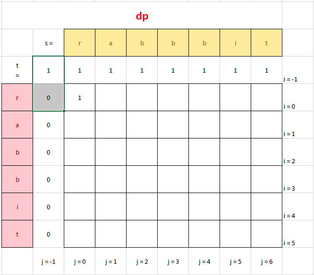
* We check if  `t[0] == s[1]`. Since `t[0] != s[1]` dp = 1 (we take the value from cells that I circle with a green line).
 It means that there isn't a new way to get t[o], so just save n. of ways that we have previously (so j - 1)

 * same for all the line
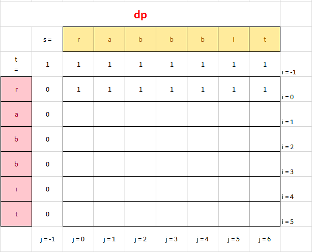
* We check if  `t[1] == s[0]`. Since `t[1] != s[0]` dp = 0 (we take the value from cells that I circle with a green line).
It means that for now (string from s[0] to s[0]) there isn't any way to get a string equal to the string (from t[0] + [1])
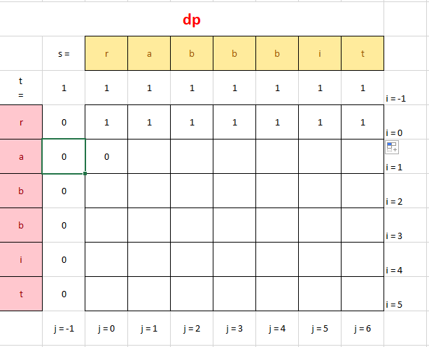
* We check if  `t[1] == s[1]`. Since `t[1] != s[1]` dp = 1 (we take the value from cells that I circle with a green line).
 It means that there is 1 way to get the string (t[0] + t[1]), we take the value from `dp[i-1][j-1] + dp[i][j-1]`
 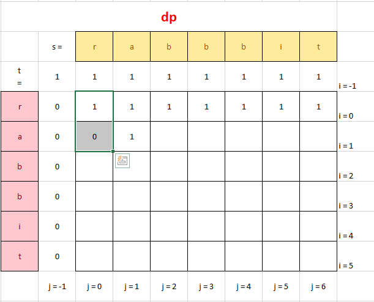
* we don't have `t[1] = s[next index, so next i]` anymore, so just take value from previous dp (`dp[i][j-1]`)
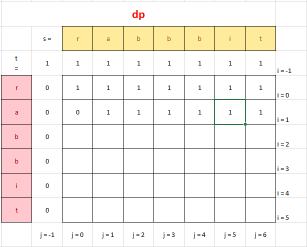
* We check if  `t[2] == s[0]`. Since `t[2] != s[0]` dp = 0 (we take the value from cells that I circle with a green line).
It means that for now (string from s[0] to s[0]) there isn't any way to get a string equal to the string (from t[0] + [2])
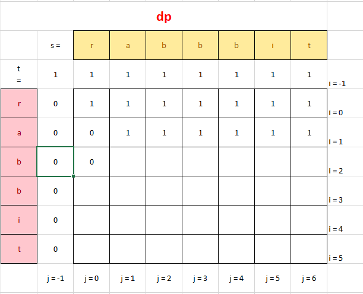
* We check if  `t[2] == s[1]`. Since `t[2] != s[1]` dp = 0 (we take the value from cells that I circle with a green line).
It means that for now (string from s[0] to s[1]) there isn't any new way to get a string equal to the string (from t[0] + [2]), so we keep previous dp (`dp[i][j-1]` which is equal to 0)

* We check if  `t[2] == s[2]`. Since `t[2] = s[2]` dp = 1 (we take the value from cells that I circle with a green line).
It means that for now (string from s[0] to s[2]) there is a new way to get a string equal to the string (from t[0] + [2])
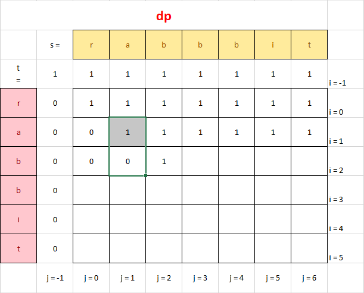
* We check if  `t[2] == s[3]`. Since `t[2] = s[3]` dp = 2 (we take the value from cells that I circle with a green line).
It means that for now (string from s[0] to s[3]) there is another way to get a string equal to the string (from t[0] + [2])
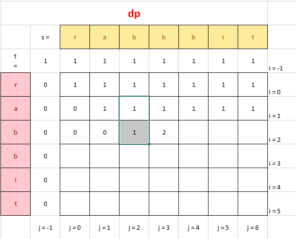
* We check if  `t[2] == s[4]`. Since `t[2] = s[4]` dp = 3(we take the value from cells that I circle with a green line).
It means that for now (string from s[0] to s[4]) there is another way to get a string equal to the string (from t[0] + [2])
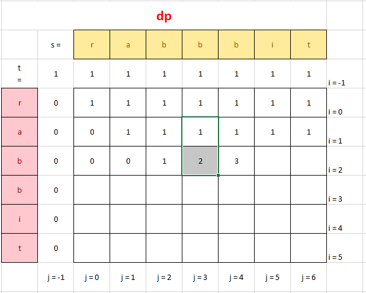
* We check if  `t[2] == s[5]` and `t[2] == s[6]`. Since `t[2] != s[5]` and `t[2] != s[6]` dp = 3(we take the value from cells that I circle with a green line).
It means that for now (string from s[0] to s[6]) there isn't any new way to get a string equal to the string (from t[0] + [2]), so just save the previous dp(`dp[i][j-1]`)
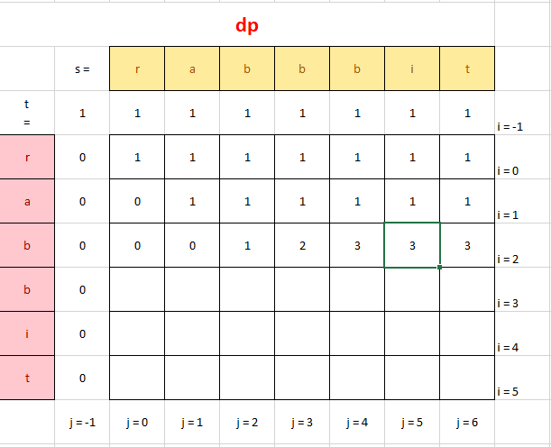
* We check if  `t[3] == s[0]`. Since `t[3] != s[0]` dp = 0 (we take the value from cells that I circle with a green line).
It means that for now (string from s[0] to s[0]) there isn't any way to get a string equal to the string (from t[0] + [3])
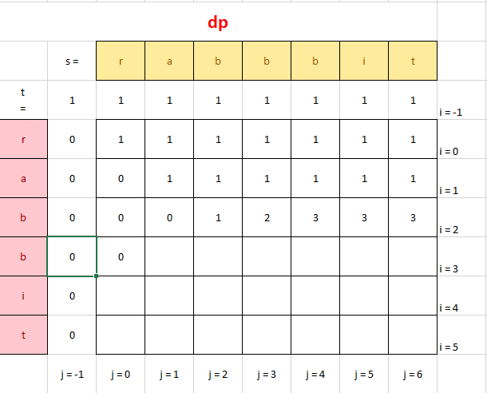
* We check if  `t[3] == s[1]`. Since `t[3] != s[1]` dp = 0 (we take the value from cells that I circle with a green line).
It means that for now (string from s[0] to s[1]) there isn't any new way to get a string equal to the string (from t[0] + [3]), so we keep previous dp (`dp[i][j-1]` which is equal to 0)
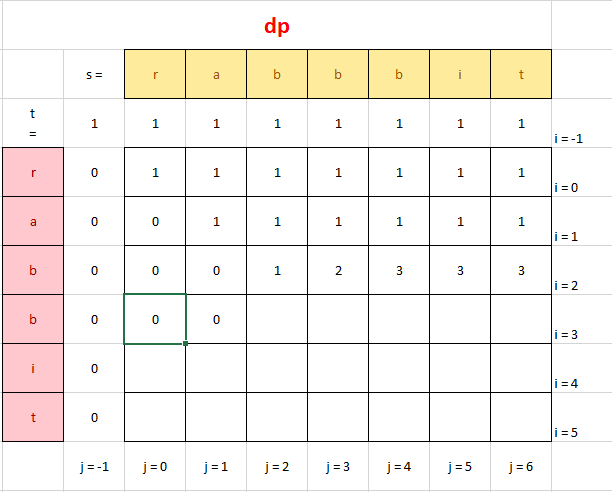
* We check if  `t[3] == s[2]`. Since `t[3] = s[2]`, but when we look at `dp[i-1][j-1]` we see that it's equal = 0 (it means that there isn't any way to get the string from t[0] t[i-1]) so dp = 0 (we take the value from cells that I circle with a green line).
It means that for now (string from s[0] to s[2]) even if t[3] = s[2] we still don't have any way to get a string equal to the string (from t[0] + [3])  because in `dp[i-1][j-1]` = 0
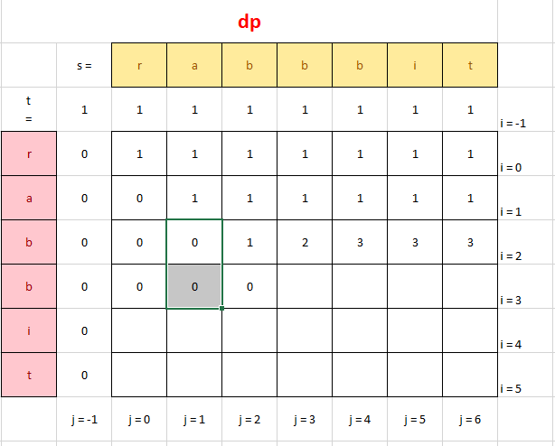
* We check if  `t[3] == s[3]`. Since `t[3] = s[3]` dp = 1 (we take the value from cells that I circle with a green line).
It means that for now (string from s[0] to s[3]) there is a way to get a string equal to the string (from t[0] + [3])
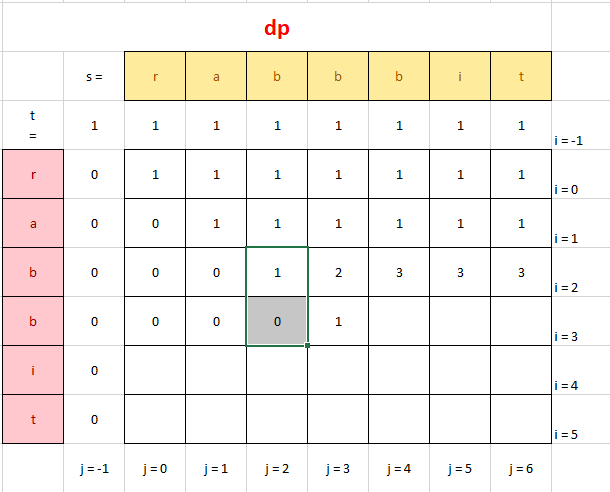
* We check if  `t[3] == s[4]`. Since `t[3] = s[4]` dp = 3(we take the value from cells that I circle with a green line).
It means that for now (string from s[0] to s[4]) there is 3 ways to get a string equal to the string (from t[0] + [3])
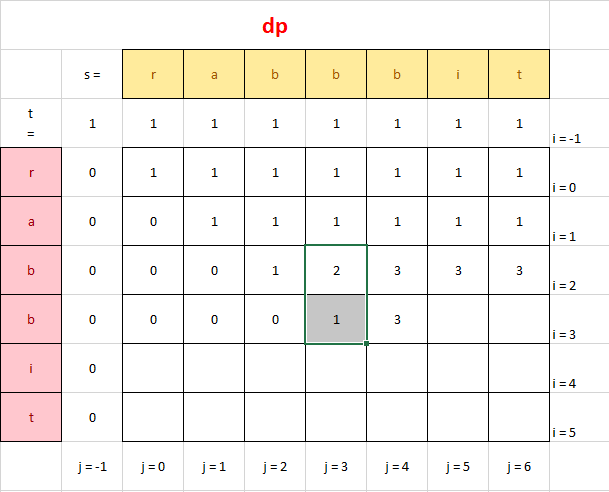
* We check if  `t[3] == s[5]` and `t[3] == s[6]`. Since `t[3] != s[5]` and `t[3] != s[6]` dp = 3(we take the value from cells that I circle with a green line).
It means that for now (string from s[0] to s[6]) there isn't any new way to get a string equal to the string (from t[0] + [3]), so just save the previous dp(`dp[i][j-1]`)
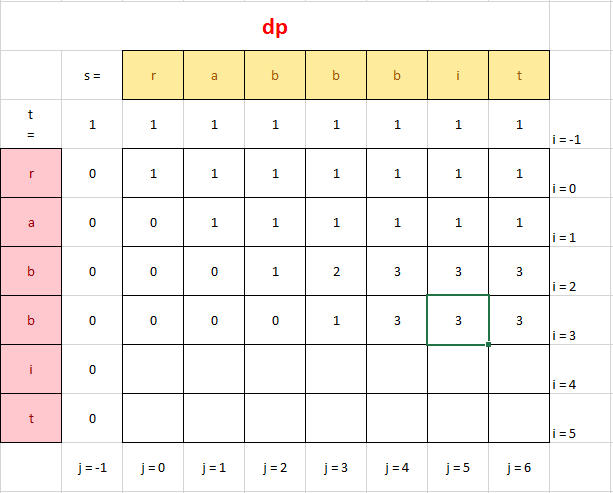
*continue with this logic for t[4], so we have dp = 3 when we calculate for  **t[4] and s[5]** 
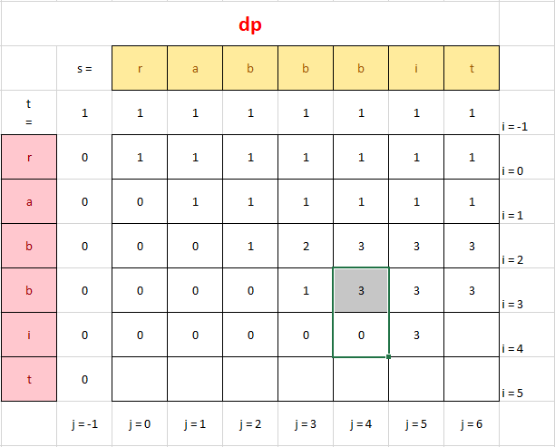
* for  **t[4] and s[6]** we have dp = 3
 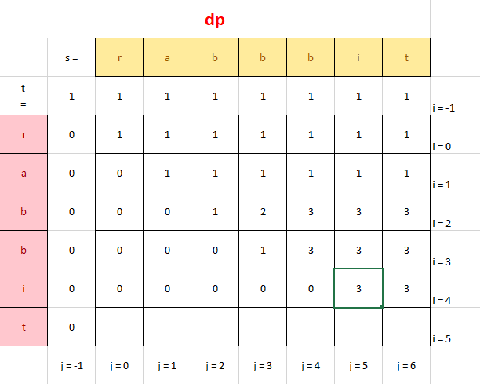
* continue with this logic for t[5] and the last value is the answer
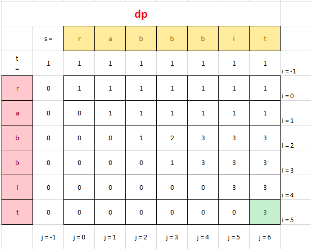


 


```
class Solution {
public:
    int numDistinct(string s, string t) {
	//we use unsigned int because there is a case with a quite large data
        vector<vector<unsigned int>> dp(t.size() + 1, vector<unsigned int>(s.size() + 1));
        
		//set as default value of  the first line as 1
        for (int j = 0; j <= s.size(); j++)dp[0][j] = 1;

//logic of the loop is above
        for (int i = 1; i <= t.size(); i++) {
            for (int j = 1; j <= s.size(); j++) {

					if (t[i - 1] == s[j - 1]) {
                    dp[i][j] = dp[i - 1][j - 1] + dp[i][j - 1];
                }
                else {
                    dp[i][j] = dp[i][j - 1];
                }
            }
        }
        return dp[dp.size() - 1][dp[0].size() - 1];
    }
};
```