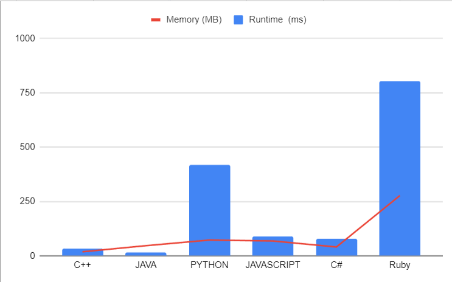

# 🔥Optimizing String Subsequence Counting: A Deep Dive into All 3 Approaches || Mr. Robot

**Author:** LakshayBrejwal_1_0
**Votes:** 13
**Link:** [https://leetcode.com/problems/distinct-subsequences/solutions/4177156/](https://leetcode.com/problems/distinct-subsequences/solutions/4177156/)

---

# Solving the "Distinct Subsequences" Problem: 

## \u2753Understanding the Problem 

The "Distinct Subsequences" problem involves two strings, `s` and `t`, and the goal is to find the number of distinct subsequences of `t` in the string `s`. A subsequence is a sequence of characters that appears in the same order in both strings, but not necessarily consecutively.

For example, given `s = "rabbbit"` and `t = "rabbit"`, there are three distinct subsequences: "rabbit," "rabb**i**t," and "rab**b**bit."

## \uD83D\uDCA1Recursive Approach

We'll start by defining a recursive function that explores all possible subsequences of `s` to match `t`. Here's the code for the recursive function:

**Complexity Analysis**:

- **\u231B**Time Complexity: The time complexity of the recursive approach is O(2^n) in the worst case, where `n` is the length of string `s`. This is because, for each character in `s`, we make two recursive calls (take or not take).

- Space Complexity: The space complexity is O(n) for the recursive call stack.

## \uD83D\uDCDDDry Run

Let's dry run the code with an example:

- `s = "rabbbit"` and `t = "rabbit"`

1. We start with `s_ind = 0` and `t_ind = 0`. Since the characters match, we explore both taking and not taking the character.
   - Taking the character: Move to the next characters in `s` and `t`.
   - Not taking the character: Move to the next character in `s`.

2. This process continues until we reach the base cases, and we accumulate the count of valid subsequences.

3. In the end, we return the total count.

## Edge Cases

Consider the following edge cases:
1. Empty strings: What happens when `s` or `t` is an empty string?
2. No match: What if there are no subsequences that match `t` in `s`?

By considering these edge cases, we ensure our solution is robust and handles all scenarios.


---
# \uD83E\uDDD1\uD83C\uDFFB\u200D\uD83D\uDCBBCode : Recursive Approach

```cpp []
class Solution {
public:
    int recursiveWithoutMemoization(string& s, string& t, int s_ind, int t_ind) {
        if (t_ind == t.length()) {
            return 1;
        }

        if (s_ind == s.length()) {
            return 0;
        }

        int take = 0, notTake = 0;

        if (s[s_ind] == t[t_ind]) {
            take = recursiveWithoutMemoization(s, t, s_ind + 1, t_ind + 1);
        }

        notTake = recursiveWithoutMemoization(s, t, s_ind + 1, t_ind);

        return take + notTake;
    }

    int numDistinct(string s, string t) {
        return recursiveWithoutMemoization(s, t, 0, 0);
    }
};
```
```python []
class Solution:
    def recursiveWithoutMemoization(self, s: str, t: str, s_ind: int, t_ind: int) -> int:
        if t_ind == len(t):
            return 1
        if s_ind == len(s):
            return 0

        take, notTake = 0, 0

        if s[s_ind] == t[t_ind]:
            take = self.recursiveWithoutMemoization(s, t, s_ind + 1, t_ind + 1)

        notTake = self.recursiveWithoutMemoization(s, t, s_ind + 1, t_ind)

        return take + notTake

    def numDistinct(self, s: str, t: str) -> int:
        return self.recursiveWithoutMemoization(s, t, 0, 0)
```


```java []
class Solution {
    public int recursiveWithoutMemoization(String s, String t, int s_ind, int t_ind) {
        if (t_ind == t.length()) {
            return 1;
        }
        if (s_ind == s.length()) {
            return 0;
        }

        int take = 0, notTake = 0;

        if (s.charAt(s_ind) == t.charAt(t_ind)) {
            take = recursiveWithoutMemoization(s, t, s_ind + 1, t_ind + 1);
        }

        notTake = recursiveWithoutMemoization(s, t, s_ind + 1, t_ind);

        return take + notTake;
    }

    public int numDistinct(String s, String t) {
        return recursiveWithoutMemoization(s, t, 0, 0);
    }
}
```


```csharp []
public class Solution {
    public int RecursiveWithoutMemoization(string s, string t, int s_ind, int t_ind) {
        if (t_ind == t.Length) {
            return 1;
        }
        if (s_ind == s.Length) {
            return 0;
        }

        int take = 0, notTake = 0;

        if (s[s_ind] == t[t_ind]) {
            take = RecursiveWithoutMemoization(s, t, s_ind + 1, t_ind + 1);
        }

        notTake = RecursiveWithoutMemoization(s, t, s_ind + 1, t_ind);

        return take + notTake;
    }

    public int NumDistinct(string s, string t) {
        return RecursiveWithoutMemoization(s, t, 0, 0);
    }
}
```


```javascript []
var recursiveWithoutMemoization=function(s, t, s_ind, t_ind) {
        if (t_ind === t.length) {
            return 1;
        }
        if (s_ind === s.length) {
            return 0;
        }

        let take = 0, notTake = 0;

        if (s[s_ind] === t[t_ind]) {
            take =  recursiveWithoutMemoization(s, t, s_ind + 1, t_ind + 1);
        }

        notTake =  recursiveWithoutMemoization(s, t, s_ind + 1, t_ind);

        return take + notTake;
    }

    var numDistinct= function(s, t) {
        return  recursiveWithoutMemoization(s, t, 0, 0);
    }

```


```ruby []
class Solution
  def recursive_without_memoization(s, t, s_ind, t_ind)
    return 1 if t_ind == t.length
    return 0 if s_ind == s.length

    take = 0
    not_take = 0

    if s[s_ind] == t[t_ind]
      take = recursive_without_memoization(s, t, s_ind + 1, t_ind + 1)
    end

    not_take = recursive_without_memoization(s, t, s_ind + 1, t_ind)

    take + not_take
  end

  def num_distinct(s, t)
    recursive_without_memoization(s, t, 0, 0)
  end
end
```

---
---

## \uD83D\uDCA1Approach 2 : Memoization Optimization

Memoization is a technique used to store and reuse the results of expensive function calls to avoid redundant calculations. In the context of our problem, we can create a memoization table to store the results of subproblems. Each entry `dp[i][j]` will represent the number of distinct subsequences of `s` starting from index `i` that form the string `t` starting from index `j`.

We'll modify our recursive function to first check if we have already calculated the result for the current subproblem. If we have, we'll simply return the cached result. If not, we'll proceed with the recursive calculations and store the result in the memoization table.

## Complexity Analysis

Let's analyze the

 time and space complexity of our memoized solution:

- Time Complexity: The time complexity of our algorithm is O(m * n), where `m` is the length of string `s` and `n` is the length of string `t`. This is because we fill up the `dp` table, which has dimensions `m x n`, and each cell takes constant time to compute.

- Space Complexity: The space complexity is also O(m * n) due to the `dp` table.

# \uD83E\uDDD1\uD83C\uDFFB\u200D\uD83D\uDCBBCode

```cpp []
class Solution {
public:
    int recursiveWithMemoization(string& s, string& t, int s_ind, int t_ind, vector<vector<int>>& dp) {
        if (t_ind == t.length()) {
            return 1;
        }
        if (s_ind == s.length()) {
            return 0;
        }

        if (dp[s_ind][t_ind] != -1) {
            return dp[s_ind][t_ind];
        }

        int take = 0, notTake = 0;

        if (s[s_ind] == t[t_ind]) {
            take = recursiveWithMemoization(s, t, s_ind + 1, t_ind + 1, dp);
        }

        notTake = recursiveWithMemoization(s, t, s_ind + 1, t_ind, dp);

        dp[s_ind][t_ind] = take + notTake;

        return dp[s_ind][t_ind];
    }

    int numDistinct(string s, string t) {
        vector<vector<int>> dp(s.length(), vector<int>(t.length(), -1));
        return recursiveWithMemoization(s, t, 0, 0, dp);
    }
};
```


```python []
class Solution:
    def recursiveWithMemoization(self, s: str, t: str, s_ind: int, t_ind: int, dp: List[List[int]]) -> int:
        if t_ind == len(t):
            return 1
        if s_ind == len(s):
            return 0

        if dp[s_ind][t_ind] != -1:
            return dp[s_ind][t_ind]

        take, notTake = 0, 0

        if s[s_ind] == t[t_ind]:
            take = self.recursiveWithMemoization(s, t, s_ind + 1, t_ind + 1, dp)

        notTake = self.recursiveWithMemoization(s, t, s_ind + 1, t_ind, dp)

        dp[s_ind][t_ind] = take + notTake

        return dp[s_ind][t_ind]

    def numDistinct(self, s: str, t: str) -> int:
        dp = [[-1 for _ in range(len(t))] for _ in range(len(s))]
        return self.recursiveWithMemoization(s, t, 0, 0, dp)
```


```java []
class Solution {
    public int recursiveWithMemoization(String s, String t, int s_ind, int t_ind, int[][] dp) {
        if (t_ind == t.length()) {
            return 1;
        }
        if (s_ind == s.length()) {
            return 0;
        }

        if (dp[s_ind][t_ind] != -1) {
            return dp[s_ind][t_ind];
        }

        int take = 0, notTake = 0;

        if (s.charAt(s_ind) == t.charAt(t_ind)) {
            take = recursiveWithMemoization(s, t, s_ind + 1, t_ind + 1, dp);
        }

        notTake = recursiveWithMemoization(s, t, s_ind + 1, t_ind, dp);

        dp[s_ind][t_ind] = take + notTake;

        return dp[s_ind][t_ind];
    }

    public int numDistinct(String s, String t) {
        int[][] dp = new int[s.length()][t.length()];
        for (int[] row : dp) {
            Arrays.fill(row, -1);
        }
        return recursiveWithMemoization(s, t, 0, 0, dp);
    }
}
```


```javascript []
var numDistinct = function (s, t) {
    const dp = Array(s.length)
        .fill(0)
        .map(() => Array(t.length).fill(-1));

    function recursiveWithMemoization(s_ind, t_ind) {
        if (t_ind === t.length) {
            return 1;
        }
        if (s_ind === s.length) {
            return 0;
        }

        if (dp[s_ind][t_ind] !== -1) {
            return dp[s_ind][t_ind];
        }

        let take = 0, notTake = 0;

        if (s[s_ind] === t[t_ind]) {
            take = recursiveWithMemoization(s_ind + 1, t_ind + 1);
        }

        notTake = recursiveWithMemoization(s_ind + 1, t_ind);

        dp[s_ind][t_ind] = take + notTake;

        return dp[s_ind][t_ind];
    }

    return recursiveWithMemoization(0, 0);
};
```


```csharp []
public class Solution {
    public int RecursiveWithMemoization(string s, string t, int s_ind, int t_ind, int[,] dp) {
        if (t_ind == t.Length) {
            return 1;
        }
        if (s_ind == s.Length) {
            return 0;
        }

        if (dp[s_ind, t_ind] != -1) {
            return dp[s_ind, t_ind];
        }

        int take = 0, notTake = 0;

        if (s[s_ind] == t[t_ind]) {
            take = RecursiveWithMemoization(s, t, s_ind + 1, t_ind + 1, dp);
        }

        notTake = RecursiveWithMemoization(s, t, s_ind + 1, t_ind, dp);

        dp[s_ind, t_ind] = take + notTake;

        return dp[s_ind, t_ind];
    }

    public int NumDistinct(string s, string t) {
        int[,] dp = new int[s.Length, t.Length];
        for (int i = 0; i < s.Length; i++) {
            for (int j = 0; j < t.Length; j++) {
                dp[i, j] = -1;
            }
       

 }
        return RecursiveWithMemoization(s, t, 0, 0, dp);
    }
}
```


```ruby []
def num_distinct(s, t)
    dp = Array.new(s.length) { Array.new(t.length, -1) }

    def recursive_with_memoization(s, t, s_ind, t_ind, dp)
        return 1 if t_ind == t.length
        return 0 if s_ind == s.length

        return dp[s_ind][t_ind] if dp[s_ind][t_ind] != -1

        take, not_take = 0, 0

        if s[s_ind] == t[t_ind]
            take = recursive_with_memoization(s, t, s_ind + 1, t_ind + 1, dp)
        end

        not_take = recursive_with_memoization(s, t, s_ind + 1, t_ind, dp)

        dp[s_ind][t_ind] = take + not_take

        dp[s_ind][t_ind]
    end

    recursive_with_memoization(s, t, 0, 0, dp)
end
```
---

## \uD83D\uDCA1Approach 3: Bottom-Up Dynamic Programming

## Steps : 

### 1. Creating the DP Array

To use dynamic programming, we'll create a two-dimensional DP array, `dp`. The size of `dp` will be `(n+1) x (m+1)`, where `n` is the length of string `s` and `m` is the length of string `t`.

In our DP array, `dp[i][j]` will represent the number of distinct subsequences of the first `i` characters in string `s` that match the first `j` characters in string `t`.

### 2. Initializing the DP Array

We'll start by initializing the DP array. The base cases are as follows:

- `dp[i][0] = 1` for all `i`. This means that there is only one way to form an empty string from any non-empty string.
- `dp[0][j] = 0` for all `j > 0`. This means that it's impossible to form a non-empty string `t` from an empty string `s`.

### 3. Filling in the DP Array

Now, we'll iterate over the characters of both strings `s` and `t` using two nested loops:

```python
for i in range(1, n + 1):
    for j in range(1, m + 1):
```

For each `i` and `j`, we'll check if `s[i-1]` is equal to `t[j-1]`. If they are equal, we have two choices:

1. We can consider the current characters as a match and move on to the next characters in both strings. In this case, `dp[i][j]` will be incremented by `dp[i-1][j-1]`.
2. We can ignore the current character in `s` and move on to the next character in `s`. In this case, `dp[i][j]` will be incremented by `dp[i-1][j]`.

### 4. Final Result

After filling in the entire DP array, the value `dp[n][m]` will represent the number of distinct subsequences of string `s` that match string `t`.

### Dry Run

Let's dry run this approach on an example:

- `s = "rabbbit"` and `t = "rabbit"`

We'll start with the initialized DP array:

```
dp = [
  [1, 0, 0, 0, 0, 0, 0],
  [1, ?, ?, ?, ?, ?, ?],
  [1, ?, ?, ?, ?, ?, ?],
  [1, ?, ?, ?, ?, ?, ?],
  [1, ?, ?, ?, ?, ?, ?],
  [1, ?, ?, ?, ?, ?, ?],
  [1, ?, ?, ?, ?, ?, ?],
  [1, ?, ?, ?, ?, ?, ?]
]
```

Now, we'll fill in the DP array:

- `i = 1`, `j = 1` (s[0] == t[0]): We have a match, so we increment `dp[1][1]` by `dp[0][0]`. The DP array becomes:

```
dp = [
  [1, 0, 0, 0, 0, 0, 0],
  [1, 1, ?, ?, ?, ?, ?],
  [1, ?, ?, ?, ?, ?, ?],
  [1, ?, ?, ?, ?, ?, ?],
  [1, ?, ?, ?, ?, ?, ?],
  [1, ?, ?, ?, ?, ?, ?],
  [1, ?, ?, ?, ?, ?, ?],
  [1, ?, ?, ?, ?, ?, ?]
]
```

- Continue filling the DP array

 following the same logic.

### Complexity Analysis

The time complexity of this solution is **O(n x m)**, where `n` and `m` are the lengths of strings `s` and `t`, respectively.

The space complexity is O(n*m) for the DP array and O(1) for other variables. Therefore, the overall space complexity is **O(n x m)**.

# \uD83E\uDDD1\uD83C\uDFFB\u200D\uD83D\uDCBBCodes 
``` cpp []
class Solution {
public:
    int numDistinct(string s, string t) {
        int m = s.length();
        int n = t.length();

        vector<vector<unsigned long long>> dp(m + 1, vector<unsigned long long>(n + 1, 0));

        // Initialize the base case:
        for (int i = 0; i <= m; i++) {
            dp[i][n] = 1;
        }

        for (int sIndex = m - 1; sIndex >= 0; sIndex--) {
            for (int tIndex = n - 1; tIndex >= 0; tIndex--) {
                dp[sIndex][tIndex] = dp[sIndex + 1][tIndex];

                if (s[sIndex] == t[tIndex]) {
                    dp[sIndex][tIndex] += dp[sIndex + 1][tIndex + 1];
                }
            }
        }

        return dp[0][0];
    }
};
```

```python []
class Solution:
    def numDistinct(self, s: str, t: str) -> int:
        m, n = len(s), len(t)
        dp = [[0] * (n + 1) for _ in range(m + 1)]

        for i in range(m + 1):
            dp[i][n] = 1

        for sIndex in range(m - 1, -1, -1):
            for tIndex in range(n - 1, -1, -1):
                dp[sIndex][tIndex] = dp[sIndex + 1][tIndex]

                if s[sIndex] == t[tIndex]:
                    dp[sIndex][tIndex] += dp[sIndex + 1][tIndex + 1]

        return dp[0][0]
```

```java []
class Solution {
    public int numDistinct(String s, String t) {
        int m = s.length();
        int n = t.length();

        int[][] dp = new int[m + 1][n + 1];

        for (int i = 0; i <= m; i++) {
            dp[i][n] = 1;
        }

        for (int sIndex = m - 1; sIndex >= 0; sIndex--) {
            for (int tIndex = n - 1; tIndex >= 0; tIndex--) {
                dp[sIndex][tIndex] = dp[sIndex + 1][tIndex];

                if (s.charAt(sIndex) == t.charAt(tIndex)) {
                    dp[sIndex][tIndex] += dp[sIndex + 1][tIndex + 1];
                }
            }
        }

        return dp[0][0];
    }
}
```


```javascript []
var numDistinct = function (s, t) {
    const m = s.length;
    const n = t.length;

    const dp = new Array(m + 1).fill().map(() => new Array(n + 1).fill(0));

    for (let i = 0; i <= m; i++) {
        dp[i][n] = 1;
    }

    for (let sIndex = m - 1; sIndex >= 0; sIndex--) {
        for (let tIndex = n - 1; tIndex >= 0; tIndex--) {
            dp[sIndex][tIndex] = dp[sIndex + 1][tIndex];

            if (s[sIndex] === t[tIndex]) {
                dp[sIndex][tIndex] += dp[sIndex + 1][tIndex + 1];
            }
        }
    }

    return dp[0][0];
};
```


```csharp []
public class Solution {
    public int NumDistinct(string s, string t) {
        int m = s.Length;
        int n = t.Length;

        int[,] dp = new int[m + 1, n + 1];

        for (int i = 0; i <= m; i++) {
            dp[i, n] = 1;
        }

        for (int sIndex = m - 1; sIndex >= 0; sIndex--) {
            for (int tIndex = n - 1; tIndex >= 0; tIndex--) {
                dp[sIndex, tIndex] = dp[sIndex + 1, tIndex];

                if (s[sIndex] == t[tIndex]) {
                    dp[sIndex, tIndex] += dp[sIndex + 1, tIndex + 1];
                }
            }
        }

        return dp[0, 0];
    }
}
```


```ruby []
# @param {String} s
# @param {String} t
# @return {Integer}
def num_distinct(s, t)
    m = s.length
    n = t.length

    dp = Array.new(m + 1) { Array.new(n + 1, 0) }

    (0..m).each do |i|
        dp[i][n] = 1
    end

    (m - 1).downto(0) do |s_index|
        (n - 1).downto(0) do |t_index|
            dp[s_index][t_index] = dp[s_index + 1][t_index]

            if s[s_index] == t[t_index]
                dp[s_index][t_index] += dp[s_index + 1][t_index + 1]
            end
        end
    end

    dp[0][0]
end
```
---
# \uD83D\uDCCAAnalysis 


| Language   | Runtime  | Memory  |
|------------|-----------------|-----------------|
| C++        | 33              | 18.7          |
| Java       | 17              | 46.8          |
| Python     | 417             | 72.8         
 JavaScript | 89              | 68.5          |
| C#         | 79              | 40.8          |
| Ruby       | 804             | 277.37         |




---
# Consider UPVOTING\u2B06\uFE0F


# DROP YOUR SUGGESTIONS IN THE COMMENT

## Keep Coding\uD83E\uDDD1\u200D\uD83D\uDCBB

 -- *MR.ROBOT SIGNING OFF*


