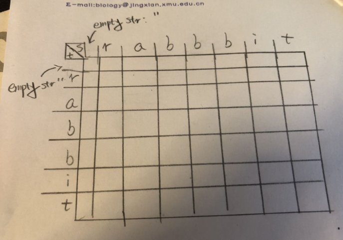
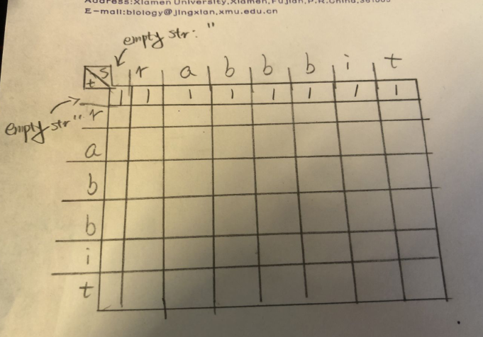
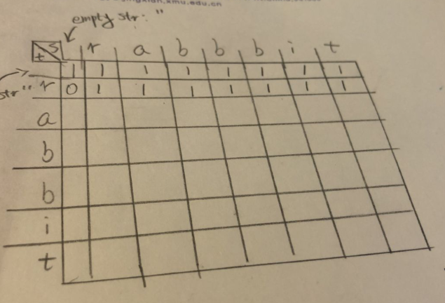
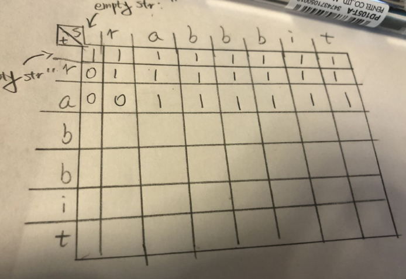
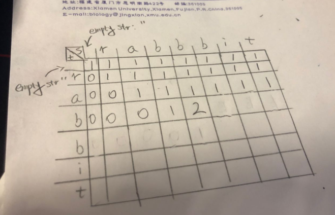
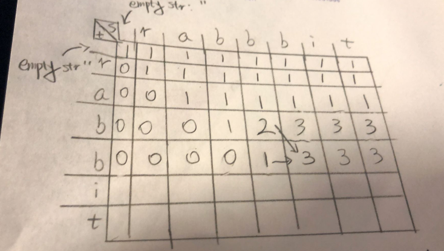
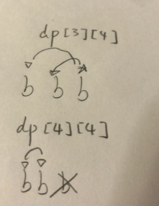
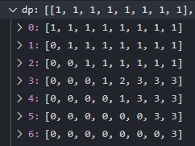

# Understand DP through question 115 - explanation with pictures

**Author:** yilingliu
**Votes:** 91
**Link:** [https://leetcode.com/problems/distinct-subsequences/solutions/572192/](https://leetcode.com/problems/distinct-subsequences/solutions/572192/)

---

Let's see the DP code first (python):
```
class Solution:
    def numDistinct(self, s, t):
        dp = [[0] * (len(s) + 1) for _ in range(len(t) + 1)]
        for col in range(len(dp[0])):
            dp[0][col] = 1
        for x in range(1, len(s) + 1):
            for y in range(1, len(t) + 1):
                if s[x - 1] == t[y - 1]:
                    dp[y][x] = dp[y - 1][x - 1] + dp[y][x - 1]
                else:
                    dp[y][x] = dp[y][x - 1]
        return dp[-1][-1]
```

You could also find this article in my [medium blog](https://medium.com/@yilingliu1994/understand-dynamic-programming-through-leetcode-115-explanation-with-pictures-318ff6a5299c)
To understand how these code work, you can draw a table on the paper first, like this:
I use s = "rabbbit" and t = "rabbit" as an example:


You have to add an extra column and an extra row at the beginning of the table, because the whole precess should be initialized from an empty string (```''```). While you are coding on the computer, this table will be generated by the following code:
dp = [[0] * (len(s) + 1) for _ in range(len(t) + 1)]
```+1``` is the first column and row in the table above

Than, fill the first row with number '1'


That means, strings in rabbbit:
```''```, ```r```, ```ra```, ```rab```, ```rabb```, ```rabbb```, ```rabbbi```, ```rabbbit``` both include one ```''``` inside it.
and then move to the next row, that means to inspect how many ```r``` in ```''```, ```r```, ```ra```, ```rab```, ```rabb```, ```rabbb```, ```rabbbi```, ```rabbbit``` 
What you will get is:


for ```r``` in string t, it cannot be included in the first element, which is ```''``` in string s. so dp[1][0] must be 0
For the third row, it is the same

String ```ra``` cannot be included in string ```r```, so dp[2][1] must be 0

For the fourth row, dp[3][4] should be 2 because there are two ```rab``` inside the substring of ```rabb```


Now, the most difficult part to understand this matrix comes:
Why dp[4][5] is generated by the sum of dp[4][4] and dp[3][4]?


You can think like that:
dp[3][4] is the way to select the first 'b' from 'bb' to combind with the third b to form 'bb'
dp[4][5] is the way to select two 'b' s from 'bb' and doesn't care about the third `b`


If you understand that, the following step is quite simple, just copy the steps above, the final matrix looks like this:


Return the last element and that's it