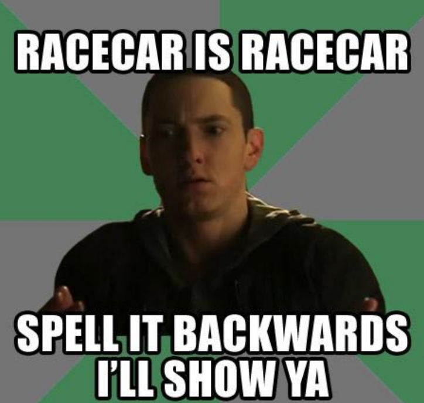
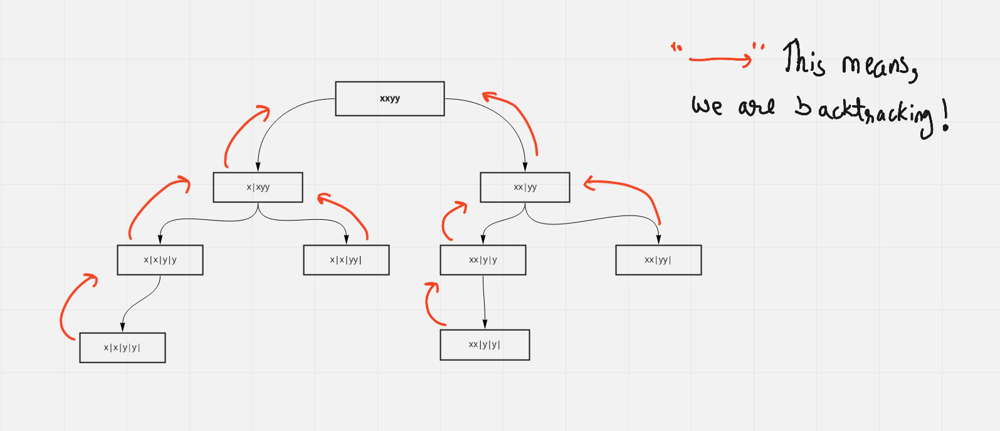
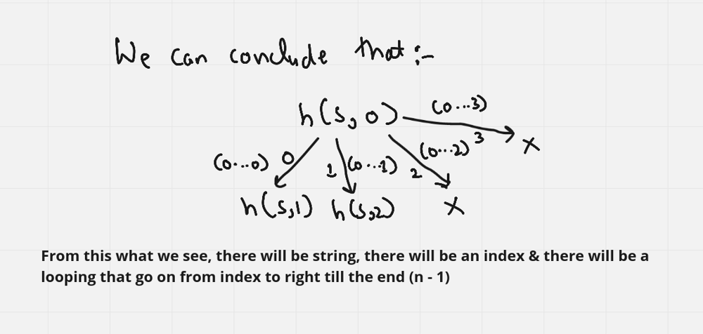

# ☕ Well Explained [JAVA , C++, PYTHON, JavaScript] || Easy for mind to Accept it

**Author:** hi-malik
**Votes:** 197
**Link:** [https://leetcode.com/problems/palindrome-partitioning/solutions/1667647/](https://leetcode.com/problems/palindrome-partitioning/solutions/1667647/)

---

**Intitution :**
```
Let's Understood with an example:

"xxyy" -> ["x", "x", "y", "y"] // 1st List of all the substring
          ["x", "x", "yy"] // 2nd List of all the substring
          ["xx", "y", "y"] // 3rd List of all the substring
          ["xx", "yy"] // 4th List of all the substring

In the above example we can only have 4 possible list's

Our task is to return a list of all of these list's, that are possible
```
# **`JUST UNDERSTAND IT LIKE THIS :-`**


**Approach Explaination :-** 
`A basic summary of diagram, how we are doing it`
Take an example, "xxyy". 
If we partition over x|xyy so the substring "x" is a palindrome. Where i can have the first partition.

But, if they don't allow to partition over there, then our second partition will be xx|yy. Because this "xx" is a palindrome substring. Thus we still left out with yy, so if i do the partion over here xxy|y the answer will be no, because if i do the partition over here the substring "xxy" is not a palindrome.

Can i do a partition over here xxyy|. No. Because xxyy is not a palindromic substring. So, we can see when we started we can do a partition over here x|xyy OR xx|yy so that is what we do. We try to do partition where ever it is possible

So, in the first case we did a partition over x|xyy where we left out with xyy. So, if i do a partiton like x|x|yy where x it'self a palindrome. And we left out with a substring yy
Now can you do a partition over here x|xy|y. No, because this substring xy is not a palindrome
Again can we do a partition over here x|xyy|. No, because this substring xyy is not a palindrome

So, the only partition possible is x|x|yy. And after that we tend to call the recursion for remaining substring

If i try to do a partition over here x|x|y|y so, the substring y in itself is a palindromic substring. After that we left out with remaining y substring.
Now you ask can we do a partition over here x|x|yy|, Yes 

Like this way, we do the partition in complete STRING using recursion. And with the help of Backtracking we store our answer.




*h means, helper function* 
**JAVA**
```
class Solution {
    public List<List<String>> partition(String s) {
        List<List<String>> res = new ArrayList<>(); // which will be our answer
        List<String> path = new ArrayList<>(); // as we are generating list everythime, so at the end this will be our list
        helper(0, s, path, res); // calling to recursion function start from index 0 and string s
        return res;
    }
    // Entire recursive function, that generates all the partition substring
    public void helper(int index, String s, List<String> path, List<List<String>> res){
        // Base Condition, which means when we have done partition at the end (n), then add it to our ultimate result
        if(index == s.length()){
            res.add(new ArrayList<>(path));
            return;
        }
        // Let's talk about partition
        for(int i = index; i < s.length(); i++){
            if(isPalindrome(s, index, i)){ // what we are checking over here is, if we partition the string from index to i Example-(0, 0) is palindrome or not
                path.add(s.substring(index, i + 1)); // take the substring and store it in our list & call the next substring from index + 1
                helper(i + 1, s, path, res); // as we have done for (0, 0) then our next will be from (1)
                path.remove(path.size() - 1); // please make sure you remove when you backtrack. 
                // Why? Because let say i had partion y, so when i go back. I can't have yy
            }
        }
    } 
    
    public boolean isPalindrome(String s, int start, int end){ // A simple palindromic function start from 0 go till end. And basically keep on checking till they don't cross. 
        while(start <= end){
            if(s.charAt(start++) != s.charAt(end--)) return false;
        }
        return true;
    }
}
```
**C++**
```
class Solution {
public:
    vector<vector<string>> partition(string s) {
        vector<vector<string>> res; // which will be our answer
        vector<string> path; // as we are generating list everythime, so at the end this will be our list
        helper(0, s, path, res); // calling to recursion function start from index 0 and string s
        return res;
    }
    // Entire recursive function, that generates all the partition substring
    void helper(int index, string s, vector<string> &path, vector<vector<string>> &res){
        // Base Condition, which means when we have done partition at the end (n), then add it to our ultimate result
        if(index == s.size()){
            res.push_back(path);
            return;
        }
        // Let's talk about partition
        for(int i = index; i < s.size(); i++){
            if(isPalindrome(s, index, i)){ // what we are checking over here is, if we partition the string from index to i Example-(0, 0) is palindrome or not
                path.push_back(s.substr(index, i - index + 1)); // take the substring and store it in our list & call the next substring from index + 1
                helper(i + 1, s, path, res); // as we have done for (0, 0) then our next will be from (1)
                path.pop_back(); // please make sure you remove when you backtrack. 
                // Why? Because let say i had partion y, so when i go back. I can't have yy
            }
        }
    }
    bool isPalindrome(string s, int start, int end){ // A simple palindromic function start from 0 go till end. And basically keep on checking till they don't cross. 
        while(start <= end){
            if(s[start++] != s[end--]) return false;
        }
        return true;
    }
};
```

**PYTHON**
```
class Solution:
    def partition(self, s: str) -> List[List[str]]:
        res = [] # which will be our answer
        self.helper(res, [], s) # calling to recursion function 
        return res
    
    # Entire recursive function, that generates all the partition substring
    def helper(self, res, curr, s):
        if s == "":
            res.append(curr)
        
        for i in range(len(s)):
            if self.isPalindrome(s[:i + 1]): # what we are checking over here is, if we partition the string from index to i Example-(0, 0) is palindrome or not
                self.helper(res, curr + [s[:i + 1]], s[i + 1:]) # take the substring and store it in our list & call the next substring from index + 1
    
    # A simple palindromic function start from 0 go till end. And basically keep on checking till they don't cross. 
    def isPalindrome(self, s):
        for i in range(len(s) // 2):
            if s[i] != s[len(s) - 1 - i]:
                return False
        return True
```

*`EDIT : JavaScript code added`*

**JavaScript**

```
/**
 * @param {string} s
 * @return {string[][]}
 */
var partition = function(s) {
    const res = [];
    const path = [];
    
    const helper = (s, i, j) =>{
        if(i === s.length){
            res.push([...path]);
            return;
        }
        
        for(let index = j; index <= s.length; ++index){
            if(isPalindrome(s, i, index)){
                path.push(s.slice(i, index));
                helper(s, index, index+1);
                path.pop();
            }
        }
    }
    
    const isPalindrome = (s, i, j) =>{
        while(i < j - 1){
            if(s[i] !== s[j-1]){
                return false;
            }
            ++i;
            --j;
        }
        return true;
    };
    
    helper(s, 0, 1);
    return res;
};
```
ANALYSIS :-
* **Time Complexity :-** BigO(N*2^N) where N is the length of string s. This is the worst-case time complexity when all the possible substrings are palindrome.

* **Space Complexity :-** BigO(N) as space will be used to store the recursion stack