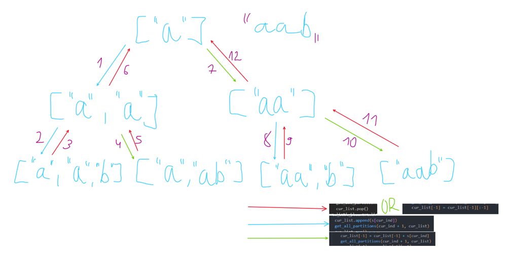

# ✅Detailed Explanation🔥🔥Extremely Simple and effective🔥O(n * 2^n) Time and O(n) Space🔥🔥🔥

**Author:** heir-of-god
**Votes:** 31
**Link:** [https://leetcode.com/problems/palindrome-partitioning/solutions/5192153/](https://leetcode.com/problems/palindrome-partitioning/solutions/5192153/)

---

# \uD83C\uDFAFProblem Explanation:
You are given string ```s``` and want to return all its palindrome partitioning.
- A substring is a contiguous non-empty sequence of characters within a string.
- A palindrome is a string that reads the same forward and backward.
- Palindrome partitioning - array of substrings of ```s``` such that every substring is a palindrome.

# \uD83D\uDCE5Input:
- String ```s```

# \uD83D\uDCE4Output:
Array which contain all possible palindrome partitioning.

# \uD83E\uDD14 Intuition
- This is actually quite an interesting backtracking problem. The first thing I decided to do to solve this problem was to draw an example with a picture (you will see it later)
- Usually problems with substrings have a clever solution - sliding a window or similar, so this is the first thing that came to my mind. However, what stopped me from such thoughts was the idea that I needed to create and return all such partitions.
- The idea of \u200B\u200Bfinding the set of all possible partitions or simillar often leads to recursion, and in this case, backtracking.
- Thus, I came to the main solution to this problem - recursion with backtracking.

# \uD83E\uDDE0 Approach
- First, let's write a helper function that will check if a string is a palindrome (some will do this with slices, however this creates a new string in memory and is not as efficient, so I wrote it using pointers)
- We want to write our main recursive function ```get_all_partitions``` which will take two arguments: ```cur_ind``` representing where we are at the moment in string and ```cur_list``` which represent current sequence we are creating with partition. 
    - Firstly, we are always interested in whether the last string in the sequence is a palindrome - our further actions depend on this. ```is_last_palindrome = is_palindrome(cur_list[-1])```
    - If the last string in list is a palindrome and we have reached the end of the ```s```, then we have found the correct state and we can add it to the result ```res```. (This is because before this we made sure that all strings before this were palindromes)
    - Next we have two options - if the last string is a palindrome, then we can start a new palindrome (add this letter as the last string) or add this letter to the last string, which is in our list.
    - In any case, after the operation is performed, we want to return the result so that it does not affect subsequent results. (*backtracking*)
- In order not to consider edge cases, we pass to the function the first index 1 and a list that initially contains the first letter of the string - obviously, partition will always start this way.
- **There is important moment**: in Python we don't want to append the array, but its copy because in other case modifiying ```cur_list``` will affect array in ```res```

### Example

On picture blue arrows means that we call our recursive function with new element and red ones that we deleting element which we added (backtracking) (there two different cases which we consider so arrows can mean several operations). On every final state (last line) on picture this array is appended to result if it is meet conditions. Purple numbers near arrows mean the number of this operation (recursive calls and backtracking).

# \uD83D\uDCD2 Complexity
- \u23F0 Time complexity: O(n * 2^n), ```O(2^n)``` because for every element we call recursion twice and on every step we're copying array (```O(n)```).
- \uD83E\uDDFA Space complexity: O(n), since we have O(n) recursion stack (we modify ```cur_list``` in-place so this is doesn't matter).

# \uD83E\uDDD1\u200D\uD83D\uDCBB Code
``` Python []
class Solution:
    def partition(self, s: str) -> List[List[str]]:
        res = []
        n = len(s)

        def is_palindrome(s):
            left = 0
            right = len(s) - 1
            while left < right:
                if s[left] != s[right]:
                    return False
                left += 1
                right -= 1

            return True

        def get_all_partitions(cur_ind, cur_list):
            is_last_palindrome = is_palindrome(cur_list[-1])
            if cur_ind == n:
                if is_last_palindrome:
                    res.append(cur_list[:])
                return
            if is_last_palindrome:
                cur_list.append(s[cur_ind])
                get_all_partitions(cur_ind + 1, cur_list)
                cur_list.pop()
            cur_list[-1] = cur_list[-1] + s[cur_ind]
            get_all_partitions(cur_ind + 1, cur_list)
            cur_list[-1] = cur_list[-1][:-1]

        get_all_partitions(1, [s[0]])
        return res
```
``` Java []
class Solution {
    public List<List<String>> partition(String s) {
        List<List<String>> res = new ArrayList<>();
        int n = s.length();
        
        getAllPartitions(s, n, 1, new ArrayList<>(List.of(s.substring(0, 1))), res);
        return res;
    }

    private boolean isPalindrome(String str) {
        int left = 0;
        int right = str.length() - 1;
        while (left < right) {
            if (str.charAt(left) != str.charAt(right)) {
                return false;
            }
            left++;
            right--;
        }
        return true;
    }

    private void getAllPartitions(String s, int n, int curInd, List<String> curList, List<List<String>> res) {
        boolean isLastPalindrome = isPalindrome(curList.get(curList.size() - 1));
        if (curInd == n) {
            if (isLastPalindrome) {
                res.add(new ArrayList<>(curList));
            }
            return;
        }
        if (isLastPalindrome) {
            curList.add(String.valueOf(s.charAt(curInd)));
            getAllPartitions(s, n, curInd + 1, curList, res);
            curList.remove(curList.size() - 1);
        }
        curList.set(curList.size() - 1, curList.get(curList.size() - 1) + s.charAt(curInd));
        getAllPartitions(s, n, curInd + 1, curList, res);
        curList.set(curList.size() - 1, curList.get(curList.size() - 1).substring(0, curList.get(curList.size() - 1).length() - 1));
    }
}
```
``` JavaScript []
var partition = function(s) {
    let res = [];
    let n = s.length;
    
    function isPalindrome(str) {
        let left = 0;
        let right = str.length - 1;
        while (left < right) {
            if (str[left] !== str[right]) {
                return false;
            }
            left++;
            right--;
        }
        return true;
    }
    
    function getAllPartitions(curInd, curList) {
        let isLastPalindrome = isPalindrome(curList[curList.length - 1]);
        if (curInd === n) {
            if (isLastPalindrome) {
                res.push([...curList]);
            }
            return;
        }
        if (isLastPalindrome) {
            curList.push(s[curInd]);
            getAllPartitions(curInd + 1, curList);
            curList.pop();
        }
        curList[curList.length - 1] += s[curInd];
        getAllPartitions(curInd + 1, curList);
        curList[curList.length - 1] = curList[curList.length - 1].slice(0, -1);
    }
    
    getAllPartitions(1, [s[0]]);
    return res;
};
```
``` C++ []
class Solution {
public:
    vector<vector<string>> partition(string s) {
        vector<vector<string>> res;
        int n = s.size();

        auto isPalindrome = [](const string& str) {
            int left = 0, right = str.size() - 1;
            while (left < right) {
                if (str[left] != str[right]) return false;
                left++;
                right--;
            }
            return true;
        };

        function<void(int, vector<string>&)> getAllPartitions = [&](int curInd, vector<string>& curList) {
            if (curInd == n) {
                if (isPalindrome(curList.back())) {
                    res.push_back(curList);
                }
                return;
            }
            if (isPalindrome(curList.back())) {
                curList.push_back(string(1, s[curInd]));
                getAllPartitions(curInd + 1, curList);
                curList.pop_back();
            }
            curList.back().push_back(s[curInd]);
            getAllPartitions(curInd + 1, curList);
            curList.back().pop_back();
        };

        vector<string> initial = { string(1, s[0]) };
        getAllPartitions(1, initial);
        return res;
    }
};
```

## \uD83D\uDCA1I encourage you to check out [my profile](https://leetcode.com/heir-of-god/) and [Project-S](https://github.com/Heir-of-God/Project-S) project for detailed explanations and code for different problems (not only Leetcode). Happy coding and learning! \uD83D\uDCDA

### Please consider *upvote* because I try really hard not just to put here my code and rewrite testcase to show that it works but explain you WHY it works and HOW. Thank you\u2764\uFE0F

## If you have any doubts or questions feel free to ask them in comments. I will be glad to help you with understanding\u2764\uFE0F\u2764\uFE0F\u2764\uFE0F


