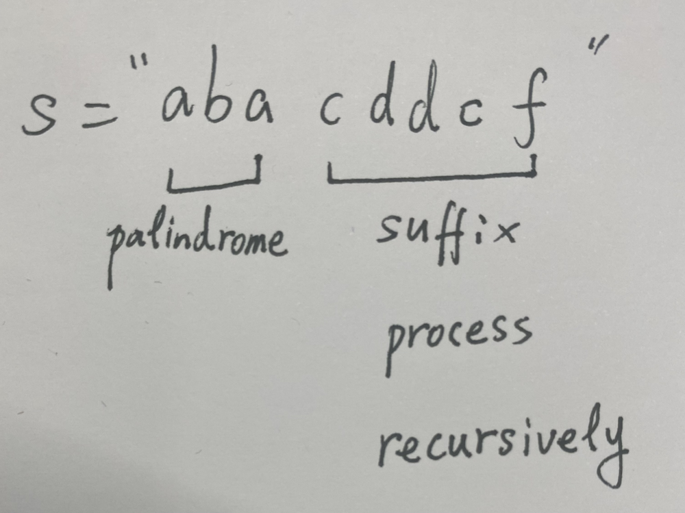

# ✅ [Python] Simple Recursion || Detailed Explanation || Easy to Understand

**Author:** linfq
**Votes:** 323
**Link:** [https://leetcode.com/problems/palindrome-partitioning/solutions/1667786/](https://leetcode.com/problems/palindrome-partitioning/solutions/1667786/)

---

**PLEASE UPVOTE if you like** \uD83D\uDE01 **If you have any question, feel free to ask.** 
* Find answer recursively and memory trick can save some time
* traverse and check every prefix `s[:i]` of `s`
	* if prefix `s[:i]` is a palindrome, then process the left suffix `s[i:]` recursively
	* since the suffix `s[i:]` may repeat, **the memory trick can save some time**




```
Time  Complexity: O(N * (2 ^ N))
Space Complexity: O(N * (2 ^ N))
```

**Python3**
```
class Solution(object):
    @cache  # the memory trick can save some time
    def partition(self, s):
        if not s: return [[]]
        ans = []
        for i in range(1, len(s) + 1):
            if s[:i] == s[:i][::-1]:  # prefix is a palindrome
                for suf in self.partition(s[i:]):  # process suffix recursively
                    ans.append([s[:i]] + suf)
        return ans
```
**Python**
```
class Solution(object):
    def __init__(self):
        self.memory = collections.defaultdict(list)
        
    def partition(self, s):
        if not s: return [[]]
        if s in self.memory: return self.memory[s]  # the memory trick can save some time
        ans = []
        for i in range(1, len(s) + 1):
            if s[:i] == s[:i][::-1]:  # prefix is a palindrome
                for suf in self.partition(s[i:]):  # process suffix recursively
                    ans.append([s[:i]] + suf)
        self.memory[s] = ans
        return ans
```
**PLEASE UPVOTE if you like** \uD83D\uDE01 **If you have any question, feel free to ask.**