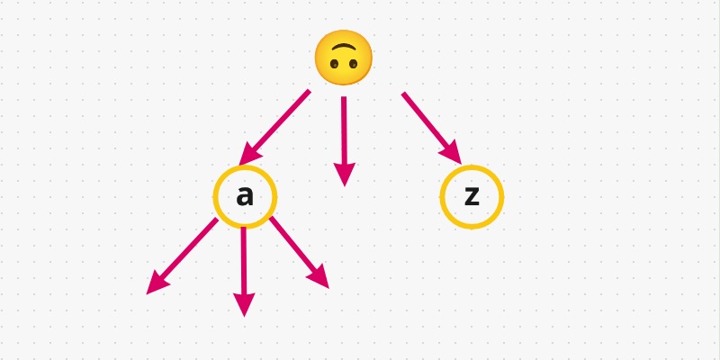
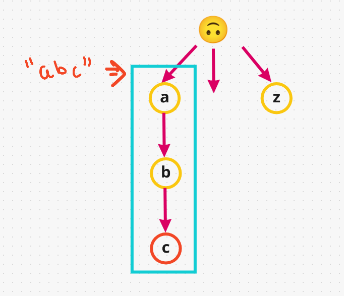
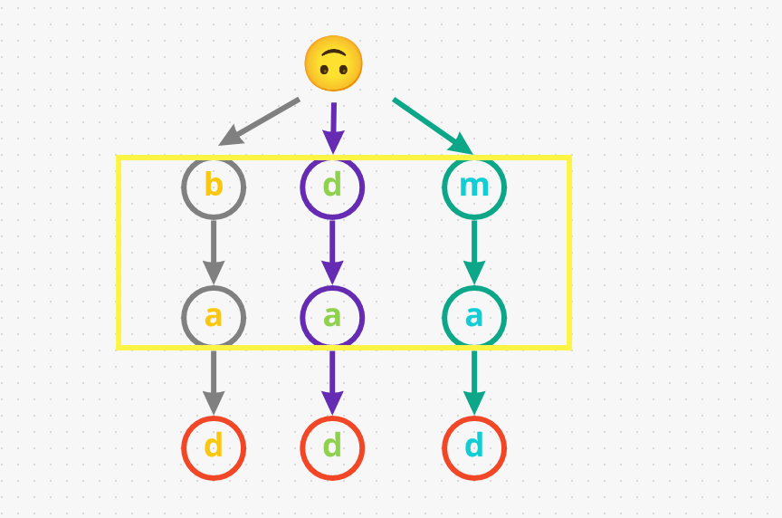
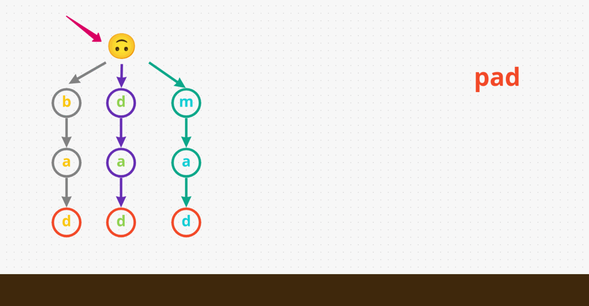

# [Java/C++/Python] A very well detailed EXPLANATION!

**Author:** hi-malik
**Votes:** 437
**Link:** [https://leetcode.com/problems/design-add-and-search-words-data-structure/solutions/1725327/](https://leetcode.com/problems/design-add-and-search-words-data-structure/solutions/1725327/)

---

```
What the question is saying, 
We have to design a data structure that supports adding new words and finding if a string matches any previously added string.
```

**So, to design a DS we only need to support 3 function's for this data structure.**

* One is the **constructor** that's gonna intialize the object.
* One is **Adding** the **word's**, but all of them are lower case from **a to z**
* One is **Searching** a **word**, and the word can contains any character from **a - z**. But there is **1 additional character** it contains, **"."** character `[And what they told "." character is a wild card, can match any character easily in the string]`

**The brute force way to solve this problem** is pretty simple, "*having a list of words & then just for every search we would just see, if this search match any of the word in input list*." **[But it's not an efficient way]**

Let's talk about, **efficient way to solve this problem**. And for that we require **Trie data structure** a.k.a **Prefix tree**

Let's understand **Trie first**,
**Trie** is basically a **tree** that has some kind of **root node** & each node can have up to **26 children in this problem**. Because we have **lower case character from a to z**. So, basically each **node represent's a single character**. And each node could have up to 26 additional children:



And basically word in this example means, let's take **"a"** having child **"b" -> with "c"**, so that's will be a **single word**. And if we insert the word **"abc"** in our **trie**, so basically how's it looks like:



One additional thing we have to say is, for a particular node such as **"c"** this is the **end of the word**. Because if we **added another word** example:- **"ab"**. So, we don't add them back again as if you notice they are already available to us, we just **gonna re-use** these characters. So, we have 2 word's along this **path "abc" & "ab"**
Basically, all words start with **"a"** are gonna be here, that's what it make it **efficient**. That's why it's called **prefix tree**.

`Now, you have understood how Trie aka Prefix Tree work.`

Now let's take an example & build our tree,
**Input**
```
["WordDictionary","addWord","addWord","addWord","search","search","search","search"]
[[],["bad"],["dad"],["mad"],["pad"],["bad"],[".ad"],["b.."]]
```
**Output**
```
[null,null,null,null,false,true,true,true]
```
* The first word we add is **"bad". "b" -> "a" -> "d"**

* Next we adding another word **"dad"**. So, we have to start with **different path**. As, these two word's have a **different prefix**. One start with **"b"** and one start with **"d"**. So, let's add it: **"d" -> "a" -> "d"**

* We have one last word before we start searching, this one gonna be **"mad"**. So, we don't have **"m"**, then let's add it: **"m" -> "a" -> "d"**


So far we have **3 word's** and all of them end with different **"d"**. But they all **3 of them have different prefix** that's why they are along different path's.



`Now let's go for searching path:-`

* So, first word we gonna search for **"pad"**. We gonna **start** at **beginning**. First we gonna try are there any **"p"** in this. That means immediately we **return false** as **"pad"** doesn't exist in our input.

* Now, we search another word **"bad"**. So, we **start at the root** and see there are any **"b"**. Yes, we have **"b"**. now we check does this **"b"** have a child **"a"**, yes it does. Now last character **"d"** does **"a"** has a child **"d"**, yes it does have. Lastly we have to say the last character **"d"** is in our **trie**, which designated as the end of the word. Sice it's **marked red**. Therefore, we **return true** for this input **"bad"**


* Now, in this search we have **".ad"**, the dot **"."** character matches any character. So, we start at the root and go to any of the path and to do that we have to use **DFS or backtracking approach**. So, let's say first path we decided **"b"**. now we check does this **"b"** have a child **"a"**, yes it does. Now last character **"d"** does **"a"** has a child **"d"**, yes it does have. Lastly we have to say the last character **"d"** in our trie, is designated as the end of the word. Therefore, we **return true** for this input **".ad"**


* One last search, In this we have **"b.."**. So, we start at the root and see there are any **"b"**. Yes, we have **"b"**. Now we check do we have any character to go below for our current dot **"."**, yes we have **"a"**. Now we are looking for any character for our last **dot "."** Yes we have **"d"** & it is end of the word. Therefore, we **return true** for this input **"b.."**

Now understand this ***VISUALLY, it's not super hard.***




**Now, let's code it up:**

**Java**
```
class WordDictionary {
    private WordDictionary[] children;
    boolean isEndOfWord;
    // Initialize your data structure here. 
    public WordDictionary() {
        children = new WordDictionary[26];
        isEndOfWord = false;
    }
    
    // Adds a word into the data structure. 
    public void addWord(String word) {
        WordDictionary curr = this;
        for(char c: word.toCharArray()){
            if(curr.children[c - 'a'] == null)
                curr.children[c - 'a'] = new WordDictionary();
            curr = curr.children[c - 'a'];
        }
        curr.isEndOfWord = true;
    }
    
    // Returns if the word is in the data structure. A word could contain the dot character '.' to represent any one letter. 
    public boolean search(String word) {
        WordDictionary curr = this;
        for(int i = 0; i < word.length(); ++i){
            char c = word.charAt(i);
            if(c == '.'){
                for(WordDictionary ch: curr.children)
                    if(ch != null && ch.search(word.substring(i+1))) return true;
                return false;
            }
            if(curr.children[c - 'a'] == null) return false;
            curr = curr.children[c - 'a'];
        }
        return curr != null && curr.isEndOfWord;
    }
}
```
**C++**
```
class WordDictionary {
    vector<WordDictionary*> children;
    bool isEndOfWord;
public:
    // Initialize your data structure here. 
    WordDictionary(): isEndOfWord(false){
        children = vector<WordDictionary*>(26, nullptr);
    }
    
    // Adds a word into the data structure. 
    void addWord(string word) {
        WordDictionary *curr = this;
        for(char c: word){
            if(curr->children[c - 'a'] == nullptr)
                curr->children[c - 'a'] = new WordDictionary();
            curr = curr->children[c - 'a'];
        }
        curr->isEndOfWord = true;
    }
    
    // Returns if the word is in the data structure. A word could contain the dot character '.' to represent any one letter. 
    bool search(string word) {
        WordDictionary *curr = this;
        for(int i = 0; i < word.length(); ++i){
            char c = word[i];
            if(c == '.'){
                for(auto ch: curr->children)
                    if(ch && ch->search(word.substr(i+1))) return true;
                return false;
            }
            if(curr->children[c - 'a'] == nullptr) return false;
            curr = curr->children[c - 'a'];
        }
        return curr && curr->isEndOfWord;
    }
};
```
**Python**
```
class WordDictionary:

    def __init__(self):
        
        # Initialize your data structure here.
        self.children = [None]*26
        self.isEndOfWord = False
        

    def addWord(self, word: str) -> None:

        # Adds a word into the data structure.
        curr = self
        for c in word:
            if curr.children[ord(c) - ord('a')] == None:
                curr.children[ord(c) - ord('a')] = WordDictionary()
            curr = curr.children[ord(c) - ord('a')]
        
        curr.isEndOfWord = True;
        

    def search(self, word: str) -> bool:

        # Returns if the word is in the data structure. A word could contain the dot character '.' to represent any one letter.
        curr = self
        for i in range(len(word)):
            c = word[i]
            if c == '.':
                for ch in curr.children:
                    if ch != None and ch.search(word[i+1:]): return True
                return False
            
            if curr.children[ord(c) - ord('a')] == None: return False
            curr = curr.children[ord(c) - ord('a')]
        
        return curr != None and curr.isEndOfWord
```
ANALYSIS :-
* **Time Complexity :-** BigO(M) for well defined words, But in worse case BigO(M.26^N)

* **Space Complexity :-** BigO(1) for well defined words, But for worst case BigO(M)