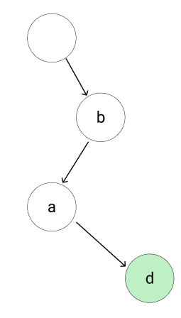
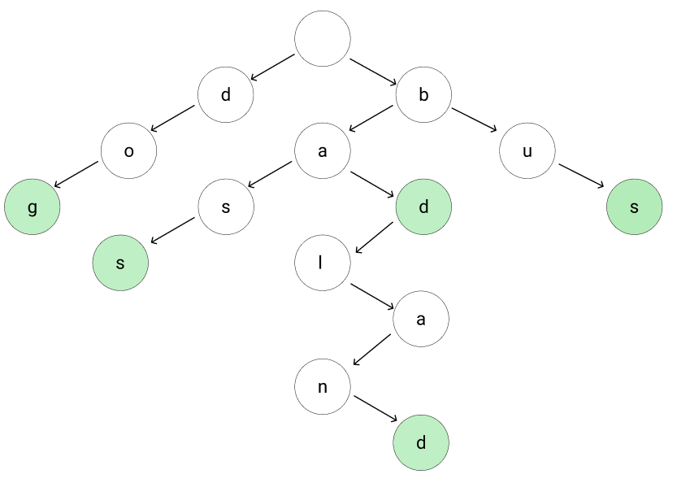

# Kotlin fast Trie solution explained

**Author:** awawa
**Votes:** 5
**Link:** [https://leetcode.com/problems/design-add-and-search-words-data-structure/solutions/1725751/](https://leetcode.com/problems/design-add-and-search-words-data-structure/solutions/1725751/)

---

To solve this challenge using Trie data structure is the most appropriate way. I mean, let's look at the challenge description again:
"Design a data structure that supports adding new words and finding if a string matches any previously added string."

Isn't it just a definition of Trie? It just looks like challenge author asked us to implement Trie without actually asking us to implement Trie. So Trie it is. Now, if you are not familiar with the Trie data structure yet, let's dive into it for a minute.

The trie data structure (or prefix tree) is very interesting data structure for storing strings (or actually any other elements that you can split into atomic parts. numbers, for example, can be split into digits). It works as follows:

1. We start with an empty root node


2. We can insert some string into the tree by splitting it into atomic elements - chars. Let's insert the word `bad` into our trie. We split it into `b`, `a`, and `d` and link `b` to the root node, `a` to the `b` node and `d` to the `a` node. We also mark node `d` as a "word" meaning that there is a word ending at this node.



3. Now we can check that our trie contains word `bad`. We split the word into characters again and first check that the root node has child with value  `b`, `b` node has a child with value `a`, and finally `a` node has a child with value `d` and also `d` is the end of the word. Note that there is no words `b` or `ba` in our trie, because nodes `b` and `a` are not marked as words.

4. Let's add some other words to the trie. We will add words `badland`, `bass`, `dog` and `bus` into the trie:
	4.1. Adding `badland`: root already has child with value `b`, so we just move to node `b`. `b` already has child `a` and `a` already has child `d` so we move to `d` the same way. Now `d` has not a child with value `l` so we create new node `l`, link it to `d` and move to node `l`. Same situation appears for characters `a`, `n` and `d`. Finally, we mark `d` as a word.
	4.2. Adding `bass`: we move to the node `root -> b -> a` same way as we did for word `badland`, now node `a` doesn't have child with value `s`, so we create new node and move to it. Same for the second `s`.
	4.3. I suppose you can figure out how to add other words using the same logic.



So, the trie we just described is already looks like the solution to the challenge. Except one thing: we need to deal with `.` cahracter. When we have any other character we can just check if current node has a child with this value. But for `.` we have to check all the children for this node, so search will be not iterative, but recursive. Modified version of trie will still work as a simple trie for strings without `.` characters and for `.` it will recursively split between subtrees. Below is the solution code. We just need to implement the `Trie` class and funcions `addWord` and `search` just directly coresspond to `Trie` methods.

```
class WordDictionary() {
    
    private class Trie {
        private val root = Node('.')
        private class Node(val value: Char, val children: Array<Node?> = Array<Node?>(26) { null }, var isWord: Boolean = false)
        
        fun insert(word: String) {
            var currNode = root
            for (char in word) {
				// If child node doesn't yet exist, create one
                if (currNode.children[char - 'a'] == null) currNode.children[char - 'a'] = Node(char)
				// Move to child node
                currNode = currNode.children[char - 'a']!!
            }
			
			// When reached the end of the word, mark the node as a word
            currNode.isWord = true
        }
        
		// Recursive search
        private fun _contains(node: Node, word: String, index: Int): Boolean {
            if (index == word.length - 1) {
                if (word[index] == '.') return node.children.any { it != null && it.isWord }
                else return node.children[word[index] - 'a']?.isWord ?: false
            }
            
            if (word[index] == '.') {
                for (n in node.children) {
                    if (n == null) continue
					// Here we recursively split between subtrees
                    if (_contains(n!!, word, index + 1)) return true
                }
                return false
            } else {
                if (node.children[word[index] - 'a'] == null) return false
                return _contains(node.children[word[index] - 'a']!!, word, index + 1)
            }
            
            return false
        }
        
        fun contains(word: String): Boolean {
            return _contains(root, word, 0)
        }
    }

    private val trie = Trie()
    
    fun addWord(word: String) {
        trie.insert(word)
    }

    fun search(word: String): Boolean {
        return trie.contains(word)
    }

}

```