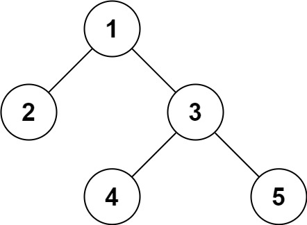

# [297. Serialize and Deserialize Binary Tree](https://leetcode.com/problems/serialize-and-deserialize-binary-tree/)

| Category | Difficulty | Likes | Dislikes |
| :------: | :--------: | :---: | :------: |
| Algorithms | Hard | 10979 | 430 |

**Tags:** [`string`](https://leetcode.com/tag/string), [`tree`](https://leetcode.com/tag/tree), [`depth-first-search`](https://leetcode.com/tag/depth-first-search), [`breadth-first-search`](https://leetcode.com/tag/breadth-first-search), [`design`](https://leetcode.com/tag/design), [`binary-tree`](https://leetcode.com/tag/binary-tree)

**Companies:** `microsoft`, `google`, `amazon`, `linkedin`, `tiktok`, `facebook`, `nutanix`, `uber`, `apple`, `citadel`, `oracle`, `quora`, `hive`, `tcs`, `doordash`, `adobe`, `nvidia`, `bloomberg`, `qualcomm`, `yahoo`

## Description

Serialization is the process of converting a data structure or object into a sequence of bits so that it can be stored in a file or memory buffer, or transmitted across a network connection link to be reconstructed later in the same or another computer environment.

Design an algorithm to serialize and deserialize a binary tree. There is no restriction on how your serialization/deserialization algorithm should work. You just need to ensure that a binary tree can be serialized to a string and this string can be deserialized to the original tree structure.

**Clarification:** The input/output format is the same as how LeetCode serializes a binary tree. You do not necessarily need to follow this format, so please be creative and come up with different approaches yourself.

 

**Example 1:**


```

Input: root = [1,2,3,null,null,4,5]
Output: [1,2,3,null,null,4,5]

```

**Example 2:**

```

Input: root = []
Output: []

```

 

**Constraints:**

	- The number of nodes in the tree is in the range `[0, 10^4]`.

	- `-1000 <= Node.val <= 1000`

---

**Links:** [Submissions](https://leetcode.com/problems/serialize-and-deserialize-binary-tree/) | [Solutions](https://leetcode.com/problems/serialize-and-deserialize-binary-tree/)
