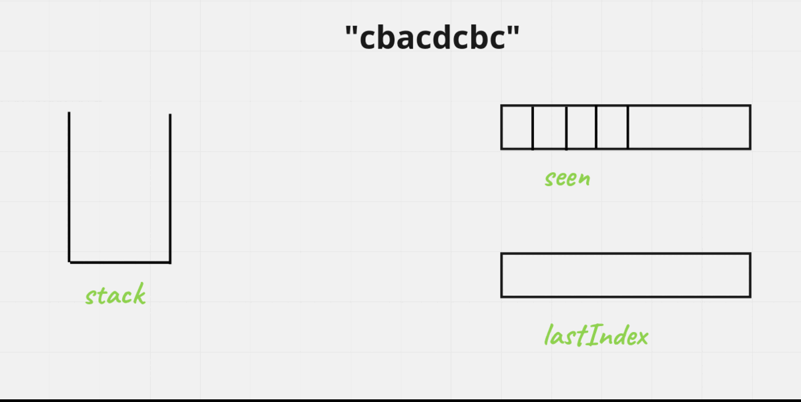

# [Java/C++] DETAILED + VISUALLY EXPLAINED !!

**Author:** hi-malik
**Votes:** 940
**Link:** [https://leetcode.com/problems/remove-duplicate-letters/solutions/1859410/](https://leetcode.com/problems/remove-duplicate-letters/solutions/1859410/)

---

How's going Ladies - n - Gentlemen, today we are going to solve another coolest problem i.e. **Remove Duplicate Letters**

```
What the problem statement is saying,

Given a string s, remove duplicate letters so that every letter appears once and only once. 
You must make sure your result is the smallest in lexicographical order among all possible results.
```

`Let's take one example in order to understand it:-`
**Input** :- "cbacdcbc"
**Output** :- "acdb"

<hr>

Now, your first Question is which **Data Structure do we use in order to solve this problem??** `Well, let's have a look at the input firstOfAll`

First Of all, we have to pick the character's if it is not already visited. If, that's the case we'll try to pick these character's. We'll also make sure, the previously picked character is smaller then the current character in order to maintain **lexicographically order**. But, how we can check the previously picked character is best for!! **And the answer is Stack!!**

<hr>

What we'll do, use the **stack** to keep track of selected character's. We try to put the character's only once & maintain the `lexicographicall smallest one`. **So, how we do that :-**
* If the stack is empty, we'll put the **current character into our stack**
* We'll also keep here **`boolean array`** which will mark, whether we have seen this character or not. So, that if we are getting again the same character and we have already seen that. We'll ignore that character.
* So, the length of **boolean array** will be **26**

***Let's Undertsand it's working***

* First we put character `c` into our stack and mark it as true


* Then we come to next character i.e. `b` we check is **`b < c`** to maintain lexicographically order. Yes `b` is samller then `c` we'll remove it from the stack.
* But before removing we have to check that, is `c` more present in our string. So, how will we quickly check that for that we'll keep one more Array which will keep track of last index of all the character's present in our string
* So, we see that `c` exists on 7th index.
* We'll remove `c` from the stack & don't forgot to mark `c` in boolean array from **true to false** 
* Now add `b` into our stack. ANd mark `b` in boolean array as true
* Now next character is `a` which is smaller then `b` & do the same process of checking if it exists somewhere in array & if so, remove it from stack update boolean to false. And put `a` into the stack. And in boolean array mark it as true.
* Let's add `c` in the stack mark it as true & `c > a` so carry on....
* Let's add `d` in the stack mark it as true & `d > c` so carry on....
* Now we encounter `c` which is already visited so, carry on....
* Let's add `b` in the stack mark it as true & `b < d` so carry on....
```
This, line explanation : BY @nirala_414

"now try to add "b" in the stack and mark it as true, for this since the current_element("b") is less than
the peek(top) element of stack("d")so we should pop the "d" for now and push "b" in stack but before 
poping "d" check is there "d" is again persent in given string after this "b" , since "d" is not more 
persent after this "b" so we can't do that pop and push operation for "d" and "b" respectively , simply 
add "b" into the stack and mark is as true that's set, but in some case if "d" is available again after 
that "b" then we will definitely be poping "d" from the stack and adding "b" into the stack( we can take 
example for this case as "cbadcbcd" and try to dry run it )
```
* Now we encounter `c` which is already visited so, carry on....
* End of the string.

Now whatever character we have present in our stack, take them out. i.e. **`bdca`** now reverse it **`acdb`** and this is our smallest lexicographically string

`Let's understand it visually :-` You can download all the images from here [**G-Drive**](https://drive.google.com/drive/folders/1ZmVXpG5uFqFHm_f6GXC78_3pmwkcaxNP?usp=sharing)



*I hope you got it* **Let's code it up:-**

**Java**
```
class Solution {
    public String removeDuplicateLetters(String s) {
        int[] lastIndex = new int[26];
        for (int i = 0; i < s.length(); i++){
            lastIndex[s.charAt(i) - 'a'] = i; // track the lastIndex of character presence
        }
        
        boolean[] seen = new boolean[26]; // keep track seen
        Stack<Integer> st = new Stack();
        
        for (int i = 0; i < s.length(); i++) {
            int curr = s.charAt(i) - 'a';
            if (seen[curr]) continue; // if seen continue as we need to pick one char only
            while (!st.isEmpty() && st.peek() > curr && i < lastIndex[st.peek()]){
                seen[st.pop()] = false; // pop out and mark unseen
            }
            st.push(curr); // add into stack
            seen[curr] = true; // mark seen
        }

        StringBuilder sb = new StringBuilder();
        while (!st.isEmpty())
            sb.append((char) (st.pop() + 'a'));
        return sb.reverse().toString();
    }
}
```
**C++**
```
class Solution {
public:
    string removeDuplicateLetters(string s) {
        vector<int> lastIndex(26, 0);
        for (int i = 0; i < s.length(); i++){
            lastIndex[s[i] - 'a'] = i; // track the lastIndex of character presence
        }
        
        vector<bool> seen(26, false); // keep track seen
        stack<char> st;
        
        for (int i = 0; i < s.size(); i++) {
            int curr = s[i] - 'a';
            if (seen[curr]) continue; // if seen continue as we need to pick one char only
            while(st.size() > 0 && st.top() > s[i] && i < lastIndex[st.top() - 'a']){
                seen[st.top() - 'a'] = false; // pop out and mark unseen
                st.pop();
            }
            st.push(s[i]); // add into stack
            seen[curr] = true; // mark seen
        }
        
        string ans = "";
        while (st.size() > 0){
            ans += st.top();
            st.pop();
        }
        reverse(ans.begin(), ans.end());
        return ans;
    }
};
```

ANALYSIS :-
* **Time Complexity :-** BigO(N)

* **Space Complexity :-** BigO(N)

```
In the End, Wishing you A Happy Holi !!

**Bura Na Mano Holi Hn**
```


