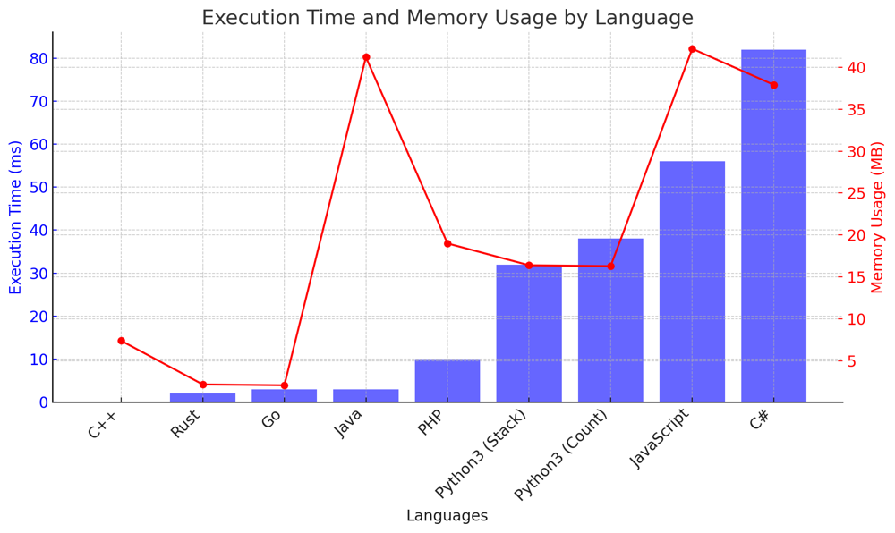

# ✅ 98.53% Stack and Greedy

**Author:** vanAmsen
**Votes:** 94
**Link:** [https://leetcode.com/problems/remove-duplicate-letters/solutions/4090711/](https://leetcode.com/problems/remove-duplicate-letters/solutions/4090711/)

---

# Interview Guide: "Remove Duplicate Letters" Problem

## Problem Understanding

The "Remove Duplicate Letters" problem tasks you with removing duplicate letters from a string such that every letter appears only once. The challenge is to make sure the result is the smallest in lexicographical order among all possible outcomes.

## Key Points to Consider

### 1. Understand the Constraints

Before diving deep into the solution, it's crucial to understand the constraints. The length of string `s` is between 1 and 10,000, and `s` consists only of lowercase English letters. This provides insight into the feasible solutions in terms of time and space complexity.

### 2. Multiple Approaches

There are different ways to solve this problem:

  - Using a Stack and Greedy algorithm
  - Using a Count and Visited array

Both approaches have their advantages and trade-offs, so it's essential to understand both and choose the one that aligns with the problem's constraints.

### 3. Stack's Utility

When using the Stack approach, the stack serves as a dynamic data structure to hold the characters in the desired order. It plays a crucial role in ensuring lexicographical ordering of characters.

### 4. Explain Your Thought Process

Always articulate your thought process and the rationale behind choosing a specific approach. Highlight the trade-offs you're considering in terms of time and space complexity.

## Conclusion

The "Remove Duplicate Letters" problem is an excellent example of how different data structures and algorithms can be used to achieve the desired outcome. By understanding the problem, deciding on the best data structures, and choosing the right algorithm, you demonstrate a comprehensive grasp of algorithmic challenges.

---

## Live Coding & Explain
https://youtu.be/Z0rg6rAWMik?si=vAkmw5iSwa_gFX3h

# Approach: Stack and Greedy

To address the "Remove Duplicate Letters" problem using a stack and greedy algorithm, we lean on the properties of the stack to maintain lexicographical order:

## Key Data Structures:

- **stack**: A dynamic data structure to hold characters in the desired order.
- **seen**: A set to track characters already in the stack.
- **last_occurrence**: A dictionary to track the last occurrence of each character in the string.

## Enhanced Breakdown:

1. **Initialization**:
   - Initialize the stack, seen set, and last_occurrence dictionary.
  
2. **Iterate through the string**:
   - For each character, if it's in the seen set, skip it.
   - If it's not in the seen set, add it to the stack. While adding, compare it with the top character of the stack. If the current character is smaller and the top character appears later in the string, pop the top character.

3. **Output**:
   - Convert the stack to a string and return.

# Complexity:

**Time Complexity:** 
- The solution iterates over each character in the string once, leading to a time complexity of $$ O(n) $$, where `n` is the length of the string `s`.

**Space Complexity:** 
- The space complexity is $$ O(n) $$ due to the stack, seen set, and last_occurrence dictionary.

# Code Stack and Greedy
``` Python []
class Solution:
    def removeDuplicateLetters(self, s: str) -> str:
        stack = []
        seen = set() 
        last_occ = {c: i for i, c in enumerate(s)}
        
        for i, c in enumerate(s):
            if c not in seen:
                
                while stack and c < stack[-1] and i < last_occ[stack[-1]]:
                    seen.discard(stack.pop())
                seen.add(c)
                stack.append(c)
        
        return ''.join(stack)
```
``` Go []
func removeDuplicateLetters(s string) string {
	stack := []rune{}
	seen := make(map[rune]bool)
	lastOcc := make(map[rune]int)

	for i, c := range s {
		lastOcc[c] = i
	}

	for i, c := range s {
		if !seen[c] {
			for len(stack) > 0 && c < stack[len(stack)-1] && i < lastOcc[stack[len(stack)-1]] {
				delete(seen, stack[len(stack)-1])
				stack = stack[:len(stack)-1]
			}
			seen[c] = true
			stack = append(stack, c)
		}
	}

	return string(stack)
}
```
``` Rust []
use std::collections::{HashSet, HashMap};

impl Solution {
    pub fn remove_duplicate_letters(s: String) -> String {
        let mut stack: Vec<char> = Vec::new();
        let mut seen: HashSet<char> = HashSet::new();
        let mut last_occ: HashMap<char, usize> = HashMap::new();
        for (i, c) in s.chars().enumerate() {
            last_occ.insert(c, i);
        }
        
        for (i, c) in s.chars().enumerate() {
            if !seen.contains(&c) {
                while let Some(&top) = stack.last() {
                    if c < top && i < *last_occ.get(&top).unwrap() {
                        seen.remove(&stack.pop().unwrap());
                    } else {
                        break;
                    }
                }
                seen.insert(c);
                stack.push(c);
            }
        }
        
        stack.into_iter().collect()
    }
}
```
``` C++ []
class Solution {
public:
    std::string removeDuplicateLetters(std::string s) {
        std::stack<char> stack;
        std::unordered_set<char> seen;
        std::unordered_map<char, int> last_occ;
        for (int i = 0; i < s.size(); i++) {
            last_occ[s[i]] = i;
        }
        
        for (int i = 0; i < s.size(); i++) {
            char c = s[i];
            if (seen.find(c) == seen.end()) {
                while (!stack.empty() && c < stack.top() && i < last_occ[stack.top()]) {
                    seen.erase(stack.top());
                    stack.pop();
                }
                seen.insert(c);
                stack.push(c);
            }
        }
        
        std::string result = "";
        while (!stack.empty()) {
            result = stack.top() + result;
            stack.pop();
        }
        return result;
    }
};
```
``` Java []
public class Solution {
    public String removeDuplicateLetters(String s) {
        Stack<Character> stack = new Stack<>();
        Set<Character> seen = new HashSet<>();
        Map<Character, Integer> lastOcc = new HashMap<>();
        for (int i = 0; i < s.length(); i++) {
            lastOcc.put(s.charAt(i), i);
        }
        
        for (int i = 0; i < s.length(); i++) {
            char c = s.charAt(i);
            if (!seen.contains(c)) {
                while (!stack.isEmpty() && c < stack.peek() && i < lastOcc.get(stack.peek())) {
                    seen.remove(stack.pop());
                }
                seen.add(c);
                stack.push(c);
            }
        }
        
        StringBuilder result = new StringBuilder();
        for (char c : stack) {
            result.append(c);
        }
        return result.toString();
    }
}
```
``` C# []
public class Solution {
    public string RemoveDuplicateLetters(string s) {
        Stack<char> stack = new Stack<char>();
        HashSet<char> seen = new HashSet<char>();
        Dictionary<char, int> lastOcc = new Dictionary<char, int>();
        for (int i = 0; i < s.Length; i++) {
            lastOcc[s[i]] = i;
        }
        
        for (int i = 0; i < s.Length; i++) {
            char c = s[i];
            if (!seen.Contains(c)) {
                while (stack.Count > 0 && c < stack.Peek() && i < lastOcc[stack.Peek()]) {
                    seen.Remove(stack.Pop());
                }
                seen.Add(c);
                stack.Push(c);
            }
        }
        
        char[] result = stack.ToArray();
        Array.Reverse(result);
        return new string(result);
    }
}
```
``` JavaScript []
var removeDuplicateLetters = function(s) {
        let stack = [];
        let seen = new Set();
        let lastOcc = {};
        for (let i = 0; i < s.length; i++) {
            lastOcc[s[i]] = i;
        }
        
        for (let i = 0; i < s.length; i++) {
            let c = s[i];
            if (!seen.has(c)) {
                while (stack.length && c < stack[stack.length - 1] && i < lastOcc[stack[stack.length - 1]]) {
                    seen.delete(stack.pop());
                }
                seen.add(c);
                stack.push(c);
            }
        }
        
        return stack.join('');
    }
```
``` PHP []
class Solution {
    function removeDuplicateLetters($s) {
        $stack = [];
        $seen = [];
        $lastOcc = [];
        for ($i = 0; $i < strlen($s); $i++) {
            $lastOcc[$s[$i]] = $i;
        }
        
        for ($i = 0; $i < strlen($s); $i++) {
            $c = $s[$i];
            if (!isset($seen[$c])) {
                while (!empty($stack) && $c < end($stack) && $i < $lastOcc[end($stack)]) {
                    unset($seen[array_pop($stack)]);
                }
                $seen[$c] = true;
                array_push($stack, $c);
            }
        }
        
        return implode('', $stack);
    }
}
```

---

# Approach: Count and Visited Array

To address the "Remove Duplicate Letters" problem using a count and visited array, we leverage the frequency of each character:

## Key Data Structures:

- **count**: A dictionary to hold the frequency of each character.
- **result**: A list to hold the final characters in the desired order.
- **visited**: A set to track characters already in the result.

## Enhanced Breakdown:

1. **Calculate Frequencies**:
   - Compute the frequency of each character in the string.
  
2. **Iterate through the string**:
   - For each character, decrease its count. If it's in the visited set, skip it.
   - If it's not in the visited set, add it to the result. While adding, compare it with the last character in the result. If the current character is smaller and the last character appears later in the string, remove the last character.

3. **Output**:
   - Convert the result list to a string and return.

# Complexity:

**Time Complexity:** 
- The solution iterates over each character in the string once, leading to a time complexity of $$ O(n) $$, where  `n`  is the length of the string `s`.

**Space Complexity:** 
- The space complexity is $$ O(n) $$ due to the count dictionary, result list, and visited set.

# Code Count and Visited Array
``` Python []
class Solution:
    def removeDuplicateLetters(self, s: str) -> str:
        count = collections.Counter(s)
        result = []
        visited = set()
        
        for c in s:
            count[c] -= 1
            if c in visited:
                continue
            while result and c < result[-1] and count[result[-1]] > 0:
                visited.remove(result.pop())
            visited.add(c)
            result.append(c)
            
        return ''.join(result)

```

## Performance

| Language    | Execution Time (ms) | Memory Usage |
|-------------|---------------------|--------------|
| C++         | 0 ms                | 7.4 MB       |
| Rust        | 2 ms                | 2.2 MB       |
| Go          | 3 ms                | 2.1 MB       |
| Java        | 3 ms                | 41.2 MB      |
| PHP         | 10 ms               | 19 MB        |
| Python3 (Stack)     | 32 ms               | 16.4 MB      |
| Python3 (Count)    | 38 ms               | 16.3 MB      |
| JavaScript  | 56 ms               | 42.2 MB      |
| C#          | 82 ms               | 37.9 MB      |




## Bonuse: Live Coding in Rust
https://youtu.be/mMJ4LtwDRnc?si=AyuKt3HQIHqkS2DT

Both approaches showcase different techniques to solve the problem: one uses the properties of a stack and the greedy algorithm, while the other leverages the frequency of characters. Deciding between them depends on the specific constraints and requirements of the given scenario. \uD83D\uDE80\uD83D\uDC69\u200D\uD83D\uDCBB\uD83D\uDC68\u200D\uD83D\uDCBB\uD83C\uDF0C.