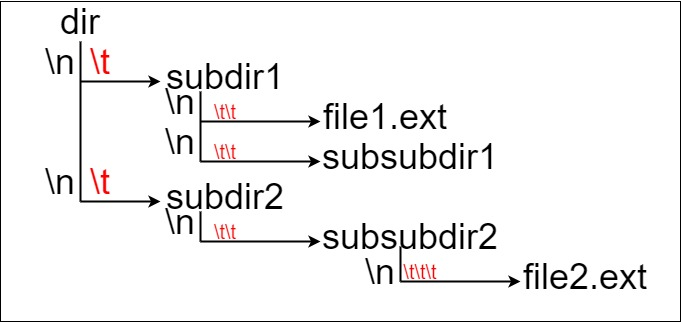
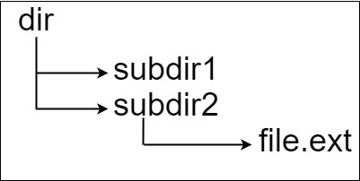
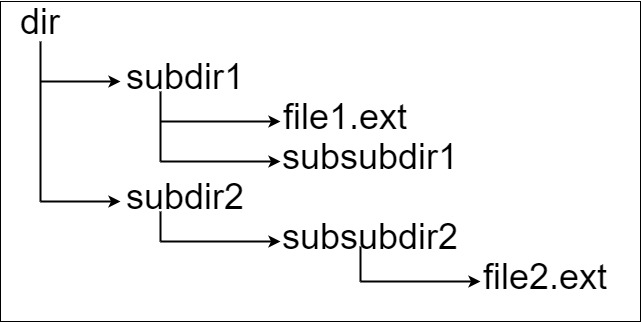

# [388. Longest Absolute File Path](https://leetcode.com/problems/longest-absolute-file-path/)

| Category | Difficulty | Likes | Dislikes |
| :------: | :--------: | :---: | :------: |
| Algorithms | Medium | 1377 | 2591 |

**Tags:** [`string`](https://leetcode.com/tag/string), [`stack`](https://leetcode.com/tag/stack), [`depth-first-search`](https://leetcode.com/tag/depth-first-search)

**Companies:** `google`, `facebook`, `amazon`, `apple`

## Description

Suppose we have a file system that stores both files and directories. An example of one system is represented in the following picture:



Here, we have `dir` as the only directory in the root. `dir` contains two subdirectories, `subdir1` and `subdir2`. `subdir1` contains a file `file1.ext` and subdirectory `subsubdir1`. `subdir2` contains a subdirectory `subsubdir2`, which contains a file `file2.ext`.

In text form, it looks like this (with ⟶ representing the tab character):

```

dir
⟶ subdir1
⟶ ⟶ file1.ext
⟶ ⟶ subsubdir1
⟶ subdir2
⟶ ⟶ subsubdir2
⟶ ⟶ ⟶ file2.ext

```

If we were to write this representation in code, it will look like this: `"dir\n\tsubdir1\n\t\tfile1.ext\n\t\tsubsubdir1\n\tsubdir2\n\t\tsubsubdir2\n\t\t\tfile2.ext"`. Note that the `'\n'` and `'\t'` are the new-line and tab characters.

Every file and directory has a unique **absolute path** in the file system, which is the order of directories that must be opened to reach the file/directory itself, all concatenated by `'/'s`. Using the above example, the **absolute path** to `file2.ext` is `"dir/subdir2/subsubdir2/file2.ext"`. Each directory name consists of letters, digits, and/or spaces. Each file name is of the form `name.extension`, where `name` and `extension` consist of letters, digits, and/or spaces.

Given a string `input` representing the file system in the explained format, return *the length of the **longest absolute path** to a **file** in the abstracted file system*. If there is no file in the system, return `0`.

**Note** that the testcases are generated such that the file system is valid and no file or directory name has length 0.

 

**Example 1:**


```

Input: input = &quot;dir\n\tsubdir1\n\tsubdir2\n\t\tfile.ext&quot;
Output: 20
Explanation: We have only one file, and the absolute path is &quot;dir/subdir2/file.ext&quot; of length 20.

```

**Example 2:**


```

Input: input = &quot;dir\n\tsubdir1\n\t\tfile1.ext\n\t\tsubsubdir1\n\tsubdir2\n\t\tsubsubdir2\n\t\t\tfile2.ext&quot;
Output: 32
Explanation: We have two files:
&quot;dir/subdir1/file1.ext&quot; of length 21
&quot;dir/subdir2/subsubdir2/file2.ext&quot; of length 32.
We return 32 since it is the longest absolute path to a file.

```

**Example 3:**

```

Input: input = &quot;a&quot;
Output: 0
Explanation: We do not have any files, just a single directory named &quot;a&quot;.

```

 

**Constraints:**

	- `1 <= input.length <= 10^4`

	- `input` may contain lowercase or uppercase English letters, a new line character `'\n'`, a tab character `'\t'`, a dot `'.'`, a space `' '`, and digits.

	- All file and directory names have **positive** length.

---

**Links:** [Submissions](https://leetcode.com/problems/longest-absolute-file-path/) | [Solutions](https://leetcode.com/problems/longest-absolute-file-path/)
