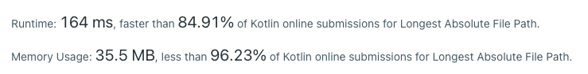

# Clean Kotlin

**Author:** kotlincheck
**Votes:** 2
**Link:** [https://leetcode.com/problems/longest-absolute-file-path/solutions/1841512/](https://leetcode.com/problems/longest-absolute-file-path/solutions/1841512/)

---

```
data class FSO(val filename: String, val level: Int) {
	val isFile: Boolean = filename.contains(".")
}

fun lengthLongestPath(input: String): Int {
	val fsObjects = input.split('\
').map{it.toFSO()}
	val stack = ArrayDeque<FSO>()
	var total = 0
	var m = 0
	for (fso in fsObjects) {
		while (stack.size > fso.level) total -= stack.pop().filename.length+1
		stack.push(fso)
		total += fso.filename.length+1
		if (fso.isFile) m = maxOf(m,total-1)
	}
	return m
}

fun String.toFSO() : FSO {
	var i = 0
	var level = 0
	while (this[i++] == '\	') level++
	return FSO(this.substring(--i), level)
}
```



