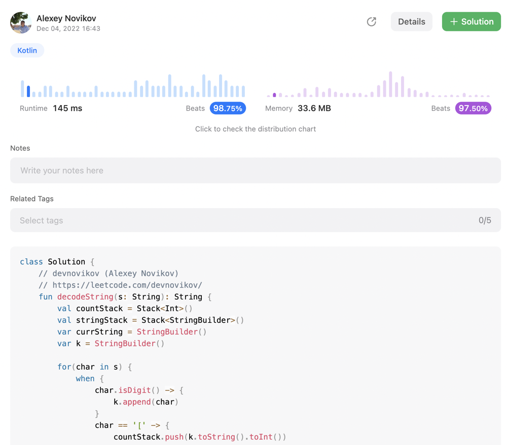

# [Kotlin] beat 98% 2 Stack solution

**Author:** devnovikov
**Votes:** 4
**Link:** [https://leetcode.com/problems/decode-string/solutions/2877392/](https://leetcode.com/problems/decode-string/solutions/2877392/)

---




# Code
```
class Solution {
    // devnovikov (Alexey Novikov)
    // https://leetcode.com/devnovikov/
    fun decodeString(s: String): String {
        val countStack = Stack<Int>()
        val stringStack = Stack<StringBuilder>()
        var currString = StringBuilder()
        var k = StringBuilder()

        for(char in s) {
            when {
                char.isDigit() -> {
                    k.append(char)
                }
                char == '[' -> {
                    countStack.push(k.toString().toInt())
                    stringStack.push(currString)

                    k = StringBuilder()
                    currString = StringBuilder()
                }
                char == ']' -> {
                    val str = stringStack.pop()
                    var count = countStack.pop()
                    while (count > 0) {
                        str.append(currString)
                        count--
                    }
                    currString = str
                }
                else -> {
                    currString.append(char)
                }
            }
        }

        return currString.toString();
    }
}
```


---

*If you like this solution or find it useful,  **upvote this post***

