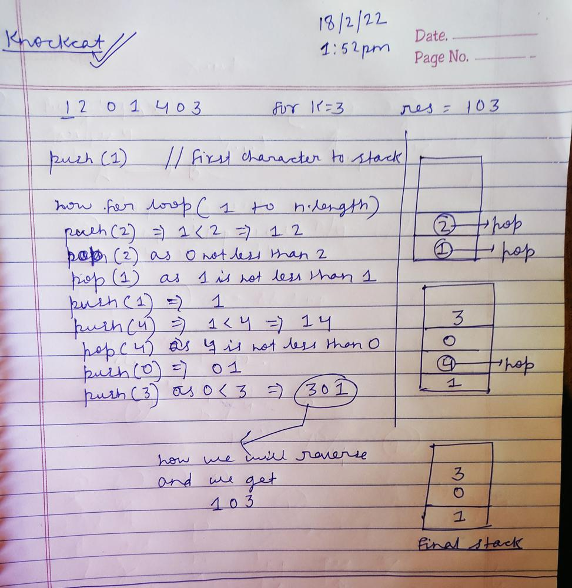

# ✅ C++ || Easy To Understand || Stack || Short & Simple

**Author:** knockcat
**Votes:** 712
**Link:** [https://leetcode.com/problems/remove-k-digits/solutions/1779458/](https://leetcode.com/problems/remove-k-digits/solutions/1779458/)

---

# 402. Remove K Digits
**KNOCKCAT**
```
1. Easy C++
2. Line by Line Explanation with Comments.
3. Detailed Explanation \u2705
4. Handwritten snap of an TestCase at the end of code given.
5. Please Upvote if it helps\u2B06\uFE0F
6. Link to my Github Profile contains a repository of Leetcode with all my Solutions. \u2B07\uFE0F
```
**My LeetCode Github Repository**
[LeetCode](https://github.com/knockcat/Leetcode)

**EXPLANATION**
```
1. Deleting k digits means keeping n - k digits, where n is the total number of digits.

2. Use a stack that you keep sorted ascendingly. You remove elements from it as long as you can still make it to n - k digits,
and your current element is smaller than the top of the stack:

push(2) => 2
push(4) because 2 < 4 => 24
push(6) because 4 < 6 => 246
pop() because 3 < 6 and we can still end up with 2 digits => 24
pop() for the same reason => 2
push(3) => 23
push(5) => 235
Then just take the first k digits => 23. Or you can make sure never to push more than k digits, and then the final stack is your solution.

3. Note that you cannot pop elements if that means you will not be able to build a solution of k digits.
For this, you need to check the current number of elements in the stack and the number of digits to the right of your current position on the input number.
```

**Some More Points**

```
1. Approach is simple. We need a number which is minimum, thus we need to remove the most significant digits first.
For eg. if we have a number having digits 1-4 then 1234 would be the minimum and not 2314 or anything else.
So in case of 2314, we remove 3 first, and then we go for 2 (Because they are more significant than 4). Observing this simple idea,
we need to remove any digit which is greater than its following digit. Thats why we deleted 3 as it,
was greater than 1 and similiarly 2 as it was also greater than 1.

2. In order to accomplish this, we use stack Data Structure where we pop the top if it is greater than current digit.

3. The conditions mentioned in while loop are important to avoid any Runtime Error. For eg. ["10001" 2] the answer is "0" but if we don't
mention the condition !s.empty(), then the while loop will run on empty stack and try to pop the top which doesn't exist thus throwing RE.

```
**Time Complexity :- O(N)** *// as we only traversing the string for once*
**Space complexity:- O(N)** *// as we will store maximum of n digits in our string*

**CODE WITH EXPLANATION**
```
								// \uD83D\uDE09\uD83D\uDE09\uD83D\uDE09\uD83D\uDE09Please upvote if it helps \uD83D\uDE09\uD83D\uDE09\uD83D\uDE09\uD83D\uDE09
class Solution {
public:
    string removeKdigits(string num, int k) {
        // number of operation greater than length we return an empty string
        if(num.length() <= k)   
            return "0";
        
        // k is 0 , no need of removing /  preforming any operation
        if(k == 0)
            return num;
        
        string res = "";// result string
        stack <char> s; // char stack
        
        s.push(num[0]); // pushing first character into stack
        
        for(int i = 1; i<num.length(); ++i)
        {
            while(k > 0 && !s.empty() && num[i] < s.top())
            {
                // if k greater than 0 and our stack is not empty and the upcoming digit,
                // is less than the current top than we will pop the stack top
                --k;
                s.pop();
            }
            
            s.push(num[i]);
            
            // popping preceding zeroes
            if(s.size() == 1 && num[i] == '0')
                s.pop();
        }
        
        while(k && !s.empty())
        {
            // for cases like "456" where every num[i] > num.top()
            --k;
            s.pop();
        }
        
        while(!s.empty())
        {
            res.push_back(s.top()); // pushing stack top to string
            s.pop(); // pop the top element
        }
        
        reverse(res.begin(),res.end()); // reverse the string 
        
        if(res.length() == 0)
            return "0";
        
        return res;
        
        
    }
};
```


**Dry Run For a Test Case Ask in Comments**



