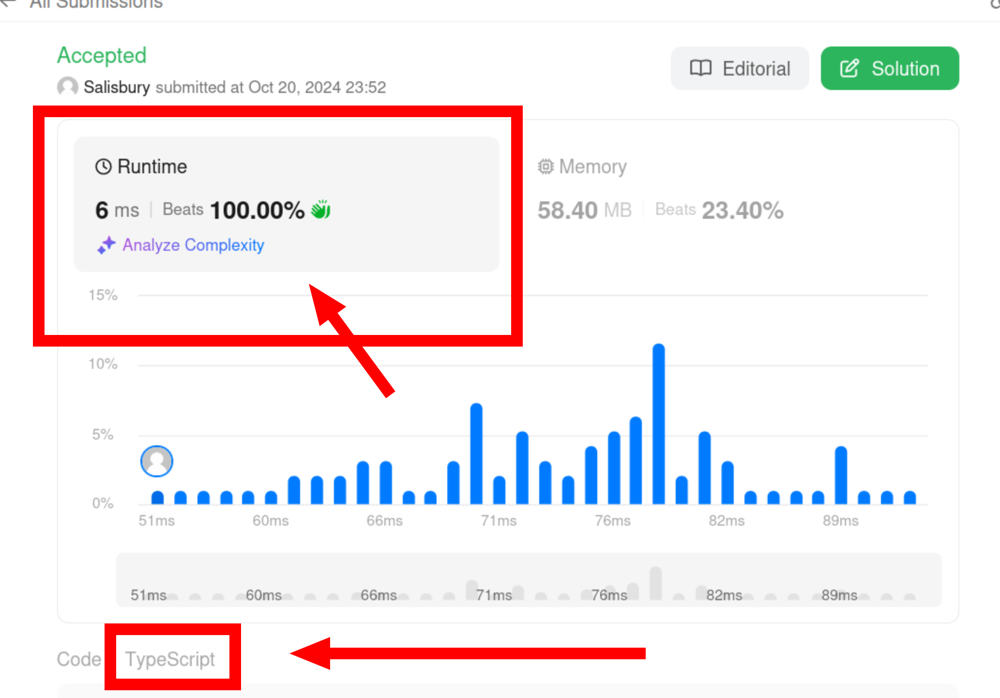

# 100% beats in typescript

**Author:** salisbury-espinosa
**Votes:** 0
**Link:** [https://leetcode.com/problems/remove-k-digits/solutions/5944607/](https://leetcode.com/problems/remove-k-digits/solutions/5944607/)

---



# Code
```typescript []
function removeKdigits(numStr: string, k: number): string {
    if (k === numStr.length) {
        return "0";
    }
    const nums = numStr.split("").map(Number);
    const stack = [];
    const len = nums.length;
    let removed = 0;
    for (let i = 0; i < len; i += 1) {
        const num = nums[i];
        if (removed === k) {
            if (stack.length !== 0 || num !== 0) {
                stack.push(num); 
            }
        }
        else {
            while (stack.length > 0 && num < stack[stack.length - 1] && removed < k) {
                stack.pop();
                removed += 1;
            }
            if (stack.length !== 0 || num !== 0) {
                stack.push(num); 
            }
        }
    }
    for (let i = removed; i < k; i += 1) {
        stack.pop();
    }
    return stack.length === 0 ? "0" : `${stack.join("")}`;
};
```
``` PHP []
class Solution {
    function removeKdigits(string $numStr, int $k): string {
        if ($k === strlen($numStr)) {
            return "0";
        }
        $nums = array_map('intval', str_split($numStr));
        $stack = [];
        $len = count($nums);
        $removed = 0;
        for ($i = 0; $i < $len; $i += 1) {
            $num = $nums[$i];
            if ($removed === $k) {
                if (count($stack) !== 0 || $num !== 0) {
                    array_push($stack, $num); 
                }
            } else {
                while (count($stack) > 0 && $num < end($stack) && $removed < $k) {
                    array_pop($stack);
                    $removed += 1;
                }
                if (count($stack) !== 0 || $num !== 0) {
                    array_push($stack, $num); 
                }
            }
        }
        for ($i = $removed; $i < $k; $i += 1) {
            array_pop($stack);
        }
        return count($stack) === 0 ? "0" : implode("", $stack);
    }
}
```