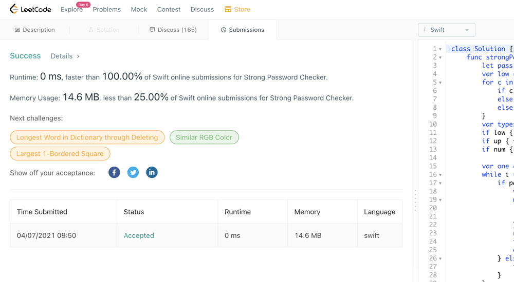

# 🔥🔥🔥 Swift: Strong Password Checker

**Author:** AsahiOcean
**Votes:** 19
**Link:** [https://leetcode.com/problems/strong-password-checker/solutions/1146420/](https://leetcode.com/problems/strong-password-checker/solutions/1146420/)

---

#### Dudes, I hope this is useful to you

```swift
class Solution {
    func strongPasswordChecker(_ password: String) -> Int {
        let pass = Array(password), c = pass.count
        var low = false, up = false, num = false
        for c in pass {
            if c.isLowercase { low = true }
            else if c.isUppercase { up = true }
            else if c.isNumber { num = true }
        }
        var types = 3
        if low { types -= 1 }
        if up { types -= 1 }
        if num { types -= 1 }
        
        var one = 0, two = 0, rep = 0, i = 2
        while i < c {
            if pass[i] == pass[i-1] && pass[i] == pass[i-2] {
                var length = 2
                while i < c && pass[i] == pass[i-1] {
                    length += 1
                    i += 1
                }
                rep += length/3
                if length % 3 == 0 { one += 1 }
                else if length % 3 == 1 { two += 1 }
            } else {
                i += 1
            }
        }
        if c < 6 {
            return max(types, 6 - c)
        } else if c <= 20 {
            return max(types, rep)
        }
        let del = c - 20
        rep -= min(del, one)
        rep -= (min(max(del - one, 0), two * 2) / 2)
        rep -= (max(del - one - 2 * two, 0) / 3)
        return max(types, rep) + del
    }
}
```

#### Solution is correct. Good luck!



