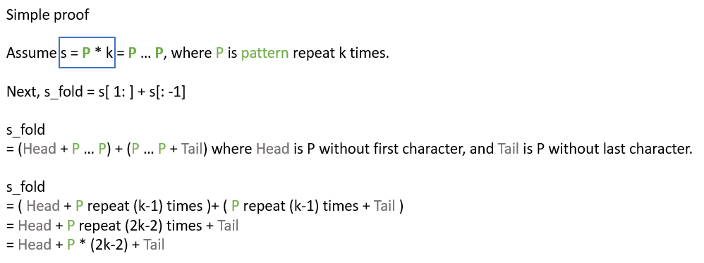
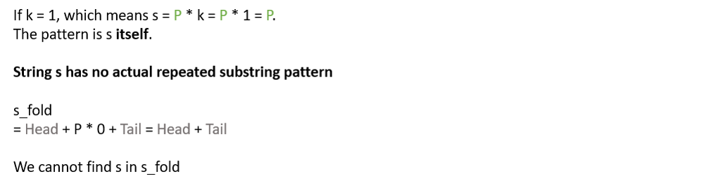
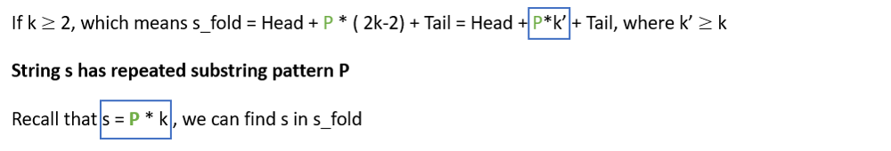

# Python/C++/Java/JS/Go by fold-and-find [w/ Simple proof]

**Author:** brianchiang_tw
**Votes:** 194
**Link:** [https://leetcode.com/problems/repeated-substring-pattern/solutions/826151/](https://leetcode.com/problems/repeated-substring-pattern/solutions/826151/)

---

# Demo and Animation


# Proof



---



---



---

**Hint**:

a.
Fold, make **s_fold** = s[ 1 : ] + s[ : -1 ]

b.
Check whether we can find **s** in **s_fold** or not

If s has repeated substring pattern, then we can find s in s_fold.
Otherwise, s cannot be found.

---

**Example & Demo**:

#1.
s = 'abab'
s_fold = 'bababa'

we can find s in s_fold, where s_fold = 'b**abab**a'

---

#2.

s = 'abac'
s_fold = 'bacaba'

we cannot find s in s_fold, where s_fold = 'bacaba'

---

**Implementation**:

**Python**:

```
class Solution:
    def repeatedSubstringPattern(self, s: str) -> bool:
        
        s_fold = "".join( (s[1:], s[:-1]) )
        
        return s in s_fold
```

---

**C++**

```
class Solution {
public:
    bool repeatedSubstringPattern(string s) {
        
        int size = s.size();
        
        string postfix = s.substr(1, size-1);
        string prefix = s.substr(0, size-1);
        
        string sFold = postfix + prefix;
        
        return sFold.find(s) != string::npos;
    }
};
```

---

**Java**:

```
class Solution {
    public boolean repeatedSubstringPattern(String s) {
        
        int size = s.length();
        
        String sFold = s.substring(1, size) + s.substring(0, size-1);
        
        return sFold.contains(s);
        
    }
}
```

---

**Javascript**:

```
/**
 * @param {string} s
 * @return {boolean}
 */
var repeatedSubstringPattern = function(s) {
    
    let size = s.length;
    let sFold = s.substr(1, size) + s.substr(0, size-1);
    
    return sFold.indexOf( s ) != -1;
};
```

---

**Golang**:

```
func repeatedSubstringPattern(s string) bool {
    
    size := len(s)
    sFold := s[1:size] + s[0:size-1]
    
    return strings.Contains(sFold, s)
}
```