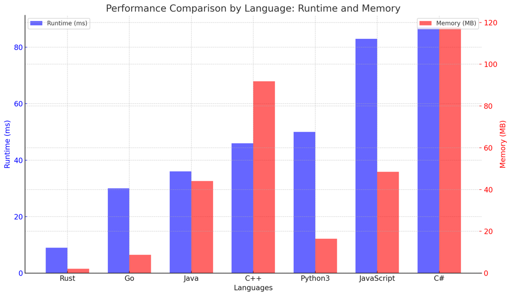
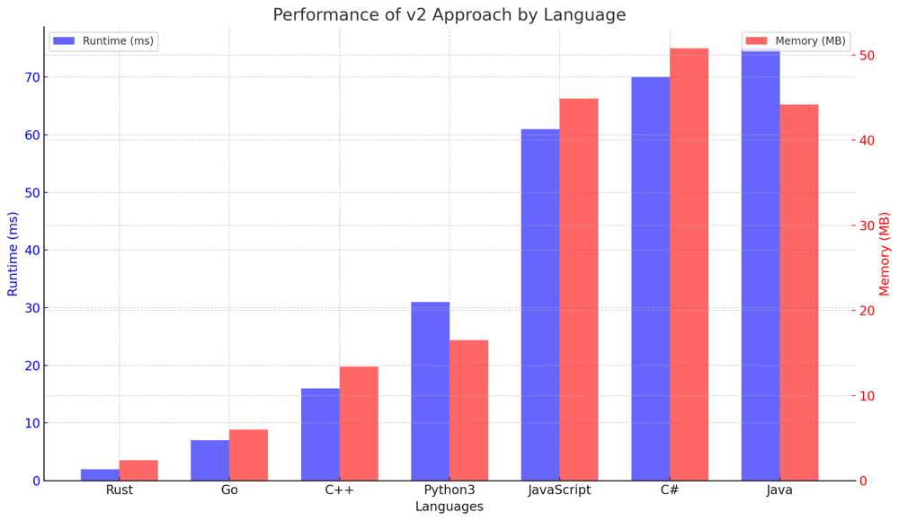

# ✅ 99.42% 2-Approaches - O(n)

**Author:** vanAmsen
**Votes:** 237
**Link:** [https://leetcode.com/problems/repeated-substring-pattern/solutions/3938580/](https://leetcode.com/problems/repeated-substring-pattern/solutions/3938580/)

---

# Problem Understanding

In the "459. Repeated Substring Pattern" problem, we are given a string `s`. The task is to check if it can be constructed by taking a substring of it and appending multiple copies of the substring together.

For instance, given the string `s = "abab"`, the output should be `True` as it is constructed by repeating the substring "ab" twice.

**Input**: "abab"
**Output**: True

---

# Live Coding v1 & v2:
https://youtu.be/RweTIFVSVck

- [in Python \uD83D\uDC0D](https://youtu.be/RweTIFVSVck)
- [in Go \uD83D\uDC39](https://youtu.be/DeCw5VFDWaI)

# Approach 1/2: Check All Possible Substrings

To solve the "459. Repeated Substring Pattern" problem, we iterate over all possible substring lengths (from 1 to `len(s)//2`). For each length, we check if the string can be constructed by repeating that substring.

## Key Data Structures:
- **Substring**: To hold the possible substring that could be repeated to form the string `s`.

## Enhanced Breakdown:

1. **Initialization**:
   - Start from the first character.
   
2. **Processing Each Substring**:
   - For each possible length of substring, check if repeating that substring forms the original string.

3. **Wrap-up**:
   - Return `True` if any such substring is found, otherwise `False`.

## Example:

Given the string "abcabc":

1. First check with substring "a" - Does not form the original string.
2. Next, check with substring "ab" - Does not form the original string.
3. Finally, check with substring "abc" - Forms the original string. Hence, return `True`.

---

# Approach 2/2: Clever String Manipulation

The idea behind this approach is that if a string `s` can be constructed by repeating a substring, then concatenating two copies of `s` together and removing the first and last character would still contain `s` as a substring.

## Key Data Structures:
- **Concatenated String**: A string formed by concatenating `s` with itself.

## Enhanced Breakdown:

1. **Initialization**:
   - Concatenate string `s` with itself.
   
2. **Check for Repeated Pattern**:
   - Remove the first and last character from the concatenated string and check if the original string `s` is present.

3. **Wrap-up**:
   - Return `True` if the string is present, otherwise `False`.

## Example:

Given the string "abab":

1. Concatenate to get "abababab".
2. Remove first and last characters to get "bababa".
3. Check if "abab" is present in "bababa" - It is. Hence, return `True`.

---

# Complexity:

## For Approach 1/2:
**Time Complexity:** 
- $$O(n^2)$$ as we are iterating over half the string and for each length, we are checking the entire string.

**Space Complexity:** 
- $$O(n)$$ as we are constructing a repeated string of length `n`.

## For Approach 2/2:
**Time Complexity:** 
- $$O(n)$$ for concatenation and substring check.

**Space Complexity:** 
- $$O(n)$$ for the concatenated string.

---

# Performance:
## Approach 1/2:
| Language   | Runtime (ms) | Runtime Beat (%) | Memory (MB) | Memory Beat (%) |
|------------|--------------|------------------|-------------|-----------------|
| Rust       | 9            | 20.37%           | 2.1         | 42.59%          |
| Go         | 30           | 22.41%           | 8.7         | 13.79%          |
| Java       | 36           | 64.96%           | 44.1        | 61.10%          |
| C++        | 46           | 30.24%           | 91.8        | 20.17%          |
| Python3    | 50           | 73.5%            | 16.4        | 75.82%          |
| JavaScript | 83           | 41.70%           | 48.5        | 42.47%          |
| C#         | 87           | 66.81%           | 117.6       | 18.14%          |




## Approach 2/2
| Language   | Runtime (ms) | Runtime Beat (%) | Memory (MB) | Memory Beat (%) |
|------------|--------------|------------------|-------------|-----------------|
| Rust       | 2            | 94.44%           | 2.4         | 20.37%          |
| Go         | 7            | 60.92%           | 6.0         | 51.15%          |
| C++        | 16           | 79.18%           | 13.4        | 57.60%          |
| Python3    | 31           | 99.42%           | 16.5        | 46.1%           |
| JavaScript | 61           | 76.6%            | 44.9        | 70.8%           |
| C#         | 70           | 88.94%           | 50.8        | 64.60%          |
| Java       | 75           | 50.12%           | 44.2        | 46.38%          |



---

# Code 1/2
``` Python []
class Solution:
    def repeatedSubstringPattern(self, s: str) -> bool:
        n = len(s)
        for i in range(1, n//2 + 1):
            if n % i == 0:
                substring = s[:i]
                if substring * (n // i) == s:
                    return True
        return False
```
``` C++ []
class Solution {
public:
    bool repeatedSubstringPattern(string s) {
        int n = s.length();
        for (int i = 1; i <= n / 2; ++i) {
            if (n % i == 0) {
                string substring = s.substr(0, i);
                string repeated = "";
                for (int j = 0; j < n / i; ++j) {
                    repeated += substring;
                }
                if (repeated == s) return true;
            }
        }
        return false;
    }
};
```
``` Java []
public class Solution {
    public boolean repeatedSubstringPattern(String s) {
        int n = s.length();
        for (int i = 1; i <= n / 2; i++) {
            if (n % i == 0) {
                String substring = s.substring(0, i);
                StringBuilder repeated = new StringBuilder();
                for (int j = 0; j < n / i; j++) {
                    repeated.append(substring);
                }
                if (repeated.toString().equals(s)) return true;
            }
        }
        return false;
    }
}
```
``` C# []
public class Solution {
    public bool RepeatedSubstringPattern(string s) {
        int n = s.Length;
        for (int i = 1; i <= n / 2; i++) {
            if (n % i == 0) {
                string substring = s.Substring(0, i);
                System.Text.StringBuilder builder = new System.Text.StringBuilder();
                for (int j = 0; j < n / i; j++) {
                    builder.Append(substring);
                }
                if (builder.ToString() == s) return true;
            }
        }
        return false;
    }
}
```
``` JavaScript []
/**
 * @param {string} s
 * @return {boolean}
 */
var repeatedSubstringPattern = function(s) {
    const n = s.length;
    for (let i = 1; i <= n / 2; i++) {
        if (n % i === 0) {
            const substring = s.slice(0, i);
            let repeated = "";
            for (let j = 0; j < n / i; j++) {
                repeated += substring;
            }
            if (repeated === s) return true;
        }
    }
    return false;
};
```
``` Rust []
impl Solution {
    pub fn repeated_substring_pattern(s: String) -> bool {
        let n = s.len();
        for i in 1..=n / 2 {
            if n % i == 0 {
                let substring = &s[0..i];
                let mut repeated = String::new();
                for _ in 0..(n / i) {
                    repeated.push_str(substring);
                }
                if repeated == s {
                    return true;
                }
            }
        }
        false
    }
}
```
``` Go []
import "strings"

func repeatedSubstringPattern(s string) bool {
    n := len(s)
    for i := 1; i <= n/2; i++ {
        if n%i == 0 {
            substring := s[:i]
            var builder strings.Builder
            for j := 0; j < n/i; j++ {
                builder.WriteString(substring)
            }
            if builder.String() == s {
                return true
            }
        }
    }
    return false
}
```
# Code 2/2
``` Python []
class Solution:
    def repeatedSubstringPattern(self, s: str) -> bool:
        return s in (s + s)[1:-1]
```
``` C++ []
class Solution {
public:
    bool repeatedSubstringPattern(string s) {
        string doubled = s + s;
        string sub = doubled.substr(1, doubled.size() - 2);
        return sub.find(s) != string::npos;
    }
};
```
``` Java []
public class Solution {
    public boolean repeatedSubstringPattern(String s) {
        String doubled = s + s;
        String sub = doubled.substring(1, doubled.length() - 1);
        return sub.contains(s);
    }
}
```
``` C# []
public class Solution {
    public bool RepeatedSubstringPattern(string s) {
        string doubled = s + s;
        string sub = doubled.Substring(1, doubled.Length - 2);
        return sub.Contains(s);
    }
}
```
``` JavaScript []
/**
 * @param {string} s
 * @return {boolean}
 */
var repeatedSubstringPattern = function(s) {
    const doubled = s + s;
    const sub = doubled.slice(1, -1);
    return sub.includes(s);
};
```
``` Go []
func repeatedSubstringPattern(s string) bool {
    doubled := s + s
    return strings.Contains(doubled[1:len(doubled)-1], s)
}
```
``` Rust []
impl Solution {
    pub fn repeated_substring_pattern(s: String) -> bool {
        let doubled = s.clone() + &s;
        let sub = &doubled[1..doubled.len()-1];
        return sub.contains(&s);
    }
}
```
## Live Coding in Go:
https://youtu.be/DeCw5VFDWaI

This problem beautifully showcases the importance of understanding the nature of strings and pattern recognition. By thinking out of the box, one can come up with more efficient solutions. \uD83D\uDCA1\uD83C\uDF20\uD83D\uDC69\u200D\uD83D\uDCBB\uD83D\uDC68\u200D\uD83D\uDCBB
